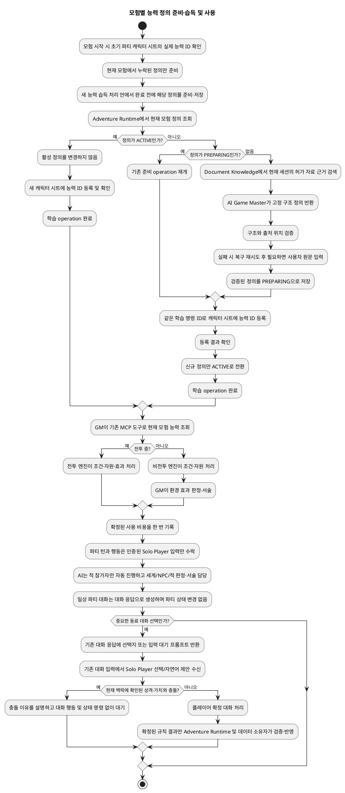
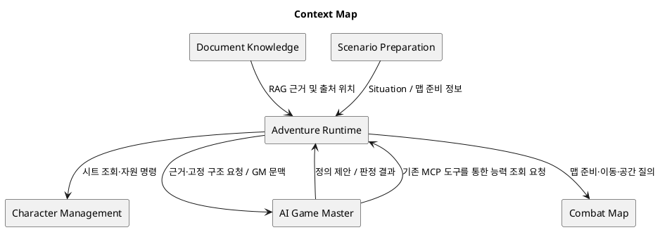
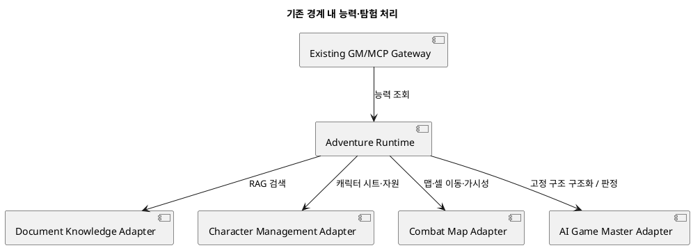
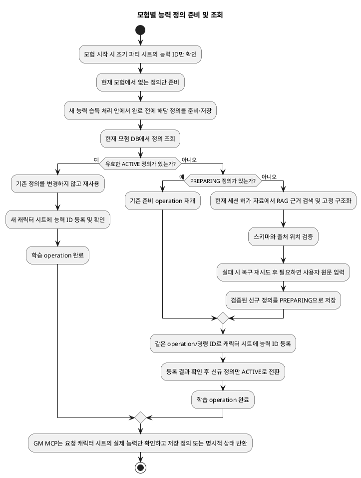
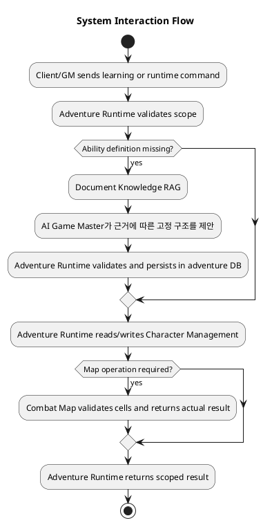

# 전투 이동·주문 사거리 Architecture Spec

- 범위 ID: `combat-movement-spell-range`
- 문서 상태: **READY** — Product·Architecture의 새 독립 리뷰, `system_targets_complete`, `harness-spec-review check` 통과; 통합 계약 revision 42 봉인 및 다이어그램 렌더·링크·해시 확인 완료; 애플리케이션 테스트·E2E는 실행하지 않음
- 입력: [Product Spec](product-spec.md), [runtime decisions](runtime-decisions.md), `CONTEXT.md`, `CONTEXT-MAP.md`, ADR-001, ADR-003, ADR-012, ADR-013, ADR-018, ADR-019, [ADR-024](../../adr/ADR-024-agent-driven-runtime-e2e.md), code-research 결과
- Engineering Decision metadata: 승인된 ID 기반 decision workflow opt-in이 아니므로 decision ID, 승인 ID, Principle/Evidence ID를 만들지 않는다.

# 1. Design Scope

## 1.1 Target

| 항목 | 대상 |
|---|---|
| Product Spec | `docs/specs/combat-movement-spell-range/product-spec.md` |
| Use Cases | UC-001 모험별 능력 정의 준비·조회·습득, UC-002 전투 이동·주문·원거리 공격·투척, UC-003 지도 확대, UC-004 비전투 능력 사용, UC-005 그룹 탐험 이동, UC-006 파티 대화 및 중요한 동료 선택 |
| Domain | 모험별 능력 상세정보, 캐릭터 자원, 그룹 탐험·전투 이동, 시츄에이션 맵 준비 및 조우 |
| Bounded Contexts | Scenario Preparation, Adventure Runtime, Document Knowledge, AI Game Master, Combat Map, Character Management — 기존 경계만 사용 |
| Existing Services | `adventure-service`, `rule-knowledge-service`, `ai-game-master-service`, `combat-map-service`, `character-management-service`, `web-ui` |
| External Dependencies | 기존 서비스 통신, 검색, 모델 제공자, 기존 GM 도구/MCP 호출 경계. 신규 서비스·MCP 서버 없음 |
| Affected Data | Situation 맵 필요 속성·초기 배치, 모험별 능력 상세 정의와 출처 위치, 캐릭터의 능력 식별자·자원, 그룹 구성·대열·우선권·이동 상태, 파티 구성원과 세션 소유자/조종자 연결, 지도 토큰·안개·이동 결과, 기존 실행 명령 기록 |

## 1.2 Product Spec Mapping

| Product 항목 | Architecture 요소 |
|---|---|
| UC-001, BR-22, BR-29, BR-33~37, BR-48, BR-50 | 시트 능력 ID 기준 모험 시작 시 초기 능력·이후 습득 중 준비, Adventure Runtime의 모험별 정의 저장·조회, 세션 문서 범위 내 독립 RAG 검색, GM 도구 게이트웨이 조회 |
| UC-002, BR-05~21, BR-30~32, BR-44~47 | Adventure Runtime의 읽기 전용 행동 미리보기와 최신 상태 재검증, Combat Map의 이동 경로·거리·가시성·차단·범위 계산, 정의에 따른 대상·효과 선택, 분리된 전투 실행과 멱등 자원 소모 |
| UC-004, BR-23~28, BR-37, BR-46~47 | 주문 기본 효과와 비용 확정 뒤 GM이 허용된 환경 작업·입력 제약을 받아 추가 응용, 필요한 굴림은 기존 제출 흐름, 실패·재시도는 기본 효과를 반복하지 않음 |
| UC-005, BR-38~45 | Adventure Runtime의 그룹·대열·우선권·공통 시간 진행과 Combat Map의 토큰 이동·안개·중단 결과 |
| UC-006, BR-17, BR-51~53, AC-43~46 | 인증된 Solo Player와 기존 세션 소속으로 모든 파티 구성원(`AdventurePartyMember`, 기존 파티 구성원 자료형)의 권한을 확인; 파티 턴·행동은 사용자 입력만 받음; AI Game Master는 세계/NPC/적, 규칙 판정·서술을 담당하고 파티 일상 대화는 상태 변경 없이 생성; 중요한 동료 대화는 기존 대화 입력에서 선택지/자연어 입력을 기다리며 근거 있는 성격 충돌은 설명 후 거절하고 상태 명령을 만들지 않음 |
| BR-40 | Situation 속성에 따른 Scenario Preparation의 맵·초기 배치 준비와 시작 전 완료 조건 |
| BR-34~36 | 해당 시점의 시트 보유 ID만 대상으로 하는 RAG 검색·고정 구조 검증·모험 DB 저장, MCP 조회 결과의 발견/복구/미습득/오류 구분 |

## 1.3 용어 설명

| 표기 | 뜻 |
|---|---|
| 고정 구조 | 필드 이름·자료형·필수 여부가 미리 정해져, 그 모양을 만족해야 저장할 수 있는 자료 |
| operation | 재시도나 응답 유실 뒤에도 같은 명령의 진행 단계와 결과를 이어서 확인할 수 있게 기존 모험 저장소에 남기는 작업 기록 |
| 공개 응답 | 원본 상태에서 플레이어·GM에게 공개해도 되는 정보만 골라 만든 화면·응답 자료 |
| lifecycle | 시작부터 종료까지 이어지는 상태 변화의 전체 흐름 |
| phase | 순환이나 작업에서 현재 처리 중인 단계 |
| 낡은 미리보기 | 계산 기준이 된 전투·지도·캐릭터 상태가 바뀌어 더 이상 실행 판단에 쓸 수 없는 미리보기 |
| payload fingerprint | 같은 명령 ID가 같은 입력으로 재전송됐는지 확인하는 입력 지문 |
| 멱등 처리 (`Idempotency`) | 같은 명령을 반복해도 상태 변경은 한 번만 적용하고 기존 결과를 돌려주는 처리 |
| `PREPARING` / `ACTIVE` | 각각 준비 중이라 숨겨야 하는 정의 / 시트 등록이 확인되어 조회·사용할 수 있는 정의; 다른 캐릭터가 같은 능력을 배워도 `ACTIVE`는 유지 |
| `Published Language` | 서비스 경계 사이에서 양쪽이 같은 뜻으로 해석하기로 한 공유 자료 형식 |
| `Customer/Supplier` | 한 서비스가 요청하고 다른 서비스가 정해진 계약으로 제공하는 관계 |

# 2. Domain Flow

## 2.1 Event Storming Flow



## 2.2 Commands

| Command | Actor | Target | Input | Preconditions | Result |
|---|---|---|---|---|---|
| 시트 능력 정의 준비 | 모험 진행 | Adventure Runtime + Character Management | 모험 시작 시 초기 파티 또는 습득하는 능력 ID | 각 ID가 해당 캐릭터 시트에 있거나 습득 요청으로 확인됨 | 모험 내 누락 정의만 준비·저장; 기존 정의는 재사용 |
| 능력 습득 완료 | 인증된 Solo Player | Character Management + Adventure Runtime | 캐릭터·능력 식별자, 필요 시 근거 기반 신규 정의, 기존 학습 operation/명령 ID | 세션 소유권과 파티 구성원 관계 확인; 시트 등록이 확인됨; 신규 정의인 경우에만 정의 활성화 확인 | 캐릭터 시트 식별자, 활성 정의, 완료 기록 |
| 능력 상세정보 조회 | GM | 기존 GM 도구 게이트웨이 → Adventure Runtime | 모험·캐릭터·능력 식별자 | 현재 모험과 습득 여부 확인 | 정의+출처 위치 또는 정해진 상태 결과 |
| 전투 능력 실행 | 인증된 Solo Player | Adventure Runtime | 능력·대상·선택·기대 상태 | 세션 소유권·파티 구성원·전투 차례·범위·자원 등 검증 통과 | 효과/상태 및 비용이 멱등하게 확정 |
| 전투 행동 미리보기 | 인증된 Solo Player | Adventure Runtime + Combat Map + Character Management | 배운 능력·토큰·포인터 위치·현재 상태 버전 | 세션 소유권·파티 구성원 관계 및 공개 전투/지도 상태 확인 | 사거리·유효 대상·경로·효과 범위·비용·가능 여부를 공개 정보만으로 반환; 상태 변경 없음 |
| 전투 행동 확정 | 인증된 Solo Player | Adventure Runtime + Combat Map + Character Management | 능력·대상/배분·선택·기대 버전·명령 ID | 세션 소유권·파티 구성원·턴·조건·자원 유효 | 최신 지도·전투·정의·캐릭터 상태 재검증 후 효과와 비용을 한 번 확정 |
| 비전투 능력 사용 | 인증된 Solo Player | Adventure Runtime | 능력·대상·선택 | 세션 소유권·파티 구성원·사용 가능 상태 및 자원 검증 | 자원 확정; 환경 효과는 GM이 판정·서술 |
| 주문 효과의 환경 응용 | 인증된 Solo Player(사용 시작); GM(환경 효과 판정·서술) | Adventure Runtime + 기존 GM 도구 게이트웨이 | 사용자가 선택·확정한 능력, 기본 효과 확정 뒤 환경 의도 | 기본 효과·비용 처리 완료 | GM은 허용된 작업만 제안·호출; 호출 오류는 보정 가능; 기본 효과 재적용 없음 |
| 그룹 이동 경로 확정 | 인증된 Solo Player | Adventure Runtime + Combat Map | 그룹 경로·확인 | 세션 소유권·파티 구성원 관계, 맵 필요 상황 활성화 및 차례 유효 | 차례 순서의 칸별 이동 또는 사건 중단 |
| Situation 맵 준비 | Scenario Preparation | Adventure Runtime + Combat Map + Document Knowledge | Situation 및 근거 | Situation의 맵 필요 속성이 참 | 맵·초기 배치 준비 완료 후 활성화 가능 |
| 파티 턴/행동 제출 | 인증된 Solo Player | Adventure Runtime | 기존 세션·구성원 ID, 턴/행동 입력, 기존 명령 ID | 세션 소유권과 파티 구성원 연결 검증; 기존 멱등성 검사 | 사용자 확정 명령만 처리; GM/AI가 호출한 파티 행동은 거부·무변경 |
| 중요한 동료 대화 입력 | Solo Player | 기존 대화 입력 → Adventure Runtime/AI Game Master | 대화 문맥과 선택지 또는 자연어 제안 | 기존 대화/턴 소유자 검증; 캐릭터 현재 문맥 확인 | 대화 응답 또는 근거 있는 충돌 설명; 별도 명령/대기 상태 저장 없음 |

## 2.3 Domain Events

기존 저장·응답 계약을 우선 재사용한다. 새 메시지 브로커나 비동기 도메인 메시지는 추가하지 않는다. 내부 전이명은 구현 시 기존 operation/event 관례와 맞춘다.

| Domain Event | Producer | Trigger | Payload | Consumers |
|---|---|---|---|---|
| 능력 상세정보 준비 완료 | Adventure Runtime | 모험 시작 시 초기 능력 또는 습득 시트 등록을 확인하고 정의를 저장·활성화함 | 모험·캐릭터·능력 ID, 정의 버전, 준비 또는 학습 operation 참조 | 이후 MCP 조회와 사용 |
| 전투 행동 확정 | Adventure Runtime | 최신 조건과 선택이 유효한 능력 실행 | 행동·대상·효과·자원 결과 및 버전 | 기존 전투 상태·캐릭터·지도 소유자 |
| 기본 주문 효과 확정 | Adventure Runtime | 기본 주문 효과와 비용 처리 완료 | 기본 효과·비용 결과와 명령 ID | 환경 응용 단계; 기본 효과 재실행 없이 이어 처리 |
| 그룹 이동 중단 | Combat Map / Adventure Runtime | 칸 이동 중 사건 발생 | 그룹·실제 위치·이동량·사건 유형 | 그룹 차례 정책, 조우 처리 |
| 탐험 순환 완료 | Adventure Runtime | 모든 그룹 차례 완료 | 순환 식별자·환경 처리 결과 | 적/순찰·함정·지속시간 처리 |

## 2.4 Policies

| Policy | Trigger Event | Decision | Emitted Command | Owner |
|---|---|---|---|---|
| 습득 정의 복구 | 검색/구조화/검증 실패 | 자동 복구 경로를 재시도하고 소진 시 원문 입력으로 전환 | 정의 복구 또는 사용자 입력 요청 | Adventure Runtime |
| 사건 후 그룹 진행 | 비전투 이동 사건 해결 | 사건 그룹 차례 종료; 남은 경로는 자동 재개하지 않음 | 우선권상 다음 그룹 차례 | Adventure Runtime |
| 미리보기와 확정 실행 | 포인터 이동 / 사용 확정 | 미리보기는 읽기 전용; 확정 시 기대 버전과 최신 상태를 재검증 | 공개 미리보기 / 실행 또는 무비용 거부 | Adventure Runtime |
| 기본 효과 후 환경 응용 | 주문 기본 효과·비용 확정 | 허용된 환경 작업만 추가 실행; 실패해도 기본 결과와 비용 유지 | 환경 작업 호출 또는 GM 서술·판정 | Adventure Runtime + 기존 GM 도구 게이트웨이 |
| 파티 차례 통제 | 턴 요청/AI 제안 | 기존 세션 소유자와 파티 구성원 제어 관계 확인; Solo Player 요청만 수락; 기존 `ControlMode=AGENT` 값(과거 파티 제어 방식 표기)은 권한 판정에 사용하지 않음 | 사용자 명령 승인 또는 AI가 제안한 파티 행동 거부 | Adventure Runtime |
| 중요한 동료 대화 | 대화 입력/응답 | 기존 대화 응답으로 프롬프트·선택지 반환 후 다음 사용자 입력 대기; 근거 있는 성격 충돌은 설명·거절; 파티 상태 변경은 사용자 확인 명령으로만 | 기존 대화 응답 또는 기존 사용자 대화 입력 | Adventure Runtime + AI Game Master |
| 전투 전환 | 탐험 중 적대적 전투 시작 | 탐험 차례 중단, 전투 차례로 전환 | 전투 시작 처리 | Adventure Runtime |
| 환경 진행 | 모든 그룹 차례 완료 | 공통 시간 6초 진행, 지정 순서로 환경 처리; 저장된 순찰 경로가 없으면 기존 GM 요청 경계로 이동·환경 제안을 받음; 상태 변경은 Combat Map의 검증된 이동·공간 요소 명령으로만 적용하고, 지원되지 않는 변화는 GM 서술로만 처리; 단계 ID로 재시도 중복을 막음 | 적/순찰 이동·감지, 함정/환경, 지속시간/제한시간 | Adventure Runtime 및 Combat Map |

## 2.5 Read Models

| Read Model | Consumer | Source | Fields | Owner |
|---|---|---|---|---|
| GM 능력 조회 결과 | AI Game Master | Adventure Runtime 모험 DB | 상세 정의+출처 위치 또는 정의 복구 필요 / 미습득·없음 / 조회 오류 | Adventure Runtime |
| 그룹 탐험 상태 | UI/GM | Adventure Runtime + Combat Map | 그룹원·대열·속도·우선권·현재 토큰 위치·공개 안개 | 각 원본 소유 경계 |
| 전투 행동 미리보기 | UI/GM | Adventure Runtime + Combat Map + Character Management | 시작 토큰, 유효 대상, 사거리, 경로·차단, 효과 범위, 고도·가시성 조건, 비용·가능 여부, 기준 버전 | 읽기 전용 공개 응답; 미공개 벽·적·함정 세부는 제외 |
| 전투 화면 상태 | UI/플레이어·GM | 기존 `CombatEncounter` 및 Character Management·Combat Map 결과 | 참가자·우선권·라운드·현재 차례·행동 자원·공개 전투 기록과 허가된 지도 정보 | 적 비공개 정보를 제거한 화면 응답 |
| 환경 응용 작업 목록 | AI Game Master | 기존 GM 도구 게이트웨이/Adventure Runtime | 허용 작업 이름, 입력 구조와 제약 | 현재 사용 가능한 작업만 반환; 임의 작업은 거부 |
| 파티 대화 문맥 | Solo Player/AI Game Master | 기존 대화 응답·세션 | 대화에 필요한 현재 인물 묘사와 선택 문맥 | 현재 응답에 필요한 자료만 제공; 별도 대화 선택 저장소 없음 |

## 2.6 External Interactions

| External System | Trigger | Input | Output | Failure |
|---|---|---|---|---|
| Document Knowledge / RAG | 실제 시트 보유 능력의 정의가 현재 모험 DB에 없을 때 | 세션 ID, 고정 문서 목록, 시트에서 확인한 능력 식별자, GM이 분류한 질의 의도 | 해당 세션 문서 안에서 의도에 맞는 근거 및 출처 위치 | 기본 룰북과 적용되는 추가 자료는 독립 검색; 고정 범위 안에서 복구 재시도; 다른 문서나 세션으로 확장 금지 |
| AI Game Master | 정의 구성, 미지원 전투 효과 판정, 비전투 환경 응용 시 | 근거·고정 출력 구조, 저장된 능력 설명, 허용 작업 목록과 입력 제약, 공개 범위 내 상황 | 구조화 정의 제안, 전체 효과 판정/서술, 등록 작업 호출 또는 기존 플레이어 굴림 제출 요청 | 정의 응답은 복구 흐름; 작업 실패는 구조화 오류 반환; 기본 주문 효과·비용을 반복하지 않음 |
| Character Management | 능력 습득/사용/회복 | 캐릭터 식별자, 능력 식별자, 자원 변경 명령 | 상태 및 멱등 처리 결과 | 동일 명령 ID로 결과 확인·복구 |
| Combat Map | 이동·사거리·가시성·배치가 필요할 때 | 지도/토큰 상태와 작업 | 실제 도달 칸·비용·공개 응답 | 기대 버전 재검증; 결과 불명 시 같은 단계 ID로 조회 |

## 2.7 Hotspots

| Hotspot | Options | Decision |
|---|---|---|
| 능력 정의의 재사용 범위 | 전역 공유 / 모험별 | 모험별로만 저장·재사용 |
| 엔진이 처리하지 못하는 효과 | 거부 / 전투에도 GM 위임 | GM이 해당 효과 해결 전체를 대신하고 자원 처리는 엔진이 확정 |
| 탐험 그룹 진행 | 동시에 시간 동기화 / 순차 차례 | 시간을 멈추고 그룹 우선권 순서대로 이동, 이후 환경이 6초 진행 |
| 그룹 토큰 경계 | 캐릭터별 탐험 위치 / 그룹 하나의 토큰 | 탐험은 그룹 토큰 1개, 전투만 캐릭터별 토큰 |

# 3. DDD Architecture

## 3.1 Bounded Contexts

| Bounded Context | Responsibility | Ubiquitous Language | Owned Model | Owned Data |
|---|---|---|---|---|
| Scenario Preparation | 대상 Situation의 map-needed 속성에 따른 진입 시 맵 준비·위치 검증 | Situation, map-needed | Situation definition 및 준비 상태 | 대상 시츄에이션 속성·맵 참조·진입 서술 |
| Adventure Runtime | 모험 상태·그룹·대열·우선권·시간, 기존 `CombatEncounter` lifecycle·전투 차례·반응, 전투/비전투 실행·모험별 능력 정의 | adventure, group, learned ability, `CombatEncounter`, turn, reaction interrupt | 그룹 이동 순환, `CombatEncounter`, 능력 정의 및 사용 operation | 모험별 정의·출처 위치, 그룹 진행 상태, 전투 상태·기록·실행 결과 |
| Document Knowledge | 세션에 고정된 문서 범위 안에서 룰북 원문·검색·근거 위치 제공 | source, evidence location | 문서·검색 결과 | 원문 및 인덱스 |
| AI Game Master | 근거 기반 고정 구조 정의 제안, 세계/NPC/적 조종, 규칙 판정 및 결과 서술; 파티 선택·실행 대행 금지 | GM proposal, adjudication | 제안과 서술 | 자체 정본 상태 없음 |
| Combat Map | 지도 기하, 토큰 좌표, 안개, 셀 이동과 공간 중단 | map, token, cell, visibility | 지도·토큰·이동 결과 | 지도 상태·실제 이동·가시성 |
| Character Management | 캐릭터 시트, 배운 능력 ID, 자원 및 회복 상태 | character sheet, resource | 캐릭터 시트 | 능력 식별자·자원 식별자/현재량/최대량/회복 조건 |
| Solo Player의 기존 세션 소속 | 세션 인증 및 기존 소유권 | 인증 사용자, 파티 구성원 | 별도 경계 아님; Adventure Runtime의 기존 모험 세션/파티 관계 | 인증 사용자와 모험 세션의 기존 소유 관계 |

## 3.1.1 Boundary Decisions

| Capability | Owner Context | Candidate Boundary | Chosen Boundary | Why Not Weaker? | Why Not Stronger? |
|---|---|---|---|---|---|
| 모험별 능력 정의와 조회 | Adventure Runtime | 내부 capability | `adventure-service` 내부 capability | 모험 범위·정의·사용 일관성을 한 소유자가 보장해야 함 | 독립 생명주기나 별도 배포 근거가 없어 신규 서비스가 불필요 |
| 캐릭터 능력 식별자와 자원 | Character Management | Character Sheet aggregate | 기존 캐릭터 시트 경계 | 캐릭터 시트 변경·자원 소모는 기존 정본과 멱등 명령을 사용 | 별도 능력/자원 서비스는 시트 소유권을 쪼개고 원자적 갱신을 어렵게 함 |
| 그룹 순서와 탐험 순환 | Adventure Runtime | 내부 capability/모험 상태 | 기존 Adventure Runtime | 여러 그룹의 공통 시간과 사건 순서를 같은 모험 상태에서 통제해야 함 | 별도 서비스는 동기 조정만 늘리고 독립 자료 생명주기가 없음 |
| 셀 단위 지도 이동 | Combat Map | 기존 지도 capability | `combat-map-service` 내부 | 지도 기하·토큰·안개·실제 도달 위치의 단일 권위가 필요 | 지도 정본 복제 및 별도 서비스 추가는 불필요 |
| 전투 lifecycle과 차례 | Adventure Runtime | 기존 `CombatEncounter` Aggregate | 기존 Adventure Runtime 전투 도메인 | 참가자 순서·라운드·차례·반응 중단·전투 기록이 한 전투 상태에서 일관돼야 함 | 전투 규칙을 새 서비스나 다른 정본으로 분리하지 않음 |
| 능력 근거 검색 | Document Knowledge | 기존 검색 capability | 기존 지식 서비스 | 자료 권한·검색 인덱스의 기존 소유권을 사용 | 모험 런타임에 인덱스를 복제하지 않음 |
| 파티 통제와 턴 배정 | Adventure Runtime | 기존 세션/파티·턴 capability | 기존 Adventure Runtime 내부 capability | 세션 소유자와 모든 파티 구성원의 통제권 및 턴 검증이 모험 실행의 일관성에 속함 | 별도 context/module/service/MCP는 독립 상태 생명주기가 없어 불필요; 저장된 ControlMode 값의 파괴적 이전 없이 런타임 권한은 세션 소유권으로 판정 |
| 동료 대화 선택 | Adventure Runtime | 기존 대화 응답·입력 흐름 | 기존 대화 흐름 내부 capability | 응답에서 다음 사용자 입력을 기다리면 요구 흐름을 충족하며 지속 선택 상태가 필요하지 않음 | 별도 선택 대기 자료나 endpoint는 중복 상태와 경계를 만듦 |

새 Bounded Context, module, deployment service 또는 MCP 서버를 추가하지 않는다. 기존 경계 안에서 필요한 capability와 데이터만 확장한다.

## 3.2 Context Map



| Upstream | Downstream | Relationship | Contract | Translation |
|---|---|---|---|---|
| Document Knowledge | Adventure Runtime | Published Language | 세션 문서 범위·질의 의도·검색 근거와 원문 출처 위치 | 기존 검색 adapter; 각 자료 유형은 독립 검색 |
| Scenario Preparation | Adventure Runtime | Customer/Supplier | Situation 맵 필요 속성·참조 및 준비 완료 상태 | 기존 준비 경계 |
| Adventure Runtime | Character Management | Customer/Supplier | 캐릭터 시트 조회·명령 ID 기반 상태 변경 | 기존 character gateway |
| Adventure Runtime | Combat Map | Customer/Supplier | 지도·토큰·경로 요청과 권위 이동 결과 | 기존 map gateway |
| AI Game Master | Adventure Runtime | Customer/Supplier | 구조화 제안·판정 결과; 런타임 검증 후 저장 | 기존 GM adapter 및 도구 게이트웨이 |

Adventure Runtime은 정의·그룹 실행과 기존 `CombatEncounter`를 조정하지만 캐릭터 시트나 지도 상태를 복제하지 않는다. AI 제안은 권위 상태가 아니며, Adventure Runtime과 해당 데이터 소유자가 검증·저장한다.

## 3.3 Aggregates

| Aggregate | Root | Responsibility | Commands | Events | Invariants |
|---|---|---|---|---|---|
| `CombatEncounter` | Adventure Runtime의 전투 ID | 참가자, 우선권 순서, 라운드, 전투 차례, 행동·이동 예산, 반응 중단, 전투 기록과 적 상태를 소유·조정 | 전투 시작·행동·턴 진행/종료·반응 처리·전투 종료 | 기존 전투 이벤트 | 플레이어 턴은 명시적 종료까지 유지; 반응 대기·자동 진행은 기존 상태 전이 사용; 캐릭터 시트와 지도 정본을 복제하지 않음 |
| 모험별 능력 정의 | Adventure Runtime의 모험 | 한 모험에서 배운 능력의 고정 구조 상세정보와 출처 위치 | 준비·조회·복구·활성화 | 준비/활성화 완료 | 신규 정의는 `PREPARING`에서 시작해 시트 등록 확인 뒤 `ACTIVE`; 이미 `ACTIVE`인 정의는 다른 캐릭터의 습득으로 상태가 바뀌지 않음 |
| Character Sheet | 캐릭터 ID | 배운 능력 식별자 및 자원 상태 | 능력 습득 완료, 자원 사용, 회복 | 기존 시트 명령 결과 | 상세 능력 정의 전체는 시트에 중복 저장하지 않음; 자원 현재량은 0 이상 최대량 이하 |
| 파티 구성원(`AdventurePartyMember`, 기존 파티 구성원 자료형) | 기존 모험 세션/파티 구성 | 세션 ID + 캐릭터 ID | 파티원과 세션 소유자/조종 주체의 관계를 명확히 함 | 기존 세션 소속과 Solo Player 소유권 참조; 저장된 `ControlMode=AGENT` 값(과거 파티 제어 방식 표기)은 과거 값으로 보존 가능하나 런타임 권한이나 자동 파티 차례를 결정하지 않음 |
| Adventure Exploration State | 모험 ID | 그룹·구성·대열·우선권·차례·공통 시간과 현재 순환 단계, 완료한 환경 단계, 대기 중인 사건 ID·결과 | 분할·병합·경로 확정·사건 완료·환경 진행·순환 재개 | 그룹 이동 중단, 순환 완료 | 개인은 1인 그룹 가능; 병합은 명시적; 사건 뒤 이동 경로 자동 재개 금지; 환경 하위 단계와 6초 시간 전진은 완료 기록 후 한 번만 반영 |
| Combat Map State | map ID | 지도·토큰 좌표·가시성·셀 단위 실제 이동 | 준비·경로 확인·이동 | 기존 지도 결과 | 벽 통과 금지; 실제 도달 칸과 사용량만 반영 |
| Situation Definition | Situation ID | 맵 필요 여부와 장면 요구 | 준비·활성화 | 준비 완료 | 맵 필요 속성이 참이면 준비 전 활성화 불가 |

## 3.4 Entities

| Entity | Aggregate | Identity | Responsibility | State |
|---|---|---|---|---|
| AdventureAbilityDefinition | 모험별 능력 정의 | 모험 ID + 능력 ID | 엔진/GM용 상세정보와 출처 위치 제공 | 고정 구조 정의, 출처 위치, revision |
| ExplorationGroup | Adventure Exploration State | 그룹 ID | 한 명 이상 캐릭터의 탐험 단위 | 구성원, 대열, 위치 참조, 속도, 우선권 |
| GroupTurn | Adventure Exploration State | 순환 ID + 그룹 ID | 그룹 차례와 경로 진행 관리 | 경로, 이동 단계, 완료/중단 상태 |
| CharacterResource | Character Sheet | 자원 ID | 사용·최대량·회복 조건 관리 | 현재량, 최대량, 회복 조건 |

## 3.4.1 Class Diagram

목록: [UC-001·UC-002·UC-004·UC-005·UC-006 능력·그룹 이동·파티 통제·대화 클래스 다이어그램](diagrams/architecture/spell-action.class.svg), 원본 `diagrams/architecture/spell-action.class.puml`. 파티 구성원(`AdventurePartyMember`), 인증된 Solo Player의 기존 모험 세션(`AdventureSession`, 기존 세션 자료형) 소유자, 구성원별 제어 권한 관계를 구분한다. 기존 `ControlMode=AGENT` 값(파티 제어 방식 표기)은 보존되는 저장값이며 AI 파티 차례를 뜻하지 않는다.

이번 전투 이동 중단 보완에는 새 클래스 다이어그램이 해당 없음이다. 기존 소유자와 자료형을 재사용하며 새 모델 클래스를 도입하지 않는다. UC-006에는 별도 저장 선택 상태가 없다. 전투 이동 예약·판정 대기·최종 반영은 아래 설계 상태 다이어그램으로 구분한다.

## 3.5 Value Objects

| Value Object | Aggregate | Values | Validation | Behavior |
|---|---|---|---|---|
| Ability Source Location | 모험별 능력 정의 | 문서 ID·페이지/위치·추출 버전 등 원문을 찾는 위치 | 허용된 모험 자료에 속하는 위치 | 원문 근거 조회에 사용 |
| Ability Resource Cost | 모험별 능력 정의 | 캐릭터 자원 ID·소모량 | 존재하는 자원과 양수 비용; 현재량 부족 시 실행 불가 | 자원 변경은 Character Management에 위임 |
| Group Formation | Adventure Exploration State | 구성원별 전열·중열·후열 | 현재 그룹원만 포함, 각 구성원은 하나의 위치 | 위협 발견·대열 판정에 사용 |
| Group Initiative | Adventure Exploration State | 그룹 우선권 값 및 동점 기준 | 전열 구성원의 최고 우선권; 같은 값의 그룹 순서는 무작위 | 모험 탐험 순서에 사용 |
| Movement Path | Combat Map | 연속 셀 목록 | 지도 경계·벽·닫힌 통로 및 이동량 검사 | 확인 후 한 칸씩 진행 |

## 3.6 Domain Services

| Domain Service | Responsibility | Input | Output | Collaborators |
|---|---|---|---|---|
| Ability Definition Preparation | 근거 검색 결과로부터 고정 구조 정의를 검증·저장 흐름에 전달 | 능력 ID, 근거, 구조화 제안 | 검증 결과 또는 복구 상태 | Document Knowledge, AI Game Master, 모험별 정의 저장소 |
| Combat Action Preview | 정의와 공개 상태로 전투 행동의 가능성과 지도 표시를 계산 | 정의, 토큰·포인터, 공개 지도·전투·캐릭터 상태 | 읽기 전용 사거리·대상·경로·효과·비용 미리보기 | Adventure Runtime, Combat Map, Character Management |
| Combat Ability Execution | 전투 조건·자원·대상·사거리·효과를 최신 상태에서 다시 검증하고 해결 | 정의·대상/배분 선택·기대 버전·명령 ID | 멱등 실행 결과 또는 비용 없는 거부 | Character Management, Combat Map, 기존 전투 규칙, AI Game Master fallback |
| Noncombat Ability Execution | 비전투 사용 조건과 자원 소모를 확정 | 정의·선택·캐릭터 자원 | 비용 결과와 GM 판정 문맥 | Character Management, AI Game Master |
| Environmental Application | 확정된 기본 효과 뒤 GM이 주변 환경 응용을 제안하고 등록 작업으로 판정하도록 조정 | 기본 효과·비용 결과, 환경 의도, 허용 작업·제약 | 환경 변화 결과 또는 추가 응용 실패 | 기존 GM 도구 게이트웨이, Adventure Runtime, 기존 굴림 제출 흐름 |
| Exploration Turn Coordinator | 그룹 우선권, 이동 중단, 차례 완료 및 환경 진행을 조정 | 그룹/경로/사건 상태 | 다음 그룹 또는 환경 단계 | Adventure Runtime, Combat Map |

## 3.7 Business Rule Ownership

| Business Rule | Owner | Enforcement Point |
|---|---|---|
| 전투 행동 미리보기는 읽기 전용이며 공개 정보만 반환 | Adventure Runtime + Combat Map | 미리보기의 공개 응답 및 지도 가시성 필터 |
| 실행은 미리보기 뒤 최신 상태에서 재검증; 오래된 상태는 비용 없이 거부 | Adventure Runtime + 기존 전투/지도 소유자 | 확정 실행 명령 경계 |
| 대상·거리·가시성·명확한 경로·효과 모양/차단/확산은 정의와 지도 기하로 판정 | Adventure Runtime + Combat Map | 능력 규칙 계산 및 지도 질의 |
| 환경 응용은 기본 효과·비용 확정 뒤 허용 작업으로 실행; 실패·재시도는 기본 결과를 반복하지 않음 | Adventure Runtime + 기존 GM 도구 게이트웨이 | 환경 응용 별도 단계와 명령 ID |
| 상세 정의는 배운 능력만, 현재 모험 안에서만 재사용 | Adventure Runtime | 능력 정의 저장·조회 |
| 정의는 고정 구조 검증과 근거 출처 위치를 통과한 뒤 자동 저장 | Adventure Runtime | 정의 준비 application flow |
| 캐릭터 시트는 능력 식별자와 자원 ID/현재량/최대량/회복 조건을 보유 | Character Management | Character Sheet 명령·저장 검증 |
| 자원 회복 조건은 GM이 판정하고 시트의 저장된 회복 규칙을 적용 | Adventure Runtime + Character Management | 회복 요청 및 캐릭터 시트 변경 |
| 인증된 Adventure Runtime은 성공한 GM 회복 판정 뒤 판정 참조와 `CONFIRMED`를 전달한다. Character Management는 이 내부 호출을 신뢰하고 별도 판정 저장소를 조회하지 않는다. | Adventure Runtime | 기존 내부 서비스 인증, 판정 참조와 확인 결과의 필수성, 저장된 회복 조건 일치 및 명령 멱등성 검증 |
| 확인된 능력 사용은 효과 실패 여부와 무관하게 정해진 자원을 한 번 소모 | Adventure Runtime + Character Management | 실행 명령 ID 기반 사용 처리 |
| 엔진 미지원 효과의 해결은 GM이 대신함 | AI Game Master + Adventure Runtime 및 관련 상태 소유자 | 사용자가 이미 선택·확정한 능력 효과를 GM이 대신 판정; GM은 행동을 시작하거나 별도 파티 변경 명령을 만들지 않음. 판정 결과는 결과 자료로 반환하고 기존 Adventure Runtime/Character Management 상태 소유자가 검증·반영하며, 매 판정마다 추가 사용자 승인을 요구하지 않음. 확정 사용 자원은 기존 실행 경계에서 명령당 한 번 결정적으로 소모 |
| GM은 세계/NPC/적 효과를 제안·판정·서술할 수 있으나 저장 상태의 권위자가 아님 | AI Game Master + Adventure Runtime 및 관련 상태 소유자 | 제안은 Runtime과 데이터 소유자가 검증한 뒤에만 저장; AI 직접 변경 금지 |
| 그룹 이동 속도는 가장 느린 구성원 기준 | Adventure Runtime | 그룹 이동 가능량 계산 |
| 탐험은 순차 그룹 차례, 사건 때 모든 이동 정지, 각 차례 후 환경 6초 | Adventure Runtime | 탐험 순환 조정기 |
| 지도 필요 여부는 Situation 속성 | Scenario Preparation | Situation validation / start gate |
| 벽·셀·안개·실제 이동 결과 | Combat Map | 경로 검증과 각 셀 이동 |
| 파티의 모든 턴·행동은 Solo Player가 선택·확정 | Adventure Runtime | 기존 세션 소유자·파티원 멤버십 확인 및 턴/명령 권한 검사 |
| 기존 `ControlMode=AGENT` 값(과거 파티 제어 방식 표기)은 AI 파티 차례를 만들지 않음 | Adventure Runtime | 저장값은 보존; 런타임 권한 판정은 인증된 세션/파티 소유권 사용 |
| AI 자동 진행은 적 참가자에만 적용 | Adventure Runtime | 적 참가자 경로의 자동 진행; 파티 구성원은 사용자 입력 대기 |
| 일상 파티 대화와 동료 대화 응답은 상태를 변경하지 않음 | Adventure Runtime + AI Game Master | 기존 대화 응답 경계; 중요 선택은 다음 기존 사용자 입력 대기 |
| 현재 맥락에 근거한 동료 성격 충돌은 설명 후 대화 행동 거절 | AI Game Master + Adventure Runtime | 현재 문맥 근거 확인; 충돌 시 상태 명령 생성/전달 금지 |
| 파티 행동 변경은 사용자 확정 명령으로만 반영 | Adventure Runtime 및 상태 소유자 | 기존 command 멱등성와 명령 소유자 검증; 데이터 소유자의 결정적 규칙/자원 검증 |

## 3.8 Aggregate State Transitions

| Current State | Command / Event | Next State | Owner | Preconditions | Emitted Event |
|---|---|---|---|---|---|
| CombatEncounter의 진행 중 차례 | 전투 행동·턴 종료·반응 trigger | 동일 encounter의 다음 action/participant 또는 reaction pending | Adventure Runtime | Game Engine이 현재 턴·행동 예산·선택을 검증 | 기존 Combat Event |
| CombatEncounter의 진행 중 전투 | 전투 종료 command | 종료 결과 확정·일반 세션 반영 | Adventure Runtime | 기존 combat end 조건과 관련 소유자 변경 확인 | 기존 Combat End 결과 |
| 능력 정의 없음 | 구조 검증 성공 | PREPARING 정의 저장 | Adventure Runtime | 근거와 고정 구조 검증 | 학습 operation 진행 |
| ACTIVE 정의 | 다른 캐릭터의 같은 능력 습득 | ACTIVE 유지·새 캐릭터 시트 ID 등록·습득 완료 | Adventure Runtime + Character Management | 정의가 현재 모험의 유효한 ACTIVE 정의 | 기존 정의 변경 없음 |
| PREPARING 정의 | 새 습득 요청 | 기존 준비 operation 재개 | Adventure Runtime | 같은 모험·능력 정의 준비 중 | 준비 operation 진행 |
| PREPARING 정의 | 같은 명령 ID의 시트 등록 확인 | ACTIVE 정의·습득 완료 | Adventure Runtime + Character Management | 시트 등록 영수증 또는 같은 ID 조회 확인 | 능력 상세정보 준비 완료 |
| PREPARING 정의 | 시트 등록 결과 불명 | 준비 중 유지·조회 차단 | Adventure Runtime | 원격 명령 결과 미확정 | 없음 |
| PREPARING 정의 | 시트 등록 전 취소 | 준비 정의 정리·습득 미완료 | Adventure Runtime | 시트 능력 ID 미등록 확인 | 학습 operation 취소 |
| 정의 준비 실패 | 복구 재시도 실패 | 원문 입력 대기 | Adventure Runtime | 자동 복구 경로 수행 완료 | 없음 |
| 원문 입력 대기 | 입력 검증 성공 | 정의 저장·습득 완료 | Adventure Runtime + Character Management | 사용자가 원문 기반 정보를 입력 | 능력 상세정보 준비 완료 |
| 원문 입력 대기 | 취소 | 습득 미완료 | Character Management | 사용자 취소 | 없음 |
| 그룹 차례 대기 | 경로 확인 | 칸별 이동 중 | Adventure Runtime + Combat Map | 현재 순서·이동 경로 유효 | 셀 이동 결과 |
| 칸별 이동 중 | 중단 사건 | 사건 해결 중, 모든 그룹 이동 정지 | Adventure Runtime | 함정/발견/기습 등 중단 조건 | 그룹 이동 중단 |
| 비전투 사건 해결 중 | 사건 완료 | 다음 우선권 그룹 차례 | Adventure Runtime | 사건 결과 저장 | 다음 그룹 진행 |
| 모든 그룹 차례 완료 | 환경 단계 | 다음 탐험 순환 | Adventure Runtime | 전투 전환이 없음 | 탐험 순환 완료 |
| 탐험 상태 | 적대적 전투 시작 | 전투 차례 | Adventure Runtime | 전투 개시 조건 충족 | 기존 전투 시작 결과 |
| 기존 세션에 속한 파티원 | Solo Player의 전투/탐험 명령 | 요청된 파티 행동 처리 | Adventure Runtime | 인증 사용자와 기존 세션 소유권 일치; 기존 명령 소유자 검증 통과 | 기존 명령 결과 |
| 기존 세션에 속한 파티원 | AI가 만든 파티 턴/행동 제안 | 상태 불변·제안 거부 | Adventure Runtime | AI 제안이 파티원 행동 권한을 요구함 | 거부 결과와 진단 기록 |
| 기존 대화 응답 | 중요한 대화 선택지 또는 확인 요청 | 다음 사용자 입력 대기 | 기존 대화 흐름 | 대화가 중요한 선택을 요구함 | 응답에 선택지/프롬프트; 별도 저장 상태 없음 |
| 동료 대화 입력 | 현재 맥락과 충돌하는 자연어 제안 | 거절 설명 후 사용자 입력 대기 | 기존 대화 흐름 + AI Game Master | 현재 맥락에서 해당 동료의 성격/가치 근거가 확인됨 | 대화 행동·파티 상태 변경 없음 |

## 3.8.1 State Diagram

[실행 상태 다이어그램](diagrams/architecture/spell-action-execution.state.svg)은 능력 습득·복구·사용 및 탐험 그룹 순환·사건 중단을 나타낸다. 원본은 `diagrams/architecture/spell-action-execution.state.puml`이다. UC-006에는 별도 저장 선택 상태가 없으므로 새로운 설계 상태 다이어그램은 해당 없음이다.

[전투 이동 중단 설계 상태 다이어그램](diagrams/architecture/combat-movement-interruption.state.svg)은 이동 예약, 필수 판정 대기, 사건 판정, 실제 통과 경로의 최종 반영과 같은 플레이어 차례의 입력 대기를 나타낸다. 원본은 `diagrams/architecture/combat-movement-interruption.state.puml`이다. 연결 요구사항은 UC-002, BR-05/08/16/18/19, AC-05/08/16/20, ST-UC-002-01~03이다. Product 업무 흐름과 달리 저장·판정 경계의 책임을 나타낸다.

## 3.9 Repository Boundaries

| Repository | Aggregate | Operations | Consistency Boundary |
|---|---|---|---|
| 모험별 능력 정의 저장소 | AdventureAbilityDefinition | 모험+능력 조회, 검증된 신규 정의 저장 | 현재 모험 범위; 이미 ACTIVE인 정의 재사용 시 갱신하지 않음 |
| 기존 Adventure Runtime 저장소 | Adventure Exploration State / operation | 그룹 차례·순환·실행 상태 조회/저장 | 모험/명령 단위 |
| Character Management 저장소 | Character Sheet | 능력 ID·자원 조회/변경/회복 | 캐릭터 명령 ID 단위 |
| Combat Map 저장소 | Combat Map State | 경로 확인·셀 이동·가시성 갱신 | 지도 이동 단계 ID 단위 |
| Document Knowledge 저장소 | 문서/인덱스 | 검색과 출처 위치 반환 | 기존 지식 서비스 소유권 |

# 4. Program Design

## 4.1 Program Structure



## 4.2 Major Components and Responsibilities

| Component | Responsibility | Input | Output | Dependencies | Must Not Do |
|---|---|---|---|---|---|
| Existing GM Tool Gateway | 기존 권한·도구 스키마 확인과 MCP 호출 연결 | 모험·캐릭터·능력 식별자 | 정형 조회 결과 | Adventure Runtime | 저장된 상세정보를 추론하거나 직접 수정하지 않음 |
| Adventure Runtime application flow | 학습, 정의 검색/저장, 능력 실행, 그룹 순환 및 파티 권한 조정 | 현재 모험 명령 | 검증된 결과·상태 | 기존 소유자 adapter | 캐릭터/지도 정본을 소유하지 않으며 AI가 파티 행동을 실행하게 하지 않음 |
| 기존 세션 인증/멤버십 경계 | Solo Player와 현재 AdventureSession 소유자 확인, 파티원 명령의 권한 검증 | 인증 주체, 세션/캐릭터 ID, 기존 명령 ID | 허가된 파티 명령 또는 기존 권한 오류 | 기존 세션 소속 관계 및 명령 소유자 검증 | 기존 제어 모드 값만으로 AI 통제권을 부여하지 않음 |
| 기존 대화 응답 흐름 | 일상 대화 응답, 중요한 선택지/프롬프트 반환, 다음 기존 대화 입력 대기 | 현재 대화 문맥·선택지·자연어 제안 | 대화 응답, 충돌 설명 또는 확정된 사용자 선택의 기존 명령 | Adventure Runtime, AI Game Master | 새 요청 경로/선택 대기 자료를 만들거나 응답만으로 파티 상태를 변경하지 않음 |
| Ability Definition Validator | AI/사용자 입력 고정 구조 검증 | 근거·정의 구조 | 검증 결과·오류 구조 | Adventure Runtime | 원문 규칙을 임의 생성하지 않음 |
| Combat Action Preview and Execution | 전투 행동 미리보기는 읽기 전용으로 계산하고, 확정 실행은 최신 상태에서 다시 검증 | 저장 정의·선택·지도/전투/캐릭터 상태와 버전 | 공개 미리보기 또는 멱등 효과·비용 결과 | Character Management, Combat Map, 기존 전투 처리, GM | 미리보기에서 상태·자원을 바꾸거나 숨겨진 정보를 노출하지 않음 |
| Combat and Noncombat Ability Engines | 각각 전투 효과와 비전투 조건·자원 처리를 수행 | 저장 정의·현재 상태·선택 | 멱등 실행 결과 또는 GM 판정 문맥 | Character Management, Combat Map, GM | 두 실행 계약을 합치지 않거나 AI가 자원·지도 상태를 직접 변경하게 하지 않음 |
| Environmental Application | 확정된 주문 기본 효과 뒤 환경 응용을 허용 작업으로 처리 | 기본 결과·비용, 환경 의도와 작업 제약 | 추가 응용 결과 또는 실패 | 기존 GM 도구 게이트웨이, AI Game Master, 기존 플레이어 굴림 흐름 | 기본 효과·비용을 재실행하거나 허용 목록 밖의 작업을 호출하지 않음 |
| Exploration Turn Coordinator | 그룹 순서·칸 이동 중단·환경 6초 진행 | 순환 상태·이동/사건 결과 | 다음 행동 단계 | Combat Map | 병렬 그룹 이동이나 사건 뒤 자동 재개를 하지 않음 |
| Scenario Preparation | Situation 속성에 따라 맵 및 비공개 초기 상태 준비 | Situation·근거 | 활성화 가능한 준비 결과 | Document Knowledge, Combat Map, Adventure Runtime | 맵 필요 여부를 모델이 추론해 덮어쓰지 않음 |

## 4.3 Application Flow



### 전투 행동 미리보기·실행과 환경 응용

1. 미리보기는 현재 모험의 능력 정의, 캐릭터 상태, 전투 상태와 Combat Map의 공개 기하·토큰 위치를 읽어 계산한다. 전투 이동은 토큰을 클릭·드래그해 정한 경로의 각 칸에 이동 가능 여부와 비용을 계산한다. 주문·원거리 공격·투척은 토큰에서 포인터까지의 사거리와 경로, 대상 조건, 효과 모양·범위·장애물 차단 및 높이 조건을 따로 계산한다. 응답에는 공개 대상과 공개 가능한 경로·효과 칸, 비용·가능 여부 및 기준 버전만 담는다. 미리보기는 위치·자원·전투 상태를 변경하지 않는다.
2. 실행 확정은 미리보기 결과를 권위 자료로 사용하지 않는다. Adventure Runtime이 현재 턴·권한·정의 revision·캐릭터 자원·전투/지도 버전과 대상·선택을 다시 확인하고, Combat Map이 공간 규칙을 다시 검증한다. 이전 버전이면 비용 없이 거부하고 최신 공개 미리보기를 돌려준다.
3. 실행 가능한 능력은 전투 실행 경계에서 효과와 필요한 자원 변경을 명령 ID당 한 번 확정한다. 엔진이 효과를 처리하지 못하면 GM이 효과와 상태 변경 전체를 대체 해결하고, 결과는 기존 상태 소유 경계에서 검증·저장한다.
4. 환경 응용은 기본 주문 효과와 비용 확정 뒤 별도 단계로 처리한다. GM은 실행 전에 허용 작업 목록·입력 형식·제약을 받고, 목록의 작업만 호출한다. 판정이 필요하면 기존 플레이어 굴림 제출 흐름을 사용한다. 호출 실패는 오류와 제약을 GM에 돌려 재시도할 수 있게 하며 고정 재시도 횟수를 두지 않는다. 재시도는 기본 효과나 비용을 반복하지 않는다.

### 전투 이동 중단과 같은 플레이어 차례의 재개

이 보완은 **accepted-target**이다. UC-002, BR-05/08/16/18/19, AC-05/08/16/20 및 ST-UC-002-01~03을 기존 Adventure Runtime의 `CombatEncounter`와 Combat Map 안에서 구현한다. 새 aggregate·context·module·배포 단위는 만들지 않는다.

1. 플레이어는 자기 차례의 행동 전·사이·후에 남은 이동량과 규칙이 허용하는 경로를 확인한다. `CombatActionApplicationService.submitMovement`는 현재 참가자·차례·권한·이동 예산을 검증하고 기존 `MapMovementCoordinator`와 `CombatMapPort`로 이동을 조정한다. `CombatEncounter`는 이동 사용량과 남은 예산 및 차례의 정본이고, Combat Map은 실제 위치·경로·시야의 정본이다.
2. ADR-018에 따라 Combat Map은 확인된 경로를 장기 실행 이동 예약에 보존하고 칸 순서로 검증한다. GM 처리가 필요한 발견·함정·반응 등 사건에 도달하면 그 칸에서 경로 진행을 멈추고 실제 통과 경로·중단 이유·공개 가능한 사건 사실을 Adventure Runtime에 전달한다. 칸별 진행은 각 칸을 개별 영속 저장한다는 뜻이 아니다. 필수 판정이 모두 준비될 때까지 공개 지도 변경을 보류하고, 실제 통과한 최종 위치·공간 요소·시야를 하나의 로컬 트랜잭션으로 반영한다.
3. Adventure Runtime은 백엔드가 발급한 기존 작업·차례 식별자와 중단 사실을 GM 요청에 결합한다. GM은 아래 전용 고정 응답 계약으로 사건을 판정·서술한다. 백엔드는 전용 스키마와 현재 작업·차례를 검증한 뒤 기존 상태 소유자에게 필요한 변경만 적용한다. GM은 이동 소비량·토큰 위치·턴 종료를 결정하지 않는다.
4. 지도 최종 반영과 필수 후속 변경은 ADR-003의 기존 멱등 처리로 완료한다. 확정된 실제 이동량만 `CombatEncounter`에 한 번 반영한다. 지도 반영 뒤 후속 실패는 지도를 되돌리거나 비용을 다시 적용하지 않고 같은 작업을 복구한다. 필수 변경이 끝나기 전 성공 서술은 확정하지 않는다.
5. 사건 해결 후 같은 플레이어 차례에서 입력을 기다린다. 플레이어는 남은 이동량으로 새 합법 경로를 확인하거나, 다른 가능한 행동을 하거나, 명시적으로 턴 종료를 선택한다. 중단된 경로의 나머지는 자동 실행하지 않는다. GM 서술은 토큰 이동이나 턴 종료 명령이 아니다. 탐험 사건 뒤 사건 그룹의 차례를 끝내는 기존 규칙을 전투 플레이어 차례에 적용하지 않는다.

직접 UI 지도 행동과 `/combat/actions`(전투 행동 제출 경로)는 별도 호출자이므로 두 진입 경로 모두 위 중단·전용 GM 계약·재시도 규칙에 연결한다. 한 경로만 보완해 다른 경로가 일반 이동 서술로 우회하지 않도록 검증한다.

### 현재 구현 근거와 목표 차이

현재 지도 반영·전투 이동 예산 갱신·작업 완료는 하나의 원자적 저장으로 보장되지 않는다. `committedDistance`(실제 확정 이동 거리)는 로컬 값이고 저장은 순차적이므로, 지도만 반영된 뒤 중단되면 전투 예산과 어긋날 구조적 위험이 있다. 목표는 분산 원자성을 주장하는 것이 아니라 같은 장기 실행 작업 기록에서 지도 확정 결과를 재조회해 미완료 전투 예산·완료 기록만 한 번 복구하는 것이다. 지도 반영 직후·예산 저장 직후·완료 기록 직전의 장애를 각각 주입하여 사용량 누락·중복이 없는지 확인해야 한다.

다음은 제공된 domain-baseline 조사(commit `65db32352eec348e9b23d7c1691607539b856c56`)의 **implemented** 사실이며 목표 완료를 뜻하지 않는다.

| 기존 소유자·메서드 | 현재 근거 | accepted-target 변경 책임 |
|---|---|---|
| `CombatActionApplicationService.submitMovement` | `src/adventure-service/src/main/java/com/dndmaster/adventure/application/combat/CombatActionApplicationService.java:562-627`; 이동은 현재 참가자를 넘기지 않고 실제 이동량을 반영하나, 598-625의 직접 이동 응답은 중단 이유·공개 사건을 GM에 전달하지 않고 `MOVE_COMMITTED`(이동 확정 기록) 서술로 처리 | 중단 사실을 전용 GM 처리로 연결하고 같은 작업·차례에서 검증·복구; 일반 이동 완료와 사건 처리 구분 |
| `CombatEncounter` | `src/adventure-service/src/main/java/com/dndmaster/adventure/domain/combat/CombatEncounter.java:98-110`; 이동 예산과 차례 소유 | 실제 이동 사용량만 한 번 적용; 사건 서술 뒤에도 명시적 종료 전 현재 플레이어 유지 |
| `CombatMapMovementService` | `src/combat-map-service/src/main/java/com/dndmaster/combatmap/application/movement/CombatMapMovementService.java:366-381`; 칸별 이동·중단 처리 | ADR-018 예약과 실제 통과 경로의 원자적 최종 반영 유지; 중단 이유·공개 사건 전달 |
| `CombatMapRuntimeTurnCommandAdapter`, `TypedRuntimeContinuationCommandAdapter` | 기존 이어 처리에서 `HOSTILE_OBSERVED`(적에게 발견됨)만 전투로 연결하고 `hostileTokenId`(적 토큰 식별자)를 필수로 요구함; 각각 116-131, 59 및 `AdventureApiConfiguration.java:426-429` | 적 발견 이외의 GM 처리 사건도 전달하도록 기존 이어 처리 경계 확장; 모든 사건에 적 토큰을 요구하지 않음 |
| 기존 AI 응답 계약 | `combat-turn-decision-response.json`은 행동·턴 종료 판단, `runtime-turn-response.json`은 비전투 진행 서술 범위 | 어느 계약도 전투 이동 중단 전용 계약으로 간주하지 않고 아래 전용 스키마 검증 경계 구현 |

## 4.4 Component Call Contracts

| Order | Caller | Callee | Operation | Input | Output | Failure |
|---:|---|---|---|---|---|---|
| 1 | Preparation / learning flow | Character Management | 초기 파티 또는 새로 배우는 캐릭터의 시트에서 능력 ID 확인 | 모험 시작 시 초기 파티 또는 능력 습득 요청 | 실제 보유 능력 ID만 반환 | 시트 조회 실패 시 준비 미완료 |
| 2 | Preparation / learning flow | Adventure Runtime | 현재 모험 정의/준비 operation 상태 조회 | adventureId, 시트에서 확인한 characterId·abilityId 목록, operation ID | 기존 정의·진행 단계·누락 ID | 저장소 오류; 저장 정의는 재검색하지 않음 |
| 3 | Adventure Runtime | Document Knowledge | 세션 자료 범위 안에서 근거 검색 | sessionId, Session Knowledge Set 문서 ID, 질의 의도, 시트에서 확인한 능력 ID | 의도에 맞는 룰북·추가 자료의 근거와 출처 위치 | 적용 문서 유형 독립 검색; 범위 밖 자료 미검색; 실패는 복구 재시도 |
| 4 | Adventure Runtime | AI Game Master | 고정 구조 구조화 | 근거와 출력 계약 | 고정 구조 후보 | 구조/근거 검증 실패는 복구 |
| 5 | Adventure Runtime | Ability Definition Validator | 정의 확인 | 모델 제안 또는 사용자 원문 입력 | 검증 결과 | 실패 시 저장 금지 |
| 6 | Learning flow | Character Management | 신규 습득 ID 등록 | 캐릭터·능력·기존 operation/command ID | 시트 상태/저장 영수증 | 같은 ID로 재확인; 미확정이면 신규 정의는 `PREPARING` 유지 |
| 7 | Preparation / learning flow | Adventure Runtime | 정의 저장·준비 완료 확정 | 모험 준비 operation 또는 기존 학습 operation | 누락 정의 저장; 신규 습득 정의는 시트 등록 뒤 활성화 | 같은 operation으로 재개; 준비 미완료 정의 비노출 |
| 8 | GM MCP gateway | Adventure Runtime | 능력 상세정보 조회 | 모험·요청 캐릭터·능력 ID | 저장 정의 또는 복구 필요 / 미습득 또는 없음 / 조회 오류 | 시트 실제 보유 여부 확인; 상태 구분, 없으면 상세정보 비노출 |
| 9 | Ability engine | Character Management | 자원 확인/소모/회복 | 자원 ID·양·명령 ID | 확정 상태 | 현재량 부족은 실행 거부 |
| 9 | Exploration coordinator | Combat Map | 한 셀 이동 | 그룹 토큰·다음 셀·단계 ID | 실제 위치·비용·발견/중단 결과 | 결과 불명은 동일 단계로 조회 |
| 10 | Combat Action Preview | Combat Map + Character Management | 공개 지도·전투·캐릭터 조회 | 모험·토큰·포인터·정의 ID 및 기준 버전 | 공개 대상·사거리·경로/범위·비용 미리보기 | 상태를 바꾸지 않고 숨겨진 정보 제거 |
| 11 | Combat Action Execution | Character Management + Combat Map | 최신 상태·비용·공간 검증 | 선택·기대 버전·명령 ID | 실제 효과/위치·비용 또는 거부 | 오래된 상태는 무비용 거부; 결과 불명은 같은 ID로 재조정 |
| 12 | Environmental Application | 기존 GM 도구 게이트웨이 + AI Game Master | 허용 작업과 제약 제공·호출 | 확정된 기본 효과 뒤 환경 의도·작업 입력 | 작업 결과/오류; 필요한 기존 굴림 요청 | 기본 효과·비용은 재실행하지 않음 |

MCP 조회 도구의 구체적인 경로·전송 DTO는 기존 GM 도구 게이트웨이와 현재 MCP 클라이언트 계약을 확장한다. 새로운 transport, 서버, endpoint 이름은 여기서 만들지 않는다.

## 4.5 Major Types

| Type | Kind | Responsibility | State | Dependencies |
|---|---|---|---|---|
| AdventureAbilityDefinition | 모험 데이터 | 해당 모험의 실제 시트 보유 능력에 대한 고정 구조 상세정보와 출처 위치 | 모험 ID, 능력 ID, 필드 전체, revision | validator |
| AbilityLookupResult | 조회 결과 | 발견·복구 필요·미습득/미확인·오류 구분 | 상태와 해당 상태에서 허용된 값만 | Adventure Runtime |
| CharacterResource | 캐릭터 시트 값 | 현재량·최대량·회복 조건 | resourceId, current, maximum, recoveryCondition | Character Management |
| ExplorationGroup | 모험 상태 | 탐험 구성원·대열·속도·토큰 연결 | groupId, members, formation, slowestSpeed | Adventure Runtime |
| GroupTurnResolution | 모험 상태/결과 | 순차 차례에서 셀 이동과 사건 중단 결과 | groupId, path index, turn status, stop reason | Combat Map |

## 4.6 Type Design

### AdventureAbilityDefinition

| 항목 | 정의 |
|---|---|
| Kind | 모험별 저장 값 |
| Responsibility | 현재 모험의 실제 시트 보유 능력에 대해 전투 처리·비전투 설명에 필요한 상세정보를 한 구조로 제공 |
| Dependencies | 모험 ID와 능력 식별자, 스키마 검증기 |
| Must Not Depend On | 캐릭터 시트 전체 복제, 다른 모험의 정의, 모델 응답 원문 저장 |

#### State

| Field | Type | Meaning | Constraint |
|---|---|---|---|
| adventureId | existing adventure identifier | 재사용 범위 | 현재 모험 ID 필수 |
| abilityId | character sheet identifier | 시트 보유 능력 참조 | 확인된 캐릭터 시트에 실제로 존재하는 ID |
| definition | 고정 구조 | 전투/비전투가 공용으로 읽는 상세정보. 행동 시점·자원·시야, 사거리·대상 선택, 시작점·효과 형상과 치수, 경로 차단·효과 확산, 판정·지속·발동 조건·예외 포함 | 모든 필드 포함, 해당 없음은 null, 미정의 필드 금지; 설명 문장은 string 또는 null; `actionKind`, `rangeForm`, `targetMode`, `originMode`, `effectShape`, `pathBlockingRule`, `propagationRule`, `verticalDirection`은 기존 enum 값 또는 null; 각 규칙 항목은 출처 위치를 가짐 |
| status | 준비 상태 | 신규 정의를 시트 등록 전후로 보호 | `PREPARING` 또는 `ACTIVE`; 신규 정의는 시트 등록 확인 뒤 `ACTIVE`, 이후 다른 캐릭터가 배워도 `ACTIVE` 유지 |
| sourceLocations | source-location list | 원문 근거의 위치 | 원문 자체는 복제하지 않음 |
| revision | existing persistence version | 최신 정의 확인 | 저장소의 동시성 규칙 적용 |

#### Behavior

| Method | Input | Output | Responsibility | State Change |
|---|---|---|---|---|
| validate | proposed definition, source locations | valid/structured errors | 구조와 필수 근거 위치 확인 | 없음 |
| store | adventureId, abilityId, validated definition, commandId | persisted result | 없는 정의를 `PREPARING`으로 저장; 이미 유효한 `ACTIVE` 정의는 변경하지 않음 | 신규 정의 생성 또는 기존 활성 정의 유지 |
| lookup | adventureId, characterId, abilityId | AbilityLookupResult | 습득 여부와 상세정보 상태 반환 | 없음 |

#### Invariants

| Invariant | Enforcement Point |
|---|---|
| `ACTIVE` 정의만 요청 캐릭터가 실제 보유한 능력으로 조회·사용할 수 있음 | MCP lookup과 엔진 진입 시 시트 및 상태 확인 |
| 신규 정의의 `ACTIVE` 전환은 해당 학습 operation의 시트 능력 ID 등록이 확인된 뒤에만 가능 | 기존 학습 operation의 마지막 확정 단계 |
| 다른 캐릭터의 같은 능력 습득은 이미 `ACTIVE`인 정의의 상태나 내용을 바꾸지 않음 | 학습 flow와 정의 저장소 |
| 준비 정의는 MCP 조회·사용 결과에 포함되지 않음 | 조회 mapper와 엔진 진입 검사 |
| 출처 원문이 아니라 위치만 보존 | definition validator |
| 모델/사용자 입력 검증 성공 전에는 저장하지 않음 | 저장 application boundary |
| 능력 조회 응답은 미습득·복구·오류 상태에서 정의 필드를 내보내지 않음 | MCP lookup response mapper |

## 4.7 Interfaces and Function Signatures

구현 시 기존 application port 및 DTO naming convention을 따른다. 아래는 논리 계약이며 새 코드 식별자나 HTTP 경로를 확정하는 것이 아니다.

```text
prepareLearnedAbility(adventureId, characterId, abilityId) -> PreparedAbility
lookupLearnedAbility(adventureId, characterId, abilityId) -> AbilityLookupResult
executeCombatAbility(adventureId, characterId, abilityId, selection, commandId) -> CombatAbilityResult
executeNoncombatAbility(adventureId, characterId, abilityId, selection, commandId) -> NoncombatAbilityResult
previewCombatAction(adventureId, characterId, abilityId, pointer, expectedVersions) -> PublicPreview
applyEnvironmentalOperation(adventureId, baseEffectCommandId, operation, commandId) -> EnvironmentalResult
advanceExplorationGroupTurn(adventureId, groupId, confirmedPath, commandId) -> GroupTurnResult
```

| 항목 | 정의 |
|---|---|
| Responsibility | 준비 흐름은 실제 시트 보유 ID의 누락 정의를 준비; 학습 흐름은 정의 준비와 시트 능력 등록을 완료; 조회는 권한·모험·시트 보유 확인; 실행은 현재 상태와 자원을 검증 |
| Caller | 모험 시작·학습/턴 application flow, 기존 GM MCP 도구 호출 경로 |
| Implementer | Adventure Runtime application/domain 기능 및 기존 gateway adapter |
| Input | 명시된 식별자, 사용자/GM 선택, 명령 ID, 관련 상태 버전 |
| Output | 검증된 정의/상태 코드 또는 멱등 실행 결과 |
| Preconditions | 사용 권한·모험 범위·능력 습득·고정 구조·자원·최신 상태 확인 |
| Postconditions | 저장/상태 변경은 명령 ID당 한 번; 거부는 자원을 소비하지 않음 |
| Errors | 입력 검증 실패, 미습득, 복구 필요, 자원 부족, 기준 상태 변경, 외부 서비스 오류 |
| Side Effects | 현재 모험 정의 저장, 시트 능력/자원 변경, 지도 이동, 사건 상태 갱신 |
| Idempotency | 기존 commandId와 payload fingerprint/단계 ID를 재사용 |

## 4.8 Error Propagation

| Failure Point | Source Error | Converted Error | Handler | Result |
|---|---|---|---|---|
| RAG 검색 | 근거 없음/검색 오류 | 준비 실패 | 모험 준비 또는 학습 복구 흐름 | 재시도 후 원문 입력; 정의는 아직 저장되지 않음 |
| 구조화 출력 | 고정 구조/근거 검증 오류 | 정의 검증 실패 | 검증기/응용 계층 | 재검색·재구조화, 소진 시 원문 입력; 검증 전 저장 금지 |
| 원문 입력 | 취소 또는 검증 오류 | 준비 미완료 또는 습득 미완료 | 준비/학습 화면·응용 계층 | 준비 완료 보류; 학습 흐름이면 시트 능력 ID 미등록 및 operation 미완료 |
| Character Management 등록 결과 불명 | 요청 뒤 응답 시간 초과/연결 끊김 | 학습 작업 대기 | 기존 학습 operation | 같은 명령 ID로 결과 조회·재시도; `PREPARING` 정의 비노출 |
| 시트 등록 뒤 신규 정의 활성화 실패 | 저장소/완료 처리 실패 | 학습 작업 대기 | 기존 학습 operation | 시트 등록을 반복하지 않고 같은 operation으로 `ACTIVE` 전환만 재시도; 완료 전 비노출 |
| MCP 조회 | 미습득/정의 없음/저장소 오류 | 조회 상태 분기 | 게이트웨이 응답 변환 | 상세정보 추측·노출 없이 상태 반환 |
| 자원 확인 | 현재량 부족 | 자원 부족 | 실행 엔진 | 효과 미실행, 소모 없음 |
| 엔진 효과 계산 | 미지원 효과 | 엔진 처리 불가 | GM 대체 판정 | GM이 전체 효과와 상태 변경을 해결; 자원 확정 유지 |
| 이동 셀 처리 | 벽/차단/사건 | 이동 중단 | Combat Map + 순환 조정자 | 해당 위치에서 전 그룹 이동 정지, 사건 처리 |

## 4.9 State Transition Implementation

| State Transition | Domain Owner | Method | Persistence Point | Published Event |
|---|---|---|---|---|
| 습득 미완료 → 정의 준비 중 | Adventure Runtime | 기존 학습 operation | 검증한 정의를 `PREPARING`으로 저장 | 기존 operation 진행 결과 |
| 정의 준비 중 → 시트 등록 확인 | Character Management + Adventure Runtime | 같은 operation/명령 ID의 멱등 시트 명령 | Character Management 저장 영수증 또는 같은 ID 조회 결과 | 기존 operation 진행 결과 |
| 신규 정의 시트 등록 확인 → 능력 습득 완료 | Adventure Runtime | 기존 학습 operation 완료 단계 | 정의를 `ACTIVE`로 전환하고 완료 기록 | 기존 operation 완료 결과 |
| 기존 ACTIVE 정의에 새 캐릭터 등록 → 능력 습득 완료 | Adventure Runtime + Character Management | 기존 학습 operation | 캐릭터 시트 능력 ID 등록만 확인; 정의 상태·내용은 변경하지 않음 | 기존 operation 완료 결과 |
| 등록 전 취소 → 습득 미완료 | Adventure Runtime | 기존 학습 operation 취소 | 시트 능력 ID 미등록 확인 후 준비 정의 정리 | 기존 operation 취소 결과 |
| 능력 사용 가능 → 사용 완료 | Character Management + Adventure Runtime | 전투/비전투 실행 명령 | 자원과 결과의 멱등 명령 처리 | 기존 실행 결과 |
| 그룹 이동 중 → 사건 중단 | Combat Map + Adventure Runtime | 셀 이동 단계 | 지도 실제 위치와 모험 차례 상태 | 기존 map/runtime 결과 |
| 모든 그룹 차례 완료 → 환경 진행 | Adventure Runtime | 탐험 순환 진행 | 순환 ID, 현재 단계와 완료 단계 ID를 저장한 뒤 환경 하위 단계별로 반영 | 기존 순환 결과 |
| 환경 단계 중 사건 발생 → 대기 | Adventure Runtime | 현재 순환의 환경 단계 중단 | 현재 단계와 사건 ID/처리 상태 저장 | 기존 순환 진행 결과 |
| 사건 해결 → 남은 환경 단계 | Adventure Runtime | 같은 순환 이어가기 | 사건 결과 확인 후 첫 미완료 환경 단계부터 재개 | 기존 순환 완료 결과 |

## 4.10 Dependency Rules

### Allowed Dependencies

| Source | Target | Contract |
|---|---|---|
| Adventure Runtime | Document Knowledge | 기존 검색 port/adapter; 근거와 출처 위치 |
| Adventure Runtime | Character Management | 캐릭터 시트 조회·멱등 명령 |
| Adventure Runtime | Combat Map | 지도 조회·셀 이동·가시성 결과 |
| Adventure Runtime | AI Game Master | 고정 구조화 응답과 서술 판정 요청 |
| Existing GM MCP gateway | Adventure Runtime | 권한 있는 모험 능력 조회 도구 |

### Forbidden Dependencies

| Source | Forbidden Target |
|---|---|
| AI Game Master | Character Management/Combat Map DB 직접 쓰기 |
| Web UI | 능력 효과·자원·이동 결과의 권위 확정 |
| Adventure Runtime | Character Sheet/Map DB 직접 접근 또는 정본 복제 |
| New capability | 신규 deploy service, 신규 MCP server, 별도 knowledge index 복제 |

# 5. Technical Architecture

## 5.1 Boundary Mapping

| Bounded Context | Internal Capability | Code Boundary | Deployment Unit | Boundary Rationale |
|---|---|---|---|---|
| Adventure Runtime | 학습 능력 정의·실행·탐험 순서 | 기존 adventure application/domain/persistence | `adventure-service` | 모험 범위 상태와 실행 일관성 유지 |
| Character Management | 능력 ID·자원 | 기존 character sheet application/domain/persistence | `character-management-service` | 캐릭터 정본 유지 |
| Adventure Runtime | 파티원 제어·턴 배정·대화 선택 흐름 | 기존 세션 소속 관계, 턴 명령, 대화 응답/입력 경계 | `adventure-service` | 기존 세션 소유권·멱등성 재사용; 새로운 모듈이나 요청 경로 없음 |
| Combat Map | 그룹 토큰 위치·셀 이동·안개 | 기존 map domain/API | `combat-map-service` | 지도 공간 정본 유지 |
| Scenario Preparation | Situation map-needed와 초기 준비 | 기존 scenario preparation | `adventure-service` 및 기존 gateway | 별도 상태 소유자 추가 없음 |
| Document Knowledge | RAG와 출처 위치 | 기존 knowledge adapter/service | `rule-knowledge-service` | 게시 자료와 인덱스 정본 유지 |
| AI Game Master | 구조화 제안 및 판정 | 기존 planning/runtime adapter | `ai-game-master-service`와 기존 호출 경계 | AI는 제안자이며 권위 상태 소유자가 아님 |

## 5.2 Boundary Promotion Decisions

| Candidate | Owner Context | Chosen Boundary | Why Not Weaker? | Why Not Stronger? | Introduced Cost |
|---|---|---|---|---|---|
| 모험별 정의 저장 | Adventure Runtime | 기존 내부 capability | 모험별 조회와 실행 경계에서 정의 일관성 필요 | 독립 수명주기 없음 | 기존 저장 모델 확장만 필요 |
| 탐험 그룹 순서 | Adventure Runtime | 기존 내부 capability | 여러 그룹/환경의 공통 순서를 한 모험에서 원자적으로 제어 | 독립 사업 규칙/데이터 생명주기 없음 | 모험 상태 및 작업 순서 조정 |
| 그룹 토큰 이동 | Combat Map | 기존 내부 capability | 지도·가시성 정본과 이동 셀 권위가 필요 | 새 지도 서비스는 소유권 중복 | 기존 이동 계약 확장 |

## 5.3 System Interaction Flow



## 5.4 Synchronous Communication

| Caller | Provider | Protocol | Operation | Request | Response | Timeout |
|---|---|---|---|---|---|---|
| Adventure Runtime | Document Knowledge | existing HTTP/port | RAG search | sessionId, locked Session Knowledge Set document IDs, GM-classified query intent, ability | evidence/source locations from only those session documents | existing client policy; no scope expansion; independent search per applicable document type |
| Adventure Runtime | AI Game Master | 기존 AI 제공자 adapter | 고정 구조 정의 제안·GM 판정 | 근거 또는 런타임 문맥 | 구조화된 정의 또는 GM 판정 결과 | 기존 제공자 정책 |
| Adventure Runtime / 기존 GM gateway | AI Game Master | 기존 도구 호출 계약 | 환경 작업 목록 조회·실행 | 현재 허용된 작업 구조·입력 제약·작업 요청 | 허용 작업 목록·결과·구조화된 실패 | 기존 도구 검증 및 재시도 정책 |
| Adventure Runtime | Character Management | existing HTTP/port | sheet read/mutation | character IDs, resource changes, command IDs | sheet state/receipt | existing client policy |
| Adventure Runtime | Combat Map | existing HTTP/port | map prepare/move/query | map/group token/path/cell step | actual movement/fog result | existing client policy |
| 기존 GM MCP 게이트웨이 | Adventure Runtime | 기존 MCP/도구 연동 | 배운 능력 조회 | 모험·캐릭터·능력 ID | 상세정보 또는 해당 상태 결과 | 기존 게이트웨이 정책 |

No new asynchronous message channel is required by the settled contract.

## 5.5 API Contracts

신규 path/JSON field 명은 확정된 자료에 제시되지 않았으므로 생성하지 않는다. 기존 gateway와 application contracts에 다음 논리 응답을 추가한다.

| Operation | Response variants | Required behavior |
|---|---|---|
| 능력 상세정보 준비 | 시트 대상 확인; 검증·저장 완료; 기존 정의 재사용; 복구 중; 사용자 원문 입력 필요; 취소·미완료 | 모험 시작 시 초기 파티와 새 습득 ID만 대상; 검증 성공 후 자동 저장; 습득 중 취소 시 미완료 |
| 전투 행동 미리보기 | 공개 가능; 선택 필요; 실행 불가와 사유 | 정의·현재 공개 상태 기준 읽기 전용 계산; 위치·자원·전투 상태 변경 금지; 숨겨진 정보 제외 |
| 전투 능력 실행 | 완료; 자원 부족; 기준 상태 변경 또는 선택 오류; GM 판정 필요 | 실행 순간 정의·전투·지도·캐릭터 상태를 재검증; 오래된 상태는 무비용 거부; 확정 사용 비용은 효과 실패와 무관하게 명령 ID당 한 번 적용 |
| 환경 작업 실행 전 확인 | 허용 작업과 각 입력 형식·제약 | 기존 도구 게이트웨이가 현재 등록·권한 있는 작업만 제공; 허용 목록 밖 작업은 거부 |
| 환경 응용 | 완료; 작업 오류; GM 판정·굴림 대기 | 기본 주문 효과와 비용이 확정된 뒤 별도 실행; 오류는 GM에 돌려 수정·재시도; 기본 효과나 비용 재적용 금지 |
| 탐험 이동 | 칸 이동 완료; 차단; 실제 위치·비용과 함께 중단; 차례 완료 | 매 칸 결과를 반영하고 사건 시 전체 이동 정지 |
| 파티원 행동 명령 | 기존 명령 결과 또는 권한 거부 | 인증된 Solo Player, 기존 모험 세션(`AdventureSession`, 기존 세션 자료형)의 소유자 및 파티 구성원 관계를 검증; 기존 명령 ID/명령 소유자 검증 재사용; `ControlMode=AGENT` 값(과거 파티 제어 방식 표기)은 권한으로 쓰지 않음 |
| 동료 대화 응답 | 대사; 선택지/입력 프롬프트; 근거 있는 성격 충돌 설명 | 기존 대화 응답을 반환하고 다음 기존 사용자 입력을 기다림; 새 요청 경로나 저장 선택 상태를 추가하지 않음; 응답만으로 파티 상태를 변경하지 않음 |

### 전투 이동 중단 GM 전용 고정 응답 계약

사용자가 확인한 전용 계약의 의미 항목은 다음과 같다. 구체적인 JSON 키·자료형·실행 가능한 스키마 모양은 이 문서에서 새로 정하지 않으며, 아래 의미를 만족하도록 구현 산출물에서 설계한다.

| 의미 항목 | 책임·검증 |
|---|---|
| 사건 판정 결과 | 백엔드가 제공한 중단 사실에 대한 결과를 고정 구조로 반환; 허용된 상태 변경만 기존 소유자가 검증·적용 |
| 플레이어에게 공개할 서술 | 한국어 공개 서술; 숨겨진 지도 정보는 제거; 자유로운 서술 텍스트를 상태 변경으로 해석하지 않음 |
| 필요한 플레이어 판정·선택 | 필요한 경우 기존 굴림·선택 입력 대기로 연결; 응답만으로 대신 선택하거나 이동·차례를 완료하지 않음 |
| 사건으로 전투가 시작되는지 | 기존 Adventure Runtime 전투 시작 처리에 전달할 판정 결과; 지도 소유자가 전투 시작을 결정하지 않음 |
| 요청과 결과의 연결 | 백엔드가 발급한 작업·차례 식별자에 연결하고 현재 대기 작업과 일치하는지 검증; AI가 식별자를 생성하지 않음 |

전용 스키마 검증 실패·GM 호출의 재시도 가능한 실패에는 장기 실행 작업 기록과 같은 플레이어 차례를 보존한다. 검증되지 않은 응답으로 위치·사용량·턴을 바꾸지 않는다. 이미 확정한 작업·비용은 다시 실행하지 않고, 저장된 진행 지점에서 미완료 GM 처리·후속 변경만 재개한다. ADR-018의 최종 지도 반영 전 검증·판정·연동 실패로 예약을 취소하는 규칙은 유지하며, 취소된 예약과 미확정 공개 지도 상태를 성공으로 보고하지 않는다. 작업 보존은 취소된 예약을 최종 반영한 것으로 취급한다는 뜻이 아니다.

## 5.6 Asynchronous Communication

| Producer | Consumer | Channel | Message | Delivery | Ordering |
|---|---|---|---|---|---|
| 신규 메시지 없음 | — | — | — | — | 기존 동기 API와 operation 저장을 사용 |

## 5.7 Message Contracts

신규 비동기 메시지가 필요하지 않다. 기존 operation 저장 결과와 서비스 소유자 명령 응답을 재사용한다.

## 5.8 Data Ownership

| Data | Owner | Storage | Key / Schema | Readers | Writers |
|---|---|---|---|---|---|
| 능력 상세 정의 | Adventure Runtime | 모험 DB | adventureId + abilityId + 고정 구조 | Adventure Runtime, 허가된 GM 조회 | 검증된 시트 기반 모험 준비 또는 습득 흐름 |
| 전투 시작부터 종료까지의 상태·우선권·라운드·차례·행동 예산·반응 중단·전투 기록·적 상태 | Adventure Runtime의 기존 `CombatEncounter` | 기존 모험 DB | encounter ID와 기존 전투 상태/이벤트 형식 | 전투 진행 흐름, 허가된 화면 응답 | 기존 Adventure Runtime Game Engine/전투 명령 흐름 |
| 출처 위치 | Adventure Runtime (참조), Document Knowledge (원문) | 모험 DB의 참조 + knowledge store | 문서 위치·버전 | GM/엔진 | 정의 준비 흐름; 원문은 지식 서비스 |
| 능력 식별자·캐릭터 자원 | Character Management | Character Sheet DB | characterId/resourceId | Runtime, 허가된 조회 | 학습·사용·회복 명령 |
| 그룹 구성·대열·우선권·탐험 순환 | Adventure Runtime | 모험 DB | adventureId/groupId/cycle, 현재 환경 단계, 완료 단계 ID, 대기 중 사건 ID/결과 | Runtime/UI/GM 공개 응답 | 탐험 명령; 완료된 단계는 동일 단계 ID로 중복 적용하지 않음 |
| 지도·토큰 위치·안개·이동 결과 | Combat Map | 지도 저장소 | mapId/tokenId/movement step ID | Runtime/UI 공개 응답 | 지도 이동·준비 경계 |
| 맵 필요 속성 | Scenario Preparation | Situation 저장소 | situationId | 시작 흐름 | 시나리오 정의/컴파일 흐름 |

## 5.9 Schema Changes

| Target | Action | Schema Change | Migration | Compatibility |
|---|---|---|---|---|
| Character Sheet | Modify | 배운 능력 ID 및 자원 ID/현재량/최대량/회복 조건 저장 | 기존 데이터 값은 조용히 추정하지 않음; 기존 sheet compatibility 확인 | 기존 시트 읽기 호환 유지 |
| Adventure persistence | Add/Modify | 모험별 능력 정의·출처 위치·그룹 순환 상태, 현재 환경 단계·완료 하위 단계·대기 중 사건 참조 | 기존 모험을 위한 명시적 호환/변환 계획 필요 | 다른 모험과 공유 금지 |
| Situation definition | Modify | 맵 필요 속성 및 초기 맵 연결 | 기존 Situation은 명시적 기본값 정책 확인 후 변환 | 미설정 속성을 자동 추론하지 않음 |
| Combat Map | Modify | 그룹 토큰 지원 및 셀별 중단 결과가 필요한 기존 자료 | 현재 토큰/이동 저장 형식과 호환 계획 | 기존 전투 캐릭터 토큰 유지 |

구체적인 테이블·필드명과 migration 순서는 구현 계획에서 기존 저장 구조를 확인한 뒤 정한다.

## 5.10 Consistency Model

| Operation | Consistency | Source of Truth | Synchronization | Recovery |
|---|---|---|---|---|
| 능력 습득 | 캐릭터 시트 등록이 확인된 뒤 완료 | Adventure Runtime 정의 + Character Management sheet | 정의가 없으면 `PREPARING → 시트 등록 확인 → ACTIVE`; 이미 `ACTIVE`면 정의를 유지하고 새 캐릭터 시트만 등록; `PREPARING`이면 기존 준비 operation 재개 | 결과 불명이면 같은 operation/명령 ID로 조회·재개; `PREPARING`은 GM 조회와 사용에서 숨김; 등록 전 취소는 미습득으로 종료 |
| 자원 소모/회복 | 캐릭터 시트의 단일 명령 단위 결정적 변경 | Character Management | 명령 ID와 payload fingerprint | 동일 명령 결과 조회·재생 |
| 파티원 행동 권한 | 인증된 Solo Player의 기존 세션 소유권 | Adventure Runtime | 기존 세션 소속 관계와 명령 소유자 검증 | 저장된 ControlMode 값과 무관하게 파티원 행동은 사용자 명령만 허용; 기존 멱등성 규칙으로 재시도 |
| 동료 대화 | 기존 대화 요청/응답 흐름 | Adventure Runtime / AI Game Master | 응답은 상태를 바꾸지 않음; 중요한 선택·충돌은 다음 사용자 입력으로 진행 | 별도 선택 상태가 없어 응답/요청 흐름을 그대로 재사용 |
| 그룹 이동 | 각 셀 이동과 그룹 차례가 순서대로 저장 | Combat Map 위치, Adventure Runtime 차례 | 셀별 단계 ID | 실제 마지막 셀에서 복구; 자동 경로 재개 없음 |
| 환경 6초 진행 | 차례 순환 단위 순서 보장 | Adventure Runtime | 기존 순환 ID와 각 환경 하위 단계의 안정된 ID, 완료 단계, 대기 중인 사건 ID/결과 | 사건을 해결한 뒤 다음 미완료 단계부터 이어감; 완료 단계와 시간 6초 전진을 다시 적용하지 않음 |

## 5.11 Infrastructure Dependencies

| Dependency | Responsibility | Accessed By | Isolation Boundary |
|---|---|---|---|
| Existing adventure database | 모험별 정의·그룹·operation | Adventure Runtime | 기존 repository |
| Existing character database | 캐릭터 시트·자원 | Character Management | 기존 service API |
| Existing combat map database | 지도·토큰·안개 | Combat Map | 기존 service API |
| Existing knowledge index/source store | RAG·원문 위치 | Document Knowledge | 기존 search adapter |

## 5.12 External Dependency Isolation

| External Dependency | Port | Adapter | Internal Model | Conversion Point |
|---|---|---|---|---|
| Model provider | existing AI port | existing AI Game Master adapter | 고정 구조 능력 정의 제안 / adjudication result | response parser and validator |
| MCP tool transport | existing GM tool/MCP gateway | existing tool adapter | scoped ability lookup query/result | existing gateway boundary |
| RAG service | existing knowledge port | existing knowledge adapter | evidence and source location | retrieval adapter |

## 5.13 File and Module Structure

### Existing Structure

```text
src/adventure-service/          # Adventure Runtime, scenario preparation, GM gateway
src/character-management-service/ # Character sheets and resource mutation
src/combat-map-service/         # Map, tokens, movement, visibility
src/rule-knowledge-service/     # RAG and source documents
src/ai-game-master-service/     # GM structured proposals and narrative
src/web-ui/                     # client interaction
```

### Target Structure

기존 module/package 구조 안에서 아래 capability를 확장한다. 신규 service/module은 만들지 않는다. 모든 파티 구성원(`AdventurePartyMember`, 기존 파티 구성원 자료형)의 제어권은 기존 세션 소속 및 인증된 Solo Player 소유권으로 판정한다. 과거 `ControlMode=AGENT` 값(과거 파티 제어 방식 표기)은 비파괴 보존하되 AI 파티 차례를 발생시키지 않는다. 기존 AI 자동 진행은 적 참가자에만 유지한다. 중요한 동료 대화는 기존 대화 응답·다음 입력 흐름으로 처리한다.

```text
Adventure Runtime: ability preparation + ability lookup + group turn coordinator
Character Management: learned ability IDs + resource state and recovery
Combat Map: group token movement + cell result/fog/interruption
Scenario Preparation: situation map-needed attribute + entry-time map setup and validated group placement
```

### File Change Map

| Path | Action | Type / Component | Responsibility |
|---|---|---|---|
| 기존 Adventure Runtime ability/scenario persistence 경계 | Modify | 모험별 정의 저장소 | 시트에서 확인한 능력의 구조화된 상세정보 저장·조회 |
| 기존 GM tool registry/gateway | Modify | MCP 능력 조회 도구 | 상태 구분이 있는 모험 능력 조회 |
| 기존 Character Sheet model/application | Modify | 캐릭터 시트 | 능력 ID 및 자원 상태 저장 |
| 기존 exploration/adventure runtime flow | Modify | 그룹 순환 coordinator | 그룹 순서·사건 중단·환경 시간 처리 |
| `src/adventure-service/src/main/java/com/dndmaster/adventure/domain/adventure/AdventurePartyMember.java`, `AdventureSession.java` 및 기존 세션 저장소 | 수정 | 파티원/세션 소유권 검사 | 모든 파티원의 제어 주체를 기존 세션 소유자에 연결; 과거 제어 모드 값은 보존 |
| 기존 `src/adventure-service/src/main/java/com/dndmaster/adventure/application/runtime/RuntimeTurnApplicationService.java` 및 turn command 명령 소유자 검증 | Modify | 파티 턴·행동 권한 | 사용자 제공 파티 명령만 승인; 적 참가자의 자동 진행은 유지; AI가 제안한 파티 행동은 거부 |
| 기존 `src/adventure-service/src/main/java/com/dndmaster/adventure/api/AdventureSessionController.java`, 대화 응답/입력 경계 | 수정 | 동료 대화 응답과 확인 | 기존 응답으로 선택지/프롬프트를 반환하고 다음 사용자 입력을 기다림; 별도 요청 경로/상태 없음 |
| 기존 Scenario definition/preparation | Modify | Situation map-needed | 속성에 맞는 준비 절차 및 시작 조건 |
| 기존 Combat Map movement/token flow | Modify | 셀 단위 그룹 이동 | 확인된 경로를 한 칸씩 적용하고 안개 갱신 |

# 6. Runtime Design

- **전투 행동 미리보기:** 현재 모험의 능력 정의, 전투·캐릭터 공개 상태와 지도 좌표를 읽기 전용으로 결합한다. Combat Map의 기존 기하·가시성 권위로 이동 가능 경로, 대상까지 거리와 경로 차단, 효과 모양별 포함 칸 및 높이 조건을 계산한다. 직접 표적 경로와 범위 효과의 차단·확산은 별도 규칙으로 처리한다. 결과는 공개 대상·칸·비용·가능 여부와 참조한 상태 버전을 포함하며 미리보기만으로 게임 상태를 바꾸지 않는다.
- **전투 행동 확정:** 클라이언트가 보낸 미리보기 결과를 신뢰하지 않는다. 실행 요청에서 최신 전투·지도·캐릭터·정의 버전, 턴과 자원, 대상·배분·방향을 다시 확인한다. 오래된 버전은 비용 없이 거부하고 공개 상태를 갱신한다. Combat Map이 공간 규칙을 다시 검증하고 실제 셀 이동·위치·안개를 확정한다. 모든 소유자 결과가 확인된 뒤 명령 ID당 한 번 효과와 비용을 완료한다.
- **기존 전투 lifecycle:** 전투 시작부터 전투 종료까지 참가자·우선권·라운드·턴·행동/이동 예산·반응 중단·전투 기록과 적 상태는 기존 Adventure Runtime `CombatEncounter`가 소유한다. 능력 실행은 이 aggregate의 현재 turn/action 검증과 기존 Game Engine 처리에 참여한다. Character Management는 플레이어·동료 시트와 비용을, Combat Map은 위치·가시성·공간 계산을, 기존 주사위 기능은 불변 굴림을 계속 소유한다.
- **능력별 전투 규칙:** 시전 행동, 자원·구성요소·집중·지속시간, 대상·사거리·가시성, 명확한 경로와 엄폐, 효과 모양·치수·확산 및 예외는 저장된 능력 정의와 출처를 따른다. 원뿔·정육면체·원기둥·선·구의 칸 계산은 기존 지도 거리·기하 기능을 사용한다. 클라이언트가 보내는 사거리·피해·방어도는 권위 사실로 사용하지 않는다.

- **능력 습득:** 확인된 캐릭터 시트와 능력 ID를 읽는다. 현재 모험에 유효한 `ACTIVE` 정의가 있으면 그대로 재사용하고, 새 캐릭터의 시트에 능력 ID만 등록해 학습을 완료한다. 이때 정의 상태와 내용은 바꾸지 않는다. 정의가 `PREPARING`이면 기존 준비 operation을 재개한다. 정의가 없을 때만 현재 세션의 Session Knowledge Set 문서에서 근거를 검색하고, 고정 구조와 출처 위치를 검증한 새 정의를 `PREPARING`으로 저장한다. 같은 학습 명령 ID로 Character Management에 능력 ID를 등록하고 확인한 뒤 이 신규 정의만 `ACTIVE`로 전환한다.
- **복구:** 검색·구조화·검증이 실패하면 질의/근거 구성/구조화/검증의 복구 경로를 재시도한다. 자동 복구를 소진하면 사용자에게 원문을 보고 입력하도록 요청한다. 입력 취소 또는 검증 실패 시 시트 능력 등록을 확정하지 않는다. 시트 등록 결과가 불명이면 같은 명령 ID로 결과를 조회·재시도하고, 등록이 확인되기 전까지 정의를 숨긴다. 시트 등록 후 활성화 결과가 불명이면 기존 operation을 재개해 활성화만 완료한다. 이미 반영된 시트 변경을 되돌리려 하지 않는다. 검증한 사용자 입력도 동일 흐름으로 저장한다.
- **MCP 조회:** GM은 기존 도구 게이트웨이를 통해 모험·캐릭터·능력 ID를 요청한다. Runtime은 현재 모험·시트 학습 여부·정의 저장 상태를 확인하고 상세정보 있음, 복구 필요, 미습득 또는 없음, 조회 오류를 구분한다. 정의가 없는 응답에는 상세정보를 추정해 넣지 않는다.
- **능력 실행:** 전투 엔진과 비전투 엔진은 분리한다. 양쪽은 저장된 같은 상세정보를 사용하고, Character Management의 자원 상태를 권위로 확인한다. 조건과 자원이 충족되고 사용이 확정되면 효과가 실패해도 요청당 한 번 자원을 소모한다. 같은 명령 ID의 재전송은 저장 결과를 반환한다. 파티원 행동은 인증된 Solo Player가 기존 세션 멤버십으로 제출한 명령만 처리한다. 저장된 `ControlMode=AGENT` 값(과거 파티 제어 방식 표기)은 보존해도 AI 파티 차례를 발생시키지 않으며, 기존 AI 자동 진행은 적 참가자에만 유지한다.
- **전투 미지원 효과와 세계 변화 제안:** 규칙 엔진이 효과를 처리할 수 없으면 거부하거나 능력을 숨기지 않고 GM에게 전체 효과 해결을 위임한다. GM은 세계/NPC/적의 판정·서술 및 효과를 제안할 수 있으나 저장 권한을 갖지 않는다. Adventure Runtime과 관련 상태 소유자가 제안을 검증한 뒤에만 반영한다. 자원은 전투 실행 경계가 결정적으로 확정한다.
- **비전투 사용:** 비전투 엔진이 사용 조건·자원 소모를 결정적으로 처리한다. 환경 응용이 선언되면 먼저 기본 주문 효과와 비용을 확정하고, 별도 추가 응용 단계에서 GM에게 저장된 짧은 설명과 장면 문맥을 제공한다. GM은 기존 도구 게이트웨이가 돌려준 허용 작업·입력 제약만 사용할 수 있고, 필요 판정은 기존 플레이어 굴림 제출 흐름으로 요청한다. 응용 실패 뒤 수정·재시도는 기본 효과와 자원을 재실행하지 않는다.
- **탐험 차례:** 맵 필요 Situation이 시작되면 세계 시간을 멈춘 상태로 둔다. 그룹 우선권은 전열 캐릭터의 우선권 중 최고값으로 정하며, 우선권이 같은 그룹의 순서는 무작위로 정한다. 그룹별 이동 속도는 가장 느린 구성원 기준이다.
- **셀 이동:** 플레이어가 토큰을 클릭·드래그해 경로를 만들고 확인한다. Combat Map이 경로를 매 셀 검증·적용하고 안개를 갱신한다. 벽을 통과하지 않는다. 함정·발견·기습 등 사건이면 해당 위치에서 모든 그룹 이동을 멈춘다. 사건 그룹의 차례를 끝내고, 비전투 사건 후에는 남은 경로를 자동 재개하지 않는다.
- **순환과 시간:** 사건이 없으면 우선권 순서대로 각 그룹 차례를 진행한다. 모든 그룹 차례가 끝나면 환경 단계가 6초 진행한다. 적/순찰 이동·감지, 함정·환경 효과, 지속시간·제한시간 순서다. Adventure Runtime은 기존 순환 ID, 현재 환경 단계, 완료한 하위 단계 ID와 대기 중 사건 ID·결과를 저장한다. 사건이 환경 단계 도중 생기면 그 지점에서 멈추고 사건을 해결한 뒤 같은 순환의 다음 미완료 단계부터 재개한다. 이미 완료한 단계와 6초 전진은 다시 적용하지 않는다. 전투 시작은 탐험 순환을 대기시켜 기존 `CombatEncounter`로 전환하고, 전투 종료 뒤 대기 중 환경 순환을 이어간다.
- **전투 전환 (승인된 목표·구현 전; 2026-10-23 plan-368 사용자 승인, UC-005·BR-44·BR-45·AC-36):** Adventure Runtime은 기존 그룹 식별자·구성원·대열과 전투 진행 상태를 소유한다. Combat Map은 배치 기하 검증과 탐험/전투 토큰의 일괄 교체를 소유한다. 기존 소유자 내부 작업을 확장하며 새 서비스·독립 저장 경계를 만들지 않는다. 일반 탐험 그룹 토큰 동기화는 배치 대기·진입·전투 진행·종료 중 전투 캐릭터 토큰 식별자·위치·인지를 덮어쓰지 않는다. 일반 조회·동기화와 재시작 복구에서도 저장된 전환 단계의 토큰 표현을 보존한다.
  - **결정적 배치:** 진입 요청 시점의 각 그룹 토큰 칸을 기준점으로 고정한다. Combat Map의 기존 지도 거리 계산으로 가장 가까운 적 토큰을 선택하며 거리 동률은 서버 소유 적 토큰 식별자의 오름차순으로 해소한다. 적이 없으면 북쪽이다. 선택한 적까지의 열·행 차이 부호로 8방향을 정하고, 같은 칸이면 북쪽을 사용한다. 전열·중열·후열(기존 저장값 `FRONT`·`MIDDLE`·`REAR`) 순서, 같은 대열은 서버 소유 캐릭터 식별자 오름차순으로 처리한다. 전열 깊이는 0, 중열은 전열 반대 방향 한 칸, 후열은 두 칸으로 고정한다. 같은 대열의 구성원은 서버 식별자 순서로 수직 방향의 옆 간격 0, -1, +1, -2, +2, …에 배정한다. 전열 방향의 열·행 단위 벡터를 (dx, dy)라 하면 옆 방향은 (-dy, dx)이고, 칸은 기준점 - 깊이 × (dx, dy) + 옆 간격 × (-dy, dx)다. 지도 범위, 벽·닫힌 문·통과 불가 지형과 기준점에서의 도달 가능성을 검증한다. 교체 대상 탐험 토큰을 제외한 기존 토큰 점유, 같은 그룹 및 다른 그룹 배정 칸과의 중복을 금지한다. 고정된 칸 중 하나라도 유효하지 않으면 다른 빈칸을 자동 탐색하지 않고 전체 배치 대기로 전환한다. 이는 기계적 배정 순서이며 그룹 우선권 동률의 무작위 규칙을 바꾸지 않는다.
  - **배치 대기:** 모든 그룹의 모든 구성원 칸을 먼저 검증·예약한 뒤에만 지도 토큰 전체를 교체한다. 한 명이라도 확보하지 못하면 지도·토큰·안개는 바꾸지 않고 같은 작업에 기준 지도 버전, 그룹 원본, 방향, 구성원, 미해결 배치 상태를 저장한다. Adventure Runtime은 전투 차례를 시작하지 않고 Solo Player의 전원 배치 제출을 기다린다. 기존 전투 지도 화면은 현재 공개된 칸에서 각 캐릭터의 위치를 받으며 일부 좌표가 아닌 전체 구성원의 캐릭터 식별자와 칸을 제출한다. Combat Map이 최신 지도 버전·전원 포함·중복 없음·벽/지형/점유·도달 가능성을 재검증하여 모두 유효할 때만 같은 작업을 재개한다. 실패나 누락 시 대기를 유지하고 지도는 바꾸지 않는다. 비공개 지도·인지 정보는 플레이어 화면에 노출하지 않는다.
  - **일괄 교체·복구:** Adventure Runtime이 전투와 전환 방향(진입/종료)에 묶인 서버 소유 작업 식별자를 발급·저장한 뒤 Combat Map에 전달한다. 진입과 종료는 서로 다른 식별자를 가지며 각 방향의 재시도·프로세스 재시작에는 같은 식별자를 재사용한다. 입력에는 모험·지도·전투 식별자, 기대 지도 버전, 원본 그룹 식별자·구성·대열, #367의 서버 소유 적 토큰/전투 참여자 대응과 개체별 인지 참조를 포함한다. 지도 소유자가 기존 저장 경계에서 작업 상태와 토큰 교체 결과를 함께 원자적으로 저장한다. 완료 응답은 작업 식별자·방향·적용 지도 버전·토큰 대응을 포함하며, 결과 불명 시 같은 식별자로 조회·재시도하여 저장 결과를 돌려준다. 같은 식별자의 다른 전투·방향·구성원 입력은 거부한다. 새 분산 트랜잭션 기반 시설은 추가하지 않는다. Runtime은 지도 완료 응답을 확인한 뒤에만 전투 진행 상태 단계를 완료하며, 확인 전 재시작은 저장된 작업을 조회한다. 그룹 제거 후 일부 캐릭터만 추가하거나 종료 시 일부 그룹만 복원하는 상태를 게시하지 않는다.
  - **종료 복원:** 원본 그룹 식별자·구성원·대열을 복원한다. 그룹 토큰은 해당 그룹 전열 캐릭터의 현재 칸을 사용하며 전열이 여러 명이면 서버 캐릭터 식별자 오름차순 첫 캐릭터를 사용한다. 단독 그룹도 유효한 전열 구성원일 때 그 현재 칸을 사용한다. 유효한 전열이 없으면 다른 구성원을 자동 기준점으로 삼지 않고 지도는 그대로 둔 채 기존 배치 대기·Solo Player 전체 배치 검증 경로로 복구한다. 서로 다른 그룹은 자동 병합하지 않는다. 종료도 전체 교체를 검증해 한 번에 저장하며, 결과 불명·실패 시 기존 작업을 조회·재시도한다. 토큰 형태 변경이 캐릭터·적의 정체성, #367의 적별·캐릭터별 인지 대응이나 참여자별 첫 차례 기습 상태를 재계산·합집합 처리하는 이유가 되어서는 안 된다. 지도 결과 확인 전 탐험 순환을 재개하지 않는다.

# 7. Error Handling and Recovery

| Failure | Classification | Handling |
|---|---|---|
| 미리보기 뒤 상태 변경 | 기준 상태가 바뀐 미리보기 | 확정 실행을 비용 없이 거부하고 최신 공개 상태로 미리보기를 갱신 |
| 잘못된 대상·배분·방향 또는 공간 조건 | invalid selection | 실행 전 거부; 상태·자원 변경 없음 |
| 대상·경로·효과 범위가 정의의 공간 조건 위반 | 공간 조건 검증 실패 | 최신 Combat Map 기하·가시성과 능력 정의로 다시 계산; 허용되지 않은 선택은 실행 전 거부하고 숨겨진 장애물 정보는 비공개 |
| 환경 작업이 허용 목록 밖이거나 입력 검증 실패 | 사용할 수 없거나 잘못된 작업 | 작업 실행 전 거부; GM에 허용 작업과 구조화 오류를 돌려 보정 요청 |
| 환경 작업 실행 실패 | 환경 응용 실패 | 실패 작업만 수정·재시도; 확정된 기본 효과와 비용은 유지하고 다시 실행하지 않음 |
| 환경 단계 중 조우 또는 장애 | interrupted environment cycle | 현재 단계·완료 단계·대기 중 사건을 기존 모험 순환 상태에 저장; 해결 뒤 첫 미완료 단계부터 재개하고 이미 완료된 단계 및 6초 전진은 반복하지 않음 |
| RAG 근거 부족/검색 오류 | 복구 가능한 준비 실패 | 질의·범위·근거 검색 복구; 소진 시 원문 입력 |
| 구조화 정의의 스키마/출처 검증 실패 | invalid proposal | 자동 복구 재시도 후 사용자 원문 입력; 검증 전 저장 금지 |
| 원문 입력 취소 | incomplete learning | 습득을 완료하지 않고 캐릭터의 배운 능력으로 확정하지 않음 |
| 상세 정의 조회 누락/저장 오류 | lookup status | 추측 사용 금지; 정해진 복구 필요 또는 조회 오류 반환 |
| 자원 현재량 부족 | domain rejection | 능력 효과 실행·자원 소모 없음 |
| AI가 파티 턴/행동을 제안 | 권한 거부 | 제안 거부, 파티·턴·자원 상태 변경 없음; 기존 명령 소유권 및 진단 정보 기록 |
| 인증 사용자와 세션 소유자 불일치 | 인증 권한 거부 | 기존 명령 소유자 검증으로 거부; 어떤 파티·턴 상태도 변경하지 않음 |
| 동료 대화 제안이 현재 근거와 충돌 | 동료 대화 거부 | 충돌 설명을 기존 대화 응답으로 반환; 별도 명령·선택 상태를 만들거나 파티 상태를 변경하지 않음 |
| 동일 명령 ID·다른 입력 | 멱등성 충돌 | 충돌 반환; 기존 결과 유지 |
| 원격 자원/지도 결과 불명 | 일부 단계 완료 후 결과 미확정 | 같은 명령/단계 ID로 저장 결과 조회 후 이어서 처리 |
| 능력 효과 엔진 미지원 | delegated adjudication | GM이 전체 효과와 상태 변화를 대신 처리; 자원 규칙 유지 |
| 이동 중 벽·차단 | movement stop | 실제 도달 셀과 비용만 저장; 나머지 경로 미실행 |
| 탐험 그룹 이동 중 사건 | interruption | 모든 그룹 이동 정지, 사건 처리; 사건 그룹 차례 종료, 경로 수동 재확정 |
| 전투 이동 중 GM 사건·응답 계약 실패 | 재시도 가능한 GM/계약 실패 | 장기 실행 작업 기록과 같은 플레이어 차례 보존; 검증 전 상태 변경 금지; 미완료 단계만 재시도하고 확정 이동·비용 중복 적용 금지 |
| 맵 준비 실패 | 상황 준비 실패 | 맵 필요 속성이 참이면 Situation 활성화 보류 |

AI가 파티 행동 제안을 내면 검증 경계에서 거부하고 상태를 변경하지 않으며, 개발 진단에는 식별자·기대/실제 권한·결과를 남긴다. 복구 과정에서 원문 프롬프트·응답, 인증 정보, 비공개 지도 정보는 로그에 남기지 않는다. 상태 변경 결과가 불명확할 때 환불이나 새 명령 ID 생성을 추측하지 않는다.

# 8. Security

## 8.1 Authentication and Authorization

| Entry Point | Authentication | Authorization | Failure |
|---|---|---|---|
| GM MCP 능력 조회 | 기존 GM 도구 게이트웨이의 인증 주체·권한 | 모험·캐릭터·능력 범위 및 습득 여부 검사 | 상세 미노출 상태 응답 |
| 플레이어 능력/이동 명령 | 기존 인증된 Solo Player | 기존 모험 세션(`AdventureSession`) 소유권 및 파티 구성원 연결; 각 파티원 명령은 기존 명령 소유자 검증과 명령 멱등성 사용 | 기존 권한 오류; 세션 내 모든 AdventurePartyMember 제어 |
| AI가 제출한 파티 행동 | AI Game Master 인증 경계 | 파티 구성원의 턴/행동 권한 없음; AI 제안은 거부하고 진단만 기록; 적 참가자 자동 진행만 허용 | 무변경 거부 |
| 중요한 동료 대화 입력 | 기존 인증된 Solo Player와 대화 흐름 | 기존 대화/턴 소유자 확인; 충돌 기준은 현재 맥락에 명시적으로 확인되는 내용으로 제한 | 응답 설명 및 다음 입력 대기 |
| 내부 서비스 명령 | 기존 서비스 인증 | 소유 경계가 허용한 작업 | 구조화된 내부 오류 |

## 8.2 Input Validation

| Input | Validation | Sanitization | Size Limit |
|---|---|---|---|
| 모델 능력 정의 | 고정 구조의 모든 필드, 기존 typed enum 필드의 허용 값 목록, 설명 필드의 string/null 타입, 출처 위치, 추가 필드 거부. `actionKind`: `SPELL`, `RANGED_ATTACK`, `THROWN`; `rangeForm`: `SINGLE`, `NORMAL_AND_LONG`, `UNSUPPORTED`; `targetMode`: `SINGLE_TARGET`, `MULTIPLE_TARGETS`, `POINT`, `DIRECTION`, `SELF`, `UNSUPPORTED`; `originMode`: `ACTOR_TOKEN`, `TARGET`, `CURSOR_POINT`, `CURSOR_DIRECTION`, `UNSUPPORTED`; `effectShape`: `NONE`, `CONE`, `LINE`, `CUBE`, `SPHERE`, `CYLINDER`, `WALL`, `UNSUPPORTED`; `pathBlockingRule`: `SOLID_BLOCKS`, `CLEAR_PATH_REQUIRED`, `NONE`, `UNSUPPORTED`; `propagationRule`: `DIRECT`, `AREA_FROM_POINT`, `CONTIGUOUS`, `NONE`, `UNSUPPORTED`; `verticalDirection`: `UP`, `DOWN`, `UNSUPPORTED` | 원문/제어 문자 처리 기존 응답 해석 규칙 | 기존 AI 요청 한도 |
| 사용자 원문 입력 정의 | 모델과 같은 고정 구조·enum 허용 값·설명 필드 타입·출처 위치 검증. 출처는 현재 모험의 선택 문서·추출 버전에 속하고 원문 위치 인덱스에서 확인되어야 함 | 기존 입력 검증 | 기존 API 요청 한도 |
| MCP lookup | ID·현재 모험·권한·학습 여부 확인 | 일반 식별자 처리 | 기존 gateway 한도 |
| 이동 경로 | 인접 셀·벽·지도 경계·이동량·현재 차례 확인 | 지도 입력 표준화 | 기존 이동 입력 한도 |

## 8.3 Sensitive Data

| Data | Storage Protection | Transport Protection | Log Policy |
|---|---|---|---|
| 룰 원문 근거 | 기존 knowledge 저장 정책 | 기존 service transport | source location만 필요한 구조 로그; 원문 미기록 |
| 비공개 적·함정 배치 | Combat Map 기존 비공개 데이터 보호 | 공개 응답 필터 | 로그에서 원문 위치/상태 미기록 |
| 캐릭터 자원/능력 | 기존 Character Management 보호 | 기존 내부 service auth | 값 전체 대신 ID·결과 식별자 등 최소 진단 |
| AI 요청/응답 | 기존 제공자 데이터 정책 | 기존 AI adapter | 원문 금지; 길이·지문·구조 요약만 개발 진단에서 허용 |

## 8.4 Secrets

기존 제공자·서비스 인증 비밀 저장 및 회전 정책을 그대로 사용한다. 새 비밀이나 자격증명은 추가하지 않는다.

# 9. Observability

## 9.1 Logs

| Component | Event | Level | Context |
|---|---|---|---|
| 능력 준비 | begin/complete/recovery/failure | `dev_` 상세 로그 | adventureId, characterId, abilityId, source count, 구조 필드 수, branch, duration, failure kind |
| MCP 조회 | lookup result | `dev_` 상세 로그 | adventureId, abilityId, status, returned field counts, duration |
| 자원 처리 | consume/recovery/reject | `dev_` 상세 로그 | characterId, resourceId, expected/actual quantity, result, commandId |
| 그룹 이동 | begin/cell/interrupt/complete | `dev_` 상세 로그 | groupId, cell count, current/expected cell, event kind, next group, duration |
| 전투 이동 중 사건 처리 | 시작/응답 검증/완료/재시도/실패 | `dev_` 상세 로그 | 모험·차례·작업 식별자, 단계 ID, 처리된 칸 수와 기대/실제 이동량, 응답 필드·목록 개수와 스키마 검증 결과, 선택 분기, 소요 시간, 실패 종류, 다음 복구 단계; 요청·응답 원문과 비공개 지도 정보 제외 |
| 환경 처리 | 시작/완료/실패 | `dev_` 상세 로그 | cycleId, 현재 단계, 기대/실제 그룹 수, 결과, 소요 시간 |
| 파티 제어 | 시작/완료/거부/실패 | `dev_` 상세 로그 | adventureId, sessionId, characterId, authenticated owner 식별자, 명령 ID, 기대/실제 권한 결과, 분기, 소요 시간, 실패 종류 |
| AI가 제안한 파티 행동 | 제안 거부 | `dev_` 상세 로그 | adventureId, turn/command ID, participant ID, 기대 권한=사용자, 실제 제안 주체=AI, 거부 결과, 소요 시간, 실패 종류; 프롬프트·대화 원문 제외 |
| 동료 대화 충돌 | 설명/대기 완료 | `dev_` 상세 로그 | conversation/turn ID, 근거 필드·목록 개수, 분기, 상태 변경 없음 결과, 소요 시간; 제안 원문·성격 문장 원문 제외 |

진단 상세 로그는 `ADVENTURE_RUNTIME_DIAGNOSTICS_ENABLED`가 켜졌을 때만 남긴다. 원문 프롬프트·응답, 인증 정보, 불필요한 플레이어 입력, 비공개 지도·적·함정 값은 기록하지 않는다. 진단을 위해 오류를 삼키거나 동작을 바꾸지 않는다.

- **INV-01:** 개발 진단 로그 검증 — 기능 변경과 복구 경로는 시작·완료·대체 경로·재시도·실패 단계별 진단 로그를 남기고, 검증에서는 식별자·개수·기대/실제 값·분기·소요 시간·실패 종류와 민감 원문 미포함을 확인한다. 상세 로그는 `ADVENTURE_RUNTIME_DIAGNOSTICS_ENABLED`가 켜졌을 때만 남기며, 진단 로그가 실제 동작을 바꾸지 않는다.

전투 이동 중 사건 처리에서 전용 GM 응답의 구조·작업·차례 검증이 실패하거나 장기 실행 작업이 재개될 때, 로그에 같은 작업 식별자와 응답 구조 개수·기대/실제 상태·실패 종류·다음 복구 단계가 남는지 확인한다. 프롬프트·응답 원문, 사건의 비공개 상세, 실제 지도 좌표는 기록하지 않는다.

## 9.2 Metrics

| 측정 항목 | 종류 | 분류 값 | 기록 시점 |
|---|---|---|---|
| 능력 정의 준비 결과 | 횟수 | 모험 시작/습득, 성공/재사용/복구/사용자 입력/실패 | 준비/학습 완료 또는 실패 |
| MCP 조회 상태 | 횟수 | 상세정보 있음/복구 필요/미습득 또는 없음/오류 | 조회 응답 |
| 자원 사용 결과 | 횟수 | 전투/비전투/자원 부족/실패 | 실행 결과 |
| 그룹 이동 중단 | 횟수 | 벽/함정/발견/기습/기타 | 칸 이동 사건 |
| 탐험 순환 지연 | 분포 측정 | 그룹 수, 처리 단계 | 환경 단계 완료 |

## 9.3 Tracing

| 추적 구간 | 상위 구간 | 부가 정보 | 오류 조건 |
|---|---|---|---|
| 능력 준비 | 학습 명령 | adventureId, abilityId, 시도 횟수, 근거 수 | 검색/구조화/저장 실패 |
| MCP 능력 조회 | GM 턴/요청 | adventureId, characterId, abilityId, status | 권한/저장소 오류 |
| 자원 변경 | 능력 실행 | commandId, resourceId, 엔진 종류 | 자원 부족/기준 상태 변경/소유 경계 오류 |
| 그룹 칸 이동 | 그룹 차례 | groupId, cycleId, 칸 순서 | 차단/중단/지도 오류 |
| 환경 처리 단계 | 탐험 순환 | cycleId, 현재 단계 | 소유 서비스 오류 |

## 9.4 Alerts

새 SLA/경보 임계값은 정하지 않는다. 운영 측정 뒤 별도 합의한다.

# 10. Change Boundaries

## 10.1 Allowed Changes

| Target | Allowed Change |
|---|---|
| Existing Adventure Runtime | 모험별 능력 정의·MCP lookup·그룹 순환·전투/비전투 자원 처리·파티 제어 및 기존 대화 입력 흐름 확장 |
| Existing Character Management | 캐릭터 능력 ID·현재/최대 자원량·회복 조건·멱등 변경 확장 |
| Existing Combat Map | 그룹 토큰의 셀 이동·안개·사건 중단 결과 확장 |
| Existing Scenario Preparation | Situation map-needed 속성·맵 시작 준비 흐름 확장 |
| Existing GM gateway/AI adapter | 능력 조회, 고정 구조 구조화, GM 대체 판정 연결 |

## 10.2 Forbidden Changes

| Target | Forbidden Change |
|---|---|
| Architecture | 신규 Bounded Context/module/deployment service/MCP server 추가 |
| Ability data | 모든 주문 전체 사전 적재, 사용자 일괄 검토/승인, 모험 간 상세 정의 공유 |
| Unsupported effects | 효과 엔진 미지원만으로 습득/사용을 거부; GM 전체 판정 경로를 누락 |
| Ownership | Character Sheet 또는 Combat Map 정본을 Adventure Runtime에 복제 |
| AI authority | AI가 직접 DB를 변경하거나 자원·지도·전투 결과를 확정; 파티원 턴/행동을 생성·확정 |
| 파티원 권한 | 기존 `ControlMode=AGENT` 값(파티 제어 방식 표기)을 AI 통제권으로 해석하거나 저장 데이터의 일괄 파괴적 이전 수행 |
| Conversation state | 별도 선택 대기 자료 또는 신규 요청 경로 추가; 일상 대화로 파티 상태 변경 |
| Movement | 사건 후 경로 자동 재개, 벽 통과, 탐험 그룹 동시 이동 |

## 10.3 Conditional Changes

| Target | Condition | Required Decision |
|---|---|---|
| 기존 저장 구조 | 기존 모험/캐릭터 자료 변환 | 변환·기본값·호환 계획과 데이터 보존 검토 |
| 능력 정의 구조 | 고정 구조 필드 변경 | Product 계약 갱신, 버전/기존 모험 호환 계획 |
| Existing MCP tool contract | 조회 요청/상태 응답 추가 | 기존 클라이언트와 gateway 호환 확인; 새 서버 도입 금지 |

# 11. Verification Requirements

이 섹션은 구현 후 필요한 검증을 정한다. 문서 작업에서 애플리케이션 테스트를 수행했다고 주장하지 않는다.

## 11.1 Domain Verification

| Target | Verification |
|---|---|
| 시트 기반 정의 준비 | 모험 시작 시 초기 파티의 실제 보유 능력과 이후 새로 습득하는 능력만 준비, 기존 정의 재사용, 복구와 원문 입력 |
| 능력 근거 검색 범위 | 세션 ID의 문서 집합 외 자료가 검색되지 않음; GM 분류 의도 적용; 해당하는 각 문서 유형 독립 검색 및 교차 축소 없음 |
| 환경 순환 부분 완료 | 각 환경 단계 뒤 장애 또는 조우 주입 | 대기 사건 식별·완료 단계 보존, 다음 미완료 단계 재개, 시간 전진·환경 효과 중복 없음 |
| 학습 단계 부분 실패 | 정의 저장·시트 등록·활성화 각 경계의 응답 유실/실패 | 준비 정의 비노출, 같은 operation/명령 ID 재개, 중복 시트 등록 방지, 완료 전 조회 차단 |
| 모험 격리 | 같은 능력 ID의 상세정보가 다른 모험과 공유되지 않음 |
| MCP 능력 조회 | 상세정보 있음/복구 필요/미습득 또는 없음/오류의 네 결과와 정의 비노출 규칙 |
| 전투 행동 미리보기 | 이동 가능 영역·경로 비용, 대상 거리·가시성, 직접 경로 차단, 효과 모양·칸·확산, 높이, 공개 정보 필터 및 무변경 검증 |
| 전투 행동 실행 | 최신 버전 재검증, 오래된 선택의 무비용 거부, 시전·자원·집중·지속·반응 등 정의 규칙, 실제 위치·안개 확정 |
| 환경 응용 | 기본 주문 결과·비용 선확정, 허용 작업만 호출, 기존 굴림 요청, 오류 보정 시 기본 효과·비용 중복 방지 |
| 자원 | ID/current/max/recovery 저장, 부족 시 거부, GM 회복 판정 후 저장 규칙 적용, confirmed use는 효과 실패에도 1회 소모 |
| 그룹 | 1인 그룹, 분할/명시적 합류, 최저 속도, 전열/중열/후열, 우선권 tie/random 규칙 |
| 탐험 순환 | 순차 그룹 차례, 한 셀 이동, 사건 시 전체 정지, triggering group 차례 종료, 환경 6초 및 순서 |
| 맵 시작 준비 | Situation map-needed true일 때 준비 완료 전 활성화 차단; false일 때 맵 강제 없음 |
| 전투 전환 | 가장 가까운 적 방향·북쪽 대체·식별자 동률, 대열별 유효 칸의 결정적 선택, 벽·점유·중복 방지, 공간 부족 시 지도 무변경·배치 대기와 Solo Player의 기존 전투 지도 화면 전체 배치, 화면에 표시된 최신 지도 버전 확인, 동일 서버 작업 식별자의 진입/종료 재시도·재시작 복구, 원본 그룹 식별자·대열·전열 현재 칸 복원, #367 인지·참여자 대응·첫 차례 기습 보존 |
| GM 대체 판정 | 미지원 전투 효과를 GM이 전체 해결하고 자원 처리 중복 방지 |
| 파티원 제어 | 과거 `ControlMode=AGENT` 값(파티 제어 방식 표기)이 있는 세션에서도 인증된 Solo Player가 모든 파티원 행동을 제출; 과거 값을 보존하고 세션 소유자 기준으로 처리 |
| AI 파티 차례 차단 | AI가 파티 턴/행동을 제출하도록 제안 | 거부하고 파티 상태·턴·자원 변경 없음; 적 참가자 자동 진행은 계속 가능 |
| 대화의 무상태성 | 일상 대화 응답·중요 선택지 응답을 반환 | 파티·턴·자원·그룹 상태 변경 없음; 별도 선택 대기 상태/저장 자료 없음 |
| 근거 있는 대화 거절 | 현재 문맥에 근거가 확인된 가치·성격과 자연어 제안이 충돌 | 설명과 기존 대화 입력 대기; 상태 명령을 생성하지 않음; 근거 없는 가치는 거절 근거로 추가하지 않음 |
| UC-002, BR-05/08/16/18/19, AC-05/08/16/20, ST-UC-002-01~03 | 행동 전·사이·후 이동, 사건 칸 중단·실제 사용량, GM 처리 뒤 같은 플레이어 입력 대기, 새 경로/다른 행동/명시적 종료, 자동 잔여 경로 실행·서술 기반 이동/종료 없음 |

## 11.2 Program Verification

| Target | Verification |
|---|---|
| Definition validator | 필수 필드, null, enum, 추가 필드, source location 거부 결과 |
| MCP response mapping | 네 상태의 식별 가능성 및 허가 범위 |
| 전투 미리보기 공개 응답 | 읽기 전용 응답, 버전 참조, 대상/칸/비용 정합성, 숨겨진 벽·적·함정 비노출 |
| Combat action validation | 최신 전투·지도·캐릭터·정의 버전, 대상·방향·배분, 사거리/엄폐/효과 형상 규칙 재검증 |
| Environmental task gateway | 등록 작업·입력 제약만 노출, 미등록 호출 거부, 실패 구조화 및 기본 효과 재실행 방지 |
| Resource mutation | 같은 명령 재실행 1회 효과, 다른 입력 충돌, 현재량 경계 |
| Exploration coordinator | 그룹 순서·사건 중단·다음 그룹 이동·환경 단계 호출 |
| Ownership | Runtime은 Character/Map DB에 직접 접근하지 않으며 AI는 직접 mutation하지 않음 |
| Party command authorization | 서로 다른 세션 소유자, 파티원이 아닌 캐릭터, AI가 제출한 파티 행동 | 인증 세션/구성원/command owner 확인, 거부 결과, 상태 불변; 과거 ControlMode 값의 비파괴 호환 |
| Conversation response | 일상 대화와 중요한 선택·충돌 거절 | 기존 입력/응답 계약 사용; 새 요청 경로/별도 저장 자료 없이 상태 불변 확인 |
| Diagnostics | 시작/완료/복구/실패별 식별자, 개수, 기대/실제, 분기, 시간, 실패 종류 확인; 민감 원문 미포함 |

## 11.3 Technical Contract Verification

| Contract | Test Level | Verification |
|---|---|---|
| Existing MCP gateway lookup | contract/integration | 권한 범위·모험 범위·상태별 응답 |
| Session Knowledge Set RAG | contract/integration | 세션 고정 문서만 검색, GM 질의 의도 전달, RULEBOOK/STORYBOOK 독립 검색, 한쪽 결과가 다른 쪽 질의·범위를 바꾸지 않음 |
| 능력 고정 구조 저장 | 서비스 간 연동 | JSON 구조와 모험 키의 재조회·추가 필드 거부 |
| 전투 미리보기·실행 | 계약/서비스 간 연동 | 공개 응답, 기대 버전, 사거리·대상·경로·효과 형상·높이, 최신 상태 거부 및 무비용 정책 |
| Existing GM environment tools | contract/integration | 허용 작업·입력 제약·오류 반환·기존 굴림 요청 및 기본 효과 중복 방지 |
| Character resource commands | contract/integration | 현재량·최대량·회복 조건·멱등 ID |
| Map cell movement result | integration | 실제 위치·비용·fog 갱신·중단 셀 |
| Situation map-needed | compilation/integration | 준비 단계 및 시작 가능 여부 |
| 파티원 권한과 차례 정책 | 단위 검증 | 모든 파티 구성원(`AdventurePartyMember`, 기존 파티 구성원 자료형)을 기존 세션 소속 관계로 제어, `ControlMode=AGENT` 값(파티 제어 방식 표기) 보존, 사용자 입력만 파티 차례 수락, AI가 제안한 파티 행동 무변경 거부 |
| 적 차례 자동 진행 | 단위 검증 | 적 참가자는 기존 AI 자동 진행을 유지하고 파티 구성원은 자동 진행하지 않음 |
| 동료 대화 응답 | 단위 검증 | 일상 대화/선택지 응답만으로 파티 상태가 바뀌지 않고 별도 대기 선택 상태를 저장하지 않음 |
| 근거 있는 가치와 충돌하는 대화 제안 거절 | 단위 검증 | 현재 맥락에 확인되는 캐릭터 묘사와 충돌한 자연어 제안을 설명·거절하고 상태 명령 없이 다음 사용자 입력 대기 |
| 파티 행동 권한 | 단위 검증 | 인증 주체가 세션 소유자가 아니거나 구성원 소속이 맞지 않는 명령은 거부; 정당한 세션 소유자 명령은 기존 멱등성 규칙으로 처리 |
| 전투 이동 중단 전용 GM 응답 | 계약/서비스 간 연동 | 사건 판정 결과·공개 서술·필요한 판정/선택·전투 시작 여부와 서버 작업/차례 연결 검증; 적 토큰 없는 사건 지원; 전용 스키마 실패 시 무변경·복구, AI 식별자 생성 및 서술 기반 상태 변경 거부 |

## 11.4 Runtime Verification

| Condition | Execution Model | Expected Result |
|---|---|---|
| 자원 명령 중복 | 동일 commandId 반복 | 소비 1회, 기존 결과 반환 |
| 파티 명령 소유권 | 세션 소유자가 아닌 사용자 또는 파티원이 아닌 캐릭터 | 기존 명령 소유자 검증으로 거부; 파티·턴·자원 변경 없음 |
| 기존 `ControlMode=AGENT` 값이 있는 파티 구성원 | Solo Player 명령 및 런타임 턴 배정 | 사용자 명령은 세션 소유권으로 처리; 기존 데이터값 유지; AI 파티 차례는 생성되지 않음 |
| AI 파티 행동 제안 | AI 자동 진행이 파티 participant를 대상으로 제안됨 | 무변경 거부와 진단 기록; 적 참가자 자동 진행은 계속 허용 |
| 파티 일상 대화/선택지 응답 | 기존 대화 흐름에서 응답 반환 | 파티 상태 변경 없음; 별도 선택 상태 저장 없음 |
| 현재 맥락과 충돌하는 동료 대화 제안 | 근거가 있는 성격/가치 정보로 충돌을 판단 | 이유를 설명하고 기존 입력 대기; 대화 행동·상태 명령 없음 |
| 미리보기 뒤 지도/전투 상태 변경 | 이전 버전으로 확정 요청 | 무비용 거부, 최신 공개 미리보기 반환 |
| 주문/공격 대상이 엄폐·거리·가시성 조건을 벗어남 | 대상/포인터 선택 실행 | 정의와 최신 지도 사실 기준 재검증; 숨겨진 장애물 정보 미노출 |
| 범위 효과가 벽·고도·형상 규칙에 영향받음 | 각 형상·차단 조합 | 표적 경로와 범위 확산을 별도 계산하고 공개 가능한 영향 칸만 반환 |
| 환경 작업 실패 후 GM 보정 재시도 | 작업 오류 주입 | 실패한 추가 응용만 재시도; 기본 효과·비용은 재적용하지 않음 |
| 결과 불명 원격 명령 | service response drop | 같은 단계 ID로 결과 조회/재개 |
| 사건은 경로 중간 셀에서 발생 | cell-by-cell map movement | 모든 그룹 정지, 실제 셀까지 비용 반영, 자동 재개 없음 |
| 같은 그룹 우선권 | tie resolution | 무작위 순서 |
| 여러 그룹 차례 완료 | exploration cycle | 이후 환경만 6초 전진 |
| 전투 이동 예약에 필수 판정 필요 | 칸별 검증 중 판정 대기·재시작 | 최종 반영 전 공개 지도 불변; 판정 완료 후 실제 통과 위치를 원자적으로 한 번 반영 |
| 전투 이동 중 사건 해결 | 같은 플레이어 차례에서 GM 응답 처리 | 실제 이동량 유지; 다음 입력 대기; 남은 경로·턴 종료 자동 실행 없음 |
| 전용 GM 응답 검증 실패 | 응답 스키마·작업·차례 식별자 불일치 | 지도·전투 상태 불변; 같은 작업·차례 보존; 로그에 기대/실제 구조·실패 종류·복구 단계 기록; 원문 미기록 |

## 11.5 Recovery Verification

| Failure | Injection Method | Expected Recovery |
|---|---|---|
| RAG/모델/구조 응답 실패 | 검색·출력 경계 실패 주입 | 재시도 경로 후 원문 입력 요청 |
| 사용자 입력 취소 | 학습 UI/application 취소 | 능력 습득 미완료, 불완전 정의 미저장 |
| Character Management 등록 응답 유실 | 시트 변경 반영 뒤 응답 차단 | 같은 학습 명령 ID 조회·재시도로 등록을 확인; 정의는 활성화 전까지 숨김 |
| 시트 등록 확인 후 활성화 중단 | 정의 활성화 저장 경계 차단 | 기존 학습 operation 재개로 활성화만 완료; 시트 변경은 반복하지 않음 |
| 캐릭터 자원 결과 불명 | 응답 유실 | 같은 명령 ID 조회, 중복 소비 없음 |
| Combat Map 결과 불명 | 셀 명령 응답 유실 | 동일 step ID로 재조정, 실제 이동만 한 번 반영 |
| 환경 단계 중 실패 | 각 환경 하위 단계 실패 | 완료 단계 재적용 없이 순환 복구 |
| 환경 단계 도중 사건 | 하위 단계 반영 뒤 조우로 중단 | 사건 처리 상태 저장 후 다음 미완료 단계부터 재개; 이미 반영한 환경 변화와 6초 경과는 반복하지 않음 |
| 전투 이동 중 GM 오류·전용 스키마 실패 | GM 호출 실패 또는 잘못된 고정 응답 | 장기 실행 작업 기록·같은 플레이어 차례 유지; 미완료 처리만 재시도; 확정 위치·이동량·비용 중복 적용 없음 |
| 전투 이동 중 응답 유실·프로세스 재시작 | GM 응답 뒤 작업 완료 기록 전 연결 차단 또는 프로세스 중단 | 기존 작업 식별자로 미완료 단계만 재개; 로그에서 시작·재시도·복구·완료를 이어 볼 수 있고 이동·비용·서술은 한 번만 확정; 원문과 비공개 지도 정보 미기록 |
| 지도 최종 반영 후 후속 변경 실패 | 후속 소유자 응답 유실 | 같은 작업/명령으로 결과 확인·ADR-003 복구; 확정 지도 롤백 및 이미 처리한 작업·비용 재실행 없음 |

## 11.6 Agent Verifier Criteria

- [ ] 기존 Bounded Context에 소유권을 두고 신규 서비스/MCP 서버를 추가하지 않음
- [ ] 능력 정의는 각 시점의 캐릭터 시트에 실제 보유한 ID만 준비하고 현재 모험 안에서 저장·재사용
- [ ] 사용자 검토/승인 없이 검증 성공 구조를 자동 저장
- [ ] Character Sheet가 능력 ID와 자원 ID/current/max/recovery를 소유
- [ ] GM 조회는 기존 게이트웨이와 상태 구분을 사용
- [ ] 자원 사용은 전투/비전투 각각 결정적이며 명령 중복에 멱등
- [ ] 미지원 효과는 GM이 대체 해결
- [ ] 탐험 그룹 차례·셀 이동·사건 중단·환경 6초 규칙 일치
- [ ] Situation 속성이 맵 필요 여부를 결정
- [ ] Combat Map·Character Management 정본을 복제하지 않음
- [ ] Architecture diagrams와 SVG가 새 결정과 일치

# 12. Alternatives and Trade-offs

| Decision | Option | Advantages | Disadvantages | Result |
|---|---|---|---|---|
| 능력 상세정보 수명 | 전역 공유 / 모험별 저장 | 모험별 룰·수정의 혼입 방지 | 같은 능력을 다른 모험에서 다시 준비해야 함 | 모험별 저장 채택 |
| 상세정보 준비 시점 | 전체 선적재 / 시트 기반 단계별 준비 | 초기 파티 ID는 모험 시작 시, 새 능력 ID는 학습 중 준비 | 각 준비 시점의 누락 정의 복구 흐름 필요 | 모험 시작 시 초기 능력과 이후 습득 능력만 준비 채택 |
| 미지원 효과 | 실행 거부 / GM 대체 판정 | 다양한 기술을 습득·사용 가능 | GM 판정 결과 검증·상태 반영 필요 | GM이 효과 해결 전체 대체 |
| 그룹 이동 | 동시 이동 / 우선권 순차 이동 | 사건·환경 적용 순서가 명확 | 그룹별 차례 UI가 필요 | 시간 정지·순차 차례 채택 |
| 그룹 위치 | 개인 탐험 토큰 / 그룹 토큰 | 탐험 위치 관리 단순화 | 전투 진입 때 개인 위치로 펼쳐야 함 | 탐험 그룹 토큰, 전투 개인 토큰 |
| 구조 경계 | 새 서비스/MCP 서버 / 기존 gateway·service 확장 | 기존 권한·저장·운영 경계 재사용 | 기존 경계 내부 변경 필요 | 약한 기존 경계 채택 |

# 13. Risks and Open Questions

## 13.1 Risks

| Risk | Impact | Probability | Mitigation |
|---|---|---|---|
| 모험 정의 저장과 Character Sheet 습득 완료가 불일치 | 상세정보 없는 배운 능력 또는 유령 능력 | Medium | 기존 명령 ID/단계 재생을 활용하고, 학습 완료는 두 저장 결과 확인 뒤 확정 |
| 고정 구조가 능력의 필수 판정 조건을 잃음 | 잘못된 사거리·효과·비용 | Medium | 필수 근거 위치와 스키마 구조 검증, 실패 시 원문 fallback |
| AI lookup 권한 범위 오류 | 다른 모험/캐릭터 정보 노출 | Low/Medium | 기존 gateway capability와 adventure/character/ability scope 검증 |
| 그룹 차례 중 부분 이동 후 장애 | 위치와 경로 진행 불일치 | Medium | 셀별 안정 단계 ID, 실제 위치/비용 결과로 복구 |
| 탐험 사건 정보가 미발견 캐릭터에게 노출 | 메타게임/숨김 정보 누출 | Medium | 발견 캐릭터별 인식 상태와 공개 응답 분리 |
| 기존 모험 자료와 새 필드 불일치 | 시작 불가 또는 잘못된 기본값 | Medium | 명시적 migration/default policy와 기존 모험 호환 검토 |
| 과거 `ControlMode=AGENT` 값(파티 제어 방식 표기)이 파티원에 AI 권한을 부여 | AI가 사용자 선택 없이 파티 행동을 실행 | Medium | 데이터 값은 보존하고 런타임 권한을 인증된 세션 소유권으로 판정; 기존 명령 소유자 검증 적용 |
| 대화 응답이 파티 상태를 직접 변경 | 사용자 확정 없는 전투·자원·관계 변화 | Medium | 대화는 응답으로만 반환; 명시적 기존 사용자 명령을 통해서만 상태 적용 |

## 13.2 Open Questions

현재 사용자 결정에 필요한 미결 질문은 없다. 구현 전 구체적인 저장 필드·기존 command/API 확장·데이터 이전 방식은 코드 조사와 티켓 범위에서 확정한다. 현재 구현에 능력 MCP 조회, 그룹 탐험 순환, Situation 맵 필요 속성 및 캐릭터 자원 형식이 아직 없거나 불완전하다는 점은 구현 격차이며, 목표 계약의 미정 사항이 아니다.

## Architecture Topic Coverage

| Topic | Status | Basis |
|---|---|---|
| Design scope and product mapping | SETTLED | Product Spec UC-006, BR-17/51/52/53, AC-43/44/45/46 및 runtime decisions |
| Domain flow and hotspots | SETTLED | 학습·조회·실행·이동·환경 처리 및 사용자 통제 파티/동료 대화 계약 |
| Boundaries and promotion | SETTLED | 기존 경계만 사용, 새 서비스/MCP 서버 없음 |
| Context map and ownership | SETTLED | code-research와 사용자 확정 소유권 |
| Entities/value objects/services | SETTLED | 능력 정의, 자원, 그룹, 경로와 파티 구성원(`AdventurePartyMember`, 기존 파티 구성원 자료형)과 세션 소유자/조종 주체 관계 |
| State/repository boundaries | SETTLED | 모험 정의·캐릭터 시트·지도·Situation 소유권 |
| Program design | SETTLED | 기존 application/gateway 경계와 명시된 논리 계약 |
| Technical architecture | SETTLED | 기존 서비스 통신·저장 경계 확장 |
| Runtime design | SETTLED | 중복 없는 자원 처리, 순차 그룹 이동, 환경 시간 규칙과 중단 후 재개 |
| Error handling/recovery | SETTLED | 복구 후 원문 입력, 조회 상태 구분, 단계별 복구 |
| Security/observability | SETTLED | 기존 세션 소유권·명령 소유자 검증, AI가 제안한 파티 행동 거부 진단 및 민감 입력 비기록 |
| Change/verification | SETTLED | 구현 대상·금지 경계·검증 계약 |
| Alternatives/risks/open questions | SETTLED | 사용자 합의는 완료; 구현 수준 세부사항은 후속 계획에서 확인 |

UC-006 Product 다이어그램과 Architecture 클래스 다이어그램의 원본·SVG 및 링크를 확인했다. Architecture 클래스 다이어그램 제목 인벤토리에 UC-006을 포함했다. 새 상태 다이어그램은 별도 저장 선택 상태가 없고 UC-006 활동 다이어그램이 흐름을 다루므로 해당 없음이다. 애플리케이션 테스트는 실행하지 않았다.

전투 이동 중단 보완의 문서 근거는 Product Spec UC-002와 위 requirement IDs, ADR-018/003 및 제공된 domain-baseline 조사다. Product·Architecture의 새 독립 리뷰, `system_targets_complete`와 `harness-spec-review check`가 통과했다. 통합 계약 seal/check가 통과했고, 다이어그램 렌더와 링크·해시 확인이 완료되었다. 애플리케이션 테스트와 E2E는 실행하지 않았다. 계획 묶음 영향 분석으로 영향받는 기존 계획의 검토는 무효화되므로, 구현 인계 전에 새 계획 리뷰를 통과해야 한다.
