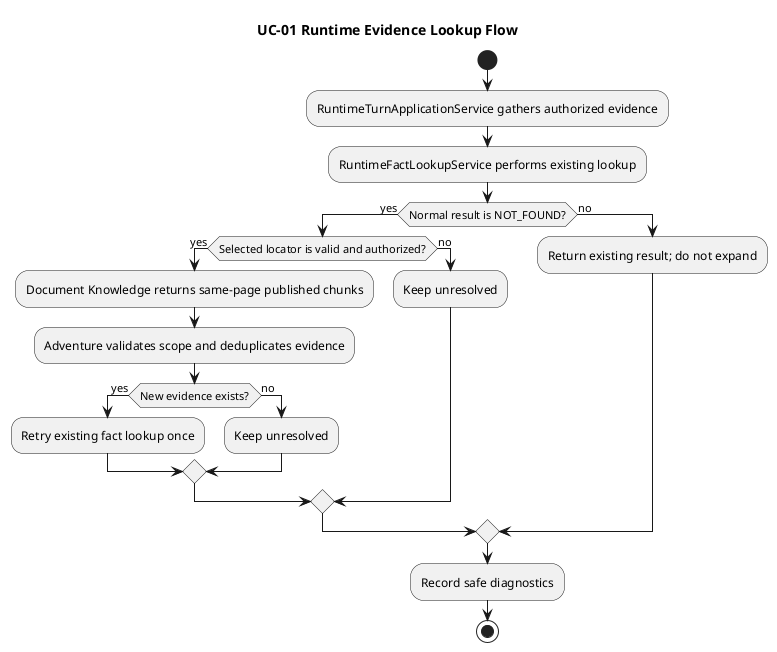

# Architecture Spec

> **후속 결정:** [ADR-023](../../adr/ADR-023-runtime-gm-input-context.md)이 일반 턴의 근거 수집에 최대 40개 검색 후보, 최대 20개 관련도 정렬 결과, 충분성 판단에서 선택한 근거 전달을 추가했다. 기존 같은 페이지 확장 분기와 자료 범위 검증은 그대로 유지한다.

# 1. Design Scope

| 항목 | 대상 |
|---|---|
| Product Spec | [product-spec.md](product-spec.md) |
| Use Case | UC-01 검색 근거 확인 및 같은 페이지 확장 |
| Bounded Contexts | Adventure Runtime, Document Knowledge |
| Existing Services | `adventure-service`, `rule-knowledge-service` |
| Affected data | 기존 허가 자료 범위, 활성 추출 버전, 게시 근거와 Source Span 참조. 신규 영속 데이터 없음 |

## 1.1 Product mapping

| Product decision | Architecture responsibility |
|---|---|
| 기존 규칙 근거 조회가 정상 `NOT_FOUND`일 때만 확장 | `RuntimeTurnApplicationService`의 명시적 결과 분기 |
| 현재 허가된 활성 추출 버전의 같은 페이지만 조회 | Adventure가 scope 전달; Document Knowledge가 검증 및 조회 |
| 확장 후 기존 조회를 한 번 재시도 | 기존 `RuntimeFactLookupService` 재사용 |
| 재시도도 `NOT_FOUND`면 미해결 | 런타임 결과를 미해결로 유지, 규칙을 만들지 않음 |
| 기술 오류와 미발견 구분 | 오류 경로를 `NOT_FOUND`로 변환하지 않음 |
| 본문을 남기지 않는 진단 | `DevelopmentDiagnostics`에 안전한 식별자·개수·시간·결과만 기록 |

# 2. Domain Flow

| Command | Caller → Owner | Preconditions | Result |
|---|---|---|---|
| 기존 규칙 사실 조회 | Adventure Runtime → 기존 `RuntimeFactLookupService` | 기존 런타임 요청 | FOUND / NOT_FOUND 또는 기술 오류 |
| 같은 페이지 게시 근거 조회 | Adventure Runtime → Document Knowledge | 기존 조회의 정상 NOT_FOUND와 유효 locator | 같은 페이지의 허가된 게시 청크 또는 빈 목록 |
| 기존 사실 조회 재시도 | Adventure Runtime → 기존 `RuntimeFactLookupService` | 확장 결과에 새 근거가 있음 | FOUND 또는 미해결; 추가 재시도 없음 |

새 domain event, policy 저장 상태, read model, aggregate 전이는 없다. 전 과정은 기존 런타임 요청의 동기 읽기 흐름이다.

## 2.1 Hotspots

| Decision | Settled choice |
|---|---|
| 확장 트리거 | 기존 조회가 반환한 명시적인 정상 `NOT_FOUND`만 |
| 범위 | 같은 문서·같은 페이지·현재 허가된 활성 버전의 이미 게시된 청크 |
| 재시도 | 기존 조회 최대 1회 |
| 일반 턴 근거 선택 | 최대 40개 검색 후보 → 최대 20개 관련도 정렬 → 충분성 판단이 선택한 근거 전달 |
| 같은 페이지 확장 조건 | 기존 조회가 정상 `NOT_FOUND`일 때만 |
| 조회 실패/빈 결과 | 규칙을 추측하지 않고 기존 기술 실패 또는 미해결 결과 유지 |

# 3. DDD Architecture

## 3.1 Contexts and boundaries

| Bounded Context | Responsibility and owned data |
|---|---|
| Adventure Runtime | 모험의 허가 자료 범위와 활성 버전 참조, 런타임 조회 순서·재시도 및 최종 결과 |
| Document Knowledge | 문서·추출 버전·Source Span, 원문 및 게시 검색 근거 |

| Capability | Owner | Chosen boundary | Boundary rationale |
|---|---|---|---|
| 런타임 미발견 후 보완 조회 조정 | Adventure Runtime | 기존 `adventure-service` 내부 기능 | 턴 결과와 모험 자료 권한을 소유한다. 별도 Context/서비스는 독립 수명주기 없이 동기 결합만 늘린다. |
| 위치 기반 게시 근거 조회 | Document Knowledge | 기존 `rule-knowledge-service` 내부 API 및 lookup port | 문서와 게시 근거의 소유권을 유지한다. Adventure의 직접 DB 접근이나 새 서비스는 불필요하다. |

Context 관계: Adventure Runtime은 Document Knowledge의 기존 동기 API를 사용한다. AI Game Master의 기존 사실 조회 계약도 유지하며, 이번 변경에서 새 경계나 데이터 소유권을 추가하지 않는다.

새 Aggregate, Entity, Value Object, 영속 상태는 없다. 기존 `RuntimeEvidence` 및 source locator 형식을 재사용한다. 근거 범위 규칙은 Adventure Runtime이 결정하고, 저장소 데이터 및 게시 여부는 Document Knowledge가 소유한다.

## 3.2 Class diagram

구조 모델과 독립 PlantUML 원본 및 SVG 렌더링을 완료했다.

- 원본: `diagrams/architecture/runtime-source-context-expansion.class.puml`
- SVG: [런타임 근거 확장 구조](diagrams/architecture/runtime-source-context-expansion.class.svg)

별도 설계 상태 다이어그램은 해당 없음: 저장 상태가 없으며 요청 결과 흐름은 Product UC-01과 같은 목적이다.

# 4. Program Design

## 4.1 Components

| Component | Responsibility | Must not do |
|---|---|---|
| `RuntimeTurnApplicationService` | 기존 조회 결과에 따라 확장 및 재조회 순서를 조정 | 기술 예외를 `NOT_FOUND`로 바꾸어 확장하지 않음 |
| `RuntimePlayerActionEvidenceAcquirer` | 기존 근거 수집과 선택 근거 locator의 같은 페이지 확장 | 다른 페이지·버전·문서를 조회하지 않음 |
| `RuntimeFactLookupService` | 기존 AI Game Master 사실 조회 수행 | 새 충분성 AI 호출을 추가하지 않음 |
| Rule Knowledge 내부 API/controller | 인증·scope 검증 후 기존 위치 조회 port 호출 | 허가되지 않은 게시 근거를 반환하지 않음 |
| `EvidenceLocationLookupPort` / `PostgreSQLEvidenceLocationLookupAdapter` | locator 기준 게시 청크 조회 | 청킹되지 않은 원문이나 과거 버전을 반환하지 않음 |
| `HttpTypedRuntimeGmAgentPort` | 기존 요청 전달 및 안전한 최종 근거 전달 진단 | 프롬프트, 원문, 응답 본문을 로그에 남기지 않음 |

## 4.2 Call contracts

| Order | Caller → callee | Contract |
|---:|---|---|
| 1 | `RuntimeTurnApplicationService` → `RuntimeFactLookupService` | 현재 근거로 기존 조회. 정상 `NOT_FOUND`와 기술 오류를 분리 |
| 2 | `RuntimePlayerActionEvidenceAcquirer` → Rule Knowledge 내부 API | 모험 허가 범위, 활성 버전, 선택 locator를 전달; 같은 페이지 게시 청크 반환 |
| 3 | API/controller → `EvidenceLocationLookupPort` | 검증된 문서·버전·페이지에 한정해 조회 |
| 4 | `RuntimeTurnApplicationService` → `RuntimeFactLookupService` | 새 근거가 있을 때만 한 번 재조회 |

API DTO는 기존 근거 출처 필드를 보존한다. 세부 URL 및 필드 이름은 기존 내부 API 규약에 맞춰 구현에서 정한다. 결과에는 출처 ID, 문서 ID, 추출 버전, locator, 발췌, 인용 키가 유지된다.

### Failure contract

| Failure | Handling |
|---|---|
| 정상 `NOT_FOUND` | 유효한 locator와 scope가 있으면 확장 검토 |
| 정상 빈 확장 결과 | 미해결; 재조회하지 않음 |
| Rule Knowledge 인증·scope 거부 | 결과 근거를 폐기하고 기존 오류 경로 유지 |
| Rule Knowledge/AI 기술 오류 | 기술 실패로 구분; NOT_FOUND 확장 트리거 금지 |
| 확장 뒤 재조회 `NOT_FOUND` | 미해결; 더 재시도하지 않음 |

## 4.3 Dependency rules

허용: Adventure Runtime → Document Knowledge 내부 API; Rule Knowledge controller → 기존 location lookup port/adapter; 런타임 애플리케이션 → 기존 evidence acquirer 및 fact lookup.

금지: Adventure에서 Rule Knowledge DB 직접 조회; 과거 버전·인접 페이지·전역 페이지 검색·미청킹 원문 사용; AI 충분성 판단 추가 호출.

# 5. Technical Architecture

## 5.1 Boundary and deployment mapping

| Context | Capability | Code boundary | Deployment |
|---|---|---|---|
| Adventure Runtime | 조건부 보완 조회 조정 | 기존 Adventure application capability | 기존 `adventure-service` |
| Document Knowledge | 출처 위치 게시 청크 조회 | 기존 API/controller와 port/adapter | 기존 `rule-knowledge-service` |

새 module/service/database/table은 만들지 않는다. 이미 존재하는 Context 경계를 넘는 읽기만 내부 API로 수행한다.

## 5.2 Synchronous API contract

기존 Rule Knowledge 내부 API/controller를 확장한다. 요청은 허가 자료 목록(문서 ID, 현재 활성 추출 버전, 자료 유형), 선택 anchor locator, 제한된 결과 개수를 포함한다. 응답은 출처가 보존된 게시 근거 목록이며 결과가 없으면 빈 목록이다. 정확한 route와 DTO 필드는 기존 API 규약에 맞춘다.

| Property | Contract |
|---|---|
| Authentication | 기존 내부 서비스 인증 |
| Authorization | 요청 scope와 인증 호출자, 문서 소유/공용 카탈로그 권한을 교차 검증 |
| Version | 현재 허가된 활성 추출 버전만 허용; 오래된 버전 조회 금지 |
| Location | 선택 anchor와 동일 문서·페이지에 한정 |
| Result bound | 기존 API의 조회 상한을 적용하고 서버에서 상한 검증 |
| Side effects | 없음; 읽기 전용 |
| Timeout | 기존 내부 API timeout 사용 |
| Errors | 인증/인가·입력 검증·저장소/전송 오류를 기존 API 오류 계약으로 반환 |

## 5.3 Data and consistency

| Data | Owner | Change |
|---|---|---|
| 게시 청크, 문서 버전, Source Span | Document Knowledge | 읽기 전용; schema 변경 없음 |
| 모험 허가 자료 범위와 active-version 참조 | Adventure Runtime | 기존 데이터 재사용; 새 저장 없음 |

조회 시 요청의 고정된 활성 버전만 읽는다. API 또는 DB 실패 시 새 근거를 추가하지 않는다. 새 비동기 메시지, transaction, lock, cache, migration은 없다.

## 5.4 Module change map

| Location | Change |
|---|---|
| Adventure `RuntimeTurnApplicationService` | NOT_FOUND/기술 오류 분리와 단회 재시도 조정 |
| Adventure `RuntimePlayerActionEvidenceAcquirer` 및 내부 API adapter | 같은 페이지 확장 요청과 출처/중복 검증 |
| Adventure `HttpTypedRuntimeGmAgentPort` | 본문 없는 최종 근거 전달 진단 |
| Rule Knowledge `RuleKnowledgeController` 및 API configuration | 내부 인증된 위치 조회 endpoint 연결 |
| Rule Knowledge lookup port/adapter | 재사용; scope 통합 테스트에서 결함이 확인될 때만 최소 변경 |
| 관련 테스트 | 단위·controller contract·DB integration 진단 |

# 6. Runtime Design

| Concern | Contract |
|---|---|
| Ordering | 한 요청 안에서 기존 lookup → 조건부 same-page lookup → 새 근거가 있을 때만 기존 lookup 1회 재시도 |
| Concurrency | 읽기 전용; 현재 활성 버전 참조를 고정하여 조회 |
| Transaction | 새 쓰기 없음; 조회 API 로컬 트랜잭션만 기존 설정 사용 |
| Idempotency | 반복해도 저장 변경 없음 |
| Partial failure | 빈 결과는 미해결; 기술 오류는 기술 실패; 잘못된 근거를 성공으로 가장하지 않음 |

# 7. Error Handling and Recovery

자동 복구는 새 게시 근거가 확보된 뒤 기존 사실 조회를 한 번 더 하는 경우에만 적용한다. 조회 API의 재시도 정책은 기존 내부 API 정책을 따르되, 이를 규칙 `NOT_FOUND`로 바꾸지 않는다. 보상/rollback은 해당 없음(읽기 전용).

| Failure | Retry | Result |
|---|---:|---|
| 기존 정상 `NOT_FOUND` | 확장 1회 조건 확인 | 유효 위치가 없으면 미해결 |
| 위치 API 정상 빈 결과 | 추가 조회 없음 | 미해결 |
| 위치 API 기술 오류 | 이번 확장 흐름에서 재조회 없음 | 기술 실패 |
| 확장 후 정상 `NOT_FOUND` | 0회 추가 | 미해결 |
| 범위/버전 불일치 | 0회 | 거부, 근거 사용 안 함 |

# 8. Security

| Surface | Authentication / authorization | Validation |
|---|---|---|
| Rule Knowledge 내부 API | 기존 내부 인증; Adventure 허가 범위와 문서 소유 또는 공용 카탈로그 접근권 검증 | 문서 ID, 활성 버전, locator, 결과 개수 및 페이지 범위 |
| 진단 로그 | 기존 개발 진단 설정으로 제한 | 원문·prompt·응답·불필요한 플레이어 입력 금지 |

새 secret은 추가하지 않는다. HTTP 보안은 기존 내부 API 설정을 재사용한다.

# 9. Observability

`DevelopmentDiagnostics`와 기존 `dev_` 로그 형식을 사용한다. 시작/완료, 선택된 분기, fallback·재조회 여부, 실패 종류, 기대/실제 개수와 소요 시간을 기록한다. 안전한 요청/turn·문서·버전·locator 식별 정보와 개수만 남기고 원문·prompt·model response는 남기지 않는다. 테스트는 주요 식별자·개수·결과가 있고 민감 본문이 없는지 확인한다. 새 운영 경보는 정의하지 않는다.

# 10. Change Boundaries

| Allowed | Forbidden |
|---|---|
| 기존 runtime 흐름, Rule Knowledge 내부 API, 위치 조회 adapter, 안전 진단, 관련 테스트의 최소 변경 | 검색 교체, BM25/reranker, 추가 AI 판단, 과거 버전, 인접/전체 페이지 탐색, 미청킹 원문, 새 서비스·테이블·저장 상태 |

공유 카탈로그 owner scope 수정은 adapter 통합 테스트가 실제 결함을 재현할 때만 허용한다.

# 11. Verification Requirements

| Area | Required evidence |
|---|---|
| Application flow | FOUND는 확장 안 함; 정상 NOT_FOUND만 확장; 기술 exception은 확장·재조회 안 함 |
| Retry | 새 근거가 있을 때만 재조회 1회; 재조회 NOT_FOUND 후 추가 호출 없음 |
| Scope | 같은 문서·페이지·현재 버전, 허가 owner 자료와 공용 카탈로그 허용; 다른 owner/document/page/version 거부 |
| Data | 확장 근거의 출처 보존 및 기존 근거 중복 제거; DB write 없음 |
| API | 인증, scope 검증, 빈 결과, 최대 개수, 오류 구분 contract tests |
| Final prompt | 확장 근거 포함 여부를 안전한 개수/식별자로 검증; prompt 본문 로그 없음 |
| Diagnostics | 분기, 기대/실제, 결과, duration 존재; 민감 원문 없음 |
| Runtime recovery | API/DB 오류 주입 시 정상 NOT_FOUND로 변환되지 않음 |

실제 모험 전체 E2E는 별도 검증이다. 개발 완료 시 실행 명령, 결과, 변경 파일, 미검증 사항과 리뷰 기록을 이 절에 덧붙인다.

# 12. Alternatives and Trade-offs

| Decision | Chosen | Trade-off |
|---|---|---|
| 확장 시점 | 명시적인 정상 NOT_FOUND만 | 기존 결과 계약에 의존하지만 불필요한 조회와 추가 AI 호출을 피함 |
| 자료 범위 | 선택 anchor의 같은 페이지, 현재 허가 버전 | 페이지 외부 예외는 놓칠 수 있지만 근거 오염·권한 혼합 방지 |
| 호출 경계 | 기존 Document Knowledge 내부 API | 동기 왕복 비용은 들지만 데이터 소유권과 접근 제어를 보존 |
| 복구 | 근거가 추가된 경우 단회 재시도 | 추가 근거로도 실패하면 자동 판정을 포기하고 미해결 유지 |

# 13. Risks and Open Questions

| Risk / question | Resolution |
|---|---|
| Runtime의 복구 가능한 기술 오류가 현재 `NOT_FOUND`로 매핑될 수 있음 | 구현에서 결과/예외를 분리하고 기술 오류가 fallback을 트리거하지 않는 테스트 추가 |
| 공유 카탈로그 adapter가 요청 owner 필터 때문에 결과를 놓칠 수 있음 | owner 및 catalog integration test로 확인; 재현될 때만 수정 |
| 유효한 페이지에 필요한 근거가 없을 수 있음 | 미해결 유지; 자동으로 다른 페이지를 검색하지 않음 |
| 정확한 API 경로와 필드 명칭 | 기존 Rule Knowledge API 규약에 맞춰 구현하고 contract test로 고정; 설계 차단 아님 |
| 기존 endpoint에 재사용 가능한 결과 수 상한이 있는지 | 구현 시 확인; 없으면 endpoint 계약에 서버 상한을 명시하고 테스트로 고정 |
