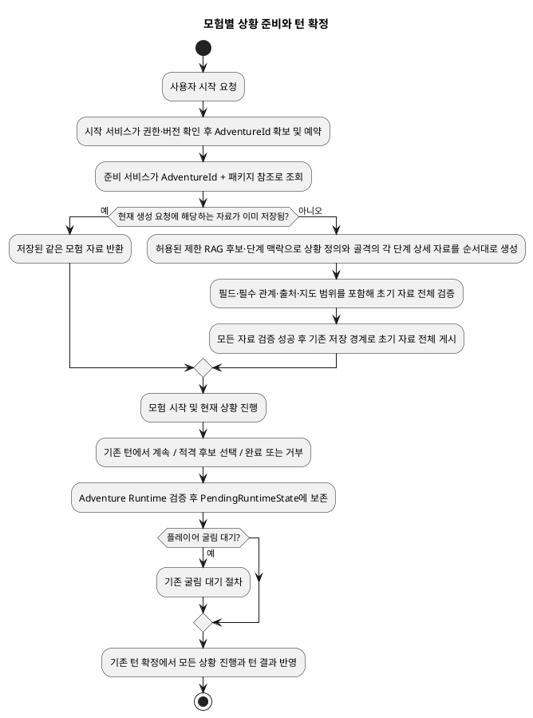

# Architecture Spec: 모험별 상황 준비와 턴 확정

## 1. Design Scope

### 1.1 Target

| 항목 | 대상 |
|---|---|
| Product Spec | [product-spec.md](product-spec.md) |
| Use Cases | UC-1 초기 필수 상황·선택 상황 준비, UC-2 그래프 기반 다음 상황 선택 |
| Domain | 모험별 상황 준비 및 기존 모험 진행 |
| Bounded Contexts | Scenario Preparation 및 Adventure Runtime (`adventure-service` 내부 경계) |
| Existing Services | `adventure-service`, AI Game Master (`ai-game-master-service`), 기존 자료·지도·세션 서비스 |
| External Dependencies | 기존 AI Game Master 호출 경로, PostgreSQL, 기존 지도·원문 참조 |
| Affected Data | 모험별 초기 준비 자료, 모험 진행 상태, 확정 대기 턴 상태 |

### 1.2 Product Spec Mapping

#### RAG 기반 초기 상황 준비 계약

선택된 추가 STORYBOOK의 RAG 검색으로 제한된 상황 후보를 얻고, 이를 한 번의 구조화된 JSON 요청으로 필수 상황과 명시된 선행 관계로 추출한다. 검색 결과는 원문 전체를 대표한다고 간주하지 않으며, 원문 전체를 다시 넣거나 페이지 단위로 열거·검토하지 않는다. 소유자·모험·문서·추출 버전·위치 범위, 중복 후보, 발췌 길이, 출력 식별자·출처·선행 관계를 검증한다. 이 구조 검증은 RAG가 검색하지 못한 원문 상황의 누락을 찾아내거나 완전성을 증명하지 않는다. 추가 STORYBOOK 검색과 기본 RULEBOOK 규칙 검색은 분리한다. 기본 RULEBOOK 검색문은 상황별로 묶어 임베딩한 뒤 dense 검색하며, 각 상황은 최대 네 발췌를 사용하고 발췌당 1,200자까지만 전달한다. 필수 상황 요약은 500자 이내다. backbone과 상세 상황 생성에는 전체 컴파일 모델이나 원문 전체를 전달하지 않고, 최대 2,000자 시작 맥락, 검색에서 추출한 필수 상황, 상황별 기본 규칙 발췌와 허용된 출처 위치를 전달한다.

| Product Spec 항목 | Architecture 요소 |
|---|---|
| UC-1, R-01, R-02, R-03, R-07, R-09, R-10 | 상황 생성 경로가 구체적인 이름·설명과 제한된 근거를 사용해 필수 상황 및 필요한 중간 후보를 생성·검증·저장; 단계별 후보 최소 수 없음; 이야기 길이·선택 상황 허용량 보존; 동일 맵 격자 선택을 기존 편집 흐름에 연결 |
| UC-2, R-01, R-03, R-04, R-06, R-08, R-09 | 기존 턴 서비스가 현재 상황과 확정 사건을 바탕으로 계속 진행 또는 후보 선택을 제안하고 검증 |
| R-05, R-06, R-08, R-09 | 새 장면 전환을 다음 상황 대안으로 허용하지 않으며, 적격 필수 상황 또는 끝 상황 완료/거부만 제안 |
| R-01, R-06, R-07 | 제한된 RAG 후보의 범위·구조·출처·선행 관계 및 제공 지도만 검증; 필수 관계는 시작 root 하나·명시적 ending 하나 이상·ending 도달 가능성·비순환 그래프 (복수 선행 및 합류 허용)여야 하며, 불일치는 임의 보정 없이 준비 실패; 검색 누락의 완전성은 보장하지 않음 |
| R-08 | 기존 버전·권한·공개 범위·플레이어 굴림 대기 절차를 유지 |
| R-09, ST-05 | 초기 자료 및 플레이 상태에 AdventureId 소유 범위를 적용하고 모험 간 공유 금지 |
| R-10 | 같은 맵 파일의 저장 격자가 있을 때 사용자 선택 후 기존 지도 정렬 저장 경계에 재사용하거나 편집 결과를 저장 |
| ST-01, ST-02 | 응답 시간 및 저장량 수치 목표는 근거가 없어 미확정 |

### 1.3 현재 준비 기준선과 이번 변경의 경계

현재 `prepare`는 골격을 만들고 모든 단계 상세 자료를 생성·검증한 뒤 `saveInitialArtifacts`로 전체를 게시한다. 이 후속 설계의 남은 준비 변경은 전체 선택 가능 후보를 사용하는 문맥 예산과 원문 선행 관계 검증이다. 코드 기준과 미완성 경로는 [현재 코드 기준](current-code-baseline.md)에 남긴다. 이후 플레이 중에는 게시된 자료를 읽으며 새 STORYBOOK 검색을 시작하지 않는다.

## 2. Domain Flow

### 2.1 Event Storming Flow

### 2.2 Commands

| Command | Actor | Target | Input | Preconditions | Result |
|---|---|---|---|---|---|
| 상황 생성 요청 | 기존 준비/런타임 호출자 | SituationDefinition 생성 경계 | 단계 맥락·허용된 제한 근거 | 기존 호출 시점·소유권 검증 | 이름·설명·기존 필수 관계·출처를 보존한 상황 정의 |
| 상황 진행 계획 | Runtime Turn 응용 서비스 | Adventure Runtime | 현재 상황, 모험별 후보·사용 상태, 확정 사건 | 활성 모험·턴 소유권 확인 | 계속, 적격 후보 선택 또는 완료/거부 |
| 상황 진행 확정 | 기존 턴 확정 흐름 | Adventure | PendingRuntimeState와 턴 식별자 | 버전·굴림·소유권 검증 통과 | 상황 진행 및 나머지 턴 결과의 단일 확정 |

### 2.3 Domain Events

| Domain Event | Producer | Trigger | Payload | Consumers |
|---|---|---|---|---|
| 상황 자료 생성 완료 | Scenario Preparation | 기존 생성 호출의 검증된 자료 저장 성공 | 모험·패키지·개정 식별자 | 기존 준비 흐름 |
| 턴 상황 진행 확정 | Adventure | 기존 턴 확정 성공 | 모험·턴 버전 및 확정된 상황 진행 | 기존 런타임 읽기 경로 |

### 2.4 Policies

| Policy | Trigger Event | Decision | Emitted Command | Owner |
|---|---|---|---|---|
| 기존 자료 재사용 | 시작 또는 단계 생성 요청 | 같은 모험·패키지·개정의 해당 자료가 있으면 재사용 | 없음 | Scenario Preparation |
| 다음 상황 결정 | 현재 상황 종료 | 자연스러운 같은 단계 선택 상황(잔여 허용량 내), 아니면 그래프상 적격한 미사용 필수 상황, 아니면 끝 상황 완료/거부 | 상황 진행 계획 | Adventure Runtime |
| 턴 확정 | 검증된 대기 상태 | 현재 상황 전환·사용 상태·선택 상황 허용량 또는 ending 완료와 턴 결과를 함께 확정 | 기존 턴 확정 | Adventure Runtime |

### 2.5 Read Models

| Read Model | Consumer | Source | Fields | Owner |
|---|---|---|---|---|
| 모험의 준비 상황 자료 | 시작·진행 서비스 | 준비 자료 저장소 | 모험 ID, 패키지·개정 참조, backbone, 기존 생성 단계·상황 정의 | Scenario Preparation |
| 모험 상황 진행 상태 | Runtime Turn 및 프롬프트 구성 | `StoryRuntimeState` (모험의 이야기 진행 상태)와 `CurrentSituation` (현재 장면 정본) | 이야기 길이·선택 상황 최대 허용량·완료 수, 초기 후보의 ID·title·description·intents·사용 상태, 명시적 ending 및 필수 상황 진행, 현재 활성화된 준비 상황과 그 진행에 필요한 현재 장면 내용·제공 맵 참조 | Adventure Runtime |

### 2.6 External Interactions

| External System | Trigger | Input | Output | Failure |
|---|---|---|---|---|
| RAG 후보·규칙 검색 API | 초기 준비 | 추가 STORYBOOK 제한 후보 검색; 기본 RULEBOOK의 필수 상황별 규칙 검색 | 문서·유형·추출 버전·소유 범위·위치 | 검색 범위 불일치와 조회 실패는 준비 실패; 검색 누락은 완전성을 증명하지 않음 |
| AI Game Master | RAG 후보의 필수 상황 추출·상세 생성 또는 턴 상황 계획 | STORYBOOK 제한 후보를 한 번 입력; RULEBOOK 검색문은 상황별 묶음 임베딩 후 별도 검색 | 추출 목록 또는 상황 후보 제안 | 검색·분류 실패는 준비 실패; 실패를 완성 결과로 취급하지 않음 |
| PostgreSQL | 자료 조회·게시 또는 턴 확정 | 모험 키·버전 조건의 저장 명령 | 저장 결과 | 기존 충돌·확정 복구 절차 적용 |

### 2.7 Hotspots

| Hotspot | Options | Decision |
|---|---|---|
| 같은 원문을 쓰는 모험의 초기 상황 공유 | 패키지 기준 공유 / 모험별 분리 | AdventureId 포함 키로 독립 생성·저장. 원문 패키지는 참조만 함 |
| 단계 자료 생성 시점 | opening 생성 후 `prepareNext` 지연 생성 / 모험 시작 전 전 단계 생성·검증·일괄 게시 | 초기 필수 상황과 중간 후보가 시작 전에 준비되도록 변경; 개별 단계 생성 경계는 재사용 |
| RAG 검색 후보에만 의존 | 제한된 검색 후보를 구조화된 출력으로 추출하고 범위·관계 검증 | 검색되지 않은 원문 상황의 누락이나 모델 의미 판단 완전성은 증명하지 않음 |
| 단계 순서 의미 | 연속 진행 제약 / 자료 정리 순서 | StageBackbone.order는 준비 자료의 나열 순서다. 플레이어에게 제안 가능한 상황은 모든 단계에서 모으고, 원문에 명시된 선행 관계만 진행을 제한한다. 단계 번호로 플레이 순서나 선행 방향을 추가하지 않는다 |
| 상황 전환 확정 | 별도 저장 / 기존 턴 확정에 포함 | 현재 상황 종료·다음 필수 상황 활성화·선택 상황 사용량 또는 ending 완료를 같은 턴 확정에 포함 |

## 3. DDD Architecture

### 3.1 Bounded Contexts

| Bounded Context | Responsibility | Ubiquitous Language | Owned Model | Owned Data |
|---|---|---|---|---|
| Scenario Preparation | 기존 준비 생명주기 안에서 단계별 상황을 생성·검증·저장 | 준비 상황, 근거 출처, 원문 선행 관계 | StageBackbone, DetailedStage, SituationDefinition | 모험 키가 포함된 준비 자료 |
| Adventure Runtime | 모험 진행 중 선택 상황·필수 상황 선택, 턴 검증·확정 | 현재 상황, 상황 사용 상태, 확정 대기 턴 | StoryRuntimeState, PendingRuntimeState, Adventure | 모험별 플레이 진행 상태와 확정 턴 |

### 3.1.1 Boundary Decisions

| Capability | Owner Context | Candidate Boundary | Chosen Boundary | Why Not Weaker? | Why Not Stronger? |
|---|---|---|---|---|---|
| 초기 상황 준비 | Scenario Preparation | 내부 capability | 기존 준비 경계 확장 | 자료 생성·검증·저장 책임을 기존 준비 흐름에서 수행 | 별도 모듈·서비스는 독립 소유·수명·배포 요구가 없고 동기 협력과 같은 저장 일관성을 필요로 함 |
| 플레이 중 상황 진행 | Adventure Runtime | 내부 capability | 기존 모험 진행 경계 확장 | 턴 검증·굴림 대기·확정과 원자적으로 결합해야 함 | 별도 경계는 같은 모험 턴의 원자성을 분산시킴 |

새 bounded context, 코드 모듈, 배포 서비스는 추가하지 않는다. 이는 기존 Scenario Preparation과 Adventure Runtime 내부 책임의 확장이다.

### 3.2 Context Map

Scenario Preparation은 기존 Document Knowledge의 패키지·추출 개정 및 원문 위치를 참조하고 AI Game Master를 후보 생성자로 사용한다. Adventure Runtime은 Scenario Preparation이 게시한 모험별 자료를 읽고, AI Game Master의 진행 제안을 검증한다. 원문 및 지도 원본 상태는 기존 소유 경계에 남는다. 두 신규 capability 사이에 별도 배포 계약은 만들지 않는다.

| Upstream | Downstream | Relationship | Contract | Translation |
|---|---|---|---|---|
| Document Knowledge | Scenario Preparation | 자료 제공자 | 패키지·추출 개정·원문 위치 식별자 참조 | 기존 어댑터 |
| Scenario Preparation | Adventure Runtime | 준비 자료 제공 | 모험 소유 범위의 게시 자료 조회 | 기존 서비스 내부 계약 |
| AI Game Master | Scenario Preparation / Adventure Runtime | 제안 제공자 | 기존 포트의 검증 가능한 요청·응답 | 기존 어댑터 및 도메인 검증 |
| 기존 지도 소유 경계 | Scenario Preparation / Adventure Runtime | 제공 자료 참조 | 이 모험에 연결된 지도 ID 또는 지도 없음 | 범위 검증 |

### 3.3 Aggregates

| Aggregate | Root | Responsibility | Commands | Events | Invariants |
|---|---|---|---|---|---|
| 모험 진행 | `Adventure` | 기존 턴의 상황 진행과 결과를 함께 확정 | 기존 턴 확정 | 턴 상황 진행 확정 | 한 모험의 버전·턴 소유권 내에서 한 번에 확정; `StoryRuntimeState`는 이 Aggregate 내부 상태다 |
| 초기 자료 저장 트랜잭션 (Aggregate 아님) | 해당 없음 | 기존 준비 서비스와 저장소가 현재 호출에서 생성한 자료를 게시 | 기존 초기 자료 저장 | 상황 생성 결과 저장 | 해당 호출의 자료가 모험·패키지·개정 키에 일치 |

### 3.4 Entities

| Entity | Aggregate | Identity | Responsibility | State |
|---|---|---|---|---|
| `SituationDefinition` | 초기 준비 자료 또는 `Adventure` 내부 이야기 진행 상태 | 모험 범위 내 상황 식별자 | 필수 여부·선행 관계·출처·핵심 요소·지도 참조 보유 | 게시된 초기 정의는 불변; 플레이 중 추가 정의는 해당 모험에만 저장 |
| `RequiredSituation` | 모험별 `StageBackbone` | `situationId` | RAG 후보에서 추출한 필수 상황 요약, 선행 상황 ID, 명시적 ending 여부, 원문 위치 참조 | 식별자·관계·명시적 ending 표시·허용 위치가 구조적으로 유효 |
| `StageBackbone` | 초기 준비 자료 | 모험·패키지·개정 | 준비 단계와 추출된 `requiredSituations` 보유 | `order`는 준비 나열 순서; 목록은 모험별 JSON에 함께 저장 |
| `DetailedStage` | 준비 자료 | 모험·패키지·개정·단계 | 현재 준비 단계의 핵심 요소와 상황 목록 제공 | 기존 단계 저장 생명주기 |

#### 3.4.1 Class Diagram

구조 및 주요 계약은 다음 다이어그램에 정의한다. 독립 `.puml` 원본, 로컬 SVG 렌더, 이 문서의 링크와 내용 일치 여부를 부모 검토에서 확인했다.

[상황 준비 클래스 다이어그램](diagrams/architecture/situations.class.svg)

### 3.5 Value Objects

| Value Object | Aggregate | Values | Validation | Behavior |
|---|---|---|---|---|
| 모험 식별자 (`AdventureId`) | 모험 진행·초기 자료 | 모험의 안정 식별자 | 시작 준비 전 예약, 재시도 시 같은 값 사용 | 소유 범위 구분 |
| 상황 선행 관계 | 초기·진행 상황 | 원문에서 확인된 선행 상황 식별자 | 시작 상황(root) 하나, 명시적 끝 상황(ending) 하나 이상, 모든 끝 아닌 상황의 끝 도달 가능성, 끝 상황 후속 없음, 비순환성을 검사; 복수 선행·합류 허용 | 실행 가능한 필수 상황 판별; 원문에 없는 관계는 만들지 않음 |
| 출처 구분 | 상황 정의 | 원문 추출 또는 AI Game Master 보완 | 출처를 허위로 표시할 수 없음; 원문 항목은 위치 보존 | 원문과 보완 내용 분리 |
| 지도 참조 | 상황 정의 | 제공된 지도 ID 또는 지도 없음 | 현재 모험의 제공 범위만 허용 | 지도 없이 진행 가능 |
| 기존 격자 정렬 | 기존 지도 소유 경계 | 원본 이미지 개정과 격자 원점·칸 크기 | 같은 모험의 지도 목록에서 같은 `imageRevision`(원본 맵 이미지 표현의 SHA-256 값)을 가진 저장 정렬이 있을 때만 재사용 | 재사용은 원본의 `mapId`별 정렬을 바꾸지 않고 대상 `mapId`에 기존 정렬 API로 적용; 직접 수정은 기존 편집 경계 사용 |

### 3.6 Domain Services

별도 도메인 서비스 승격은 없다. 기존 `StoryRuntimeRules`와 `StoryStageTransitionApplicationService`가 원문에 명시된 상황 선행 관계를 기준으로 진행 가능성을 판정한다. 준비 응용 서비스는 골격의 모든 단계 자료를 생성·검증한 뒤 초기 자료 전체를 게시한다.

### 3.7 Business Rule Ownership

| Business Rule | Owner | Enforcement Point |
|---|---|---|
| R-01 원문에 명시된 필수 상황과 선행 관계 보존 | Scenario Preparation 및 Adventure Runtime | RAG 후보 추출 목록·출처·선행 관계 검증과 다음 상황으로 진행할 수 있는지 검증 |
| R-02 이야기 연결에 필요한 중간 후보; 단계·전체 최소 개수 없음 | Scenario Preparation | 단계별/전체 후보 최소 검사를 두지 않음; 필수 상황·opening 및 근거 검증은 유지 |
| R-03 구체적인 현재 사건 이름과 장면 설명, 대본 아닌 핵심 요소 | Scenario Preparation | 프롬프트·JSON Schema·materializer·`SituationDefinition` 생성자 및 실제 모델 E2E 표본 대조 |
| R-04 플레이 행동·확정 사건 기반 후보 선택 | Adventure Runtime | `StoryRuntimeRules` 및 계획 제안 검증 |
| R-05 다음 후보 부재 | Adventure Runtime | 적격 필수 상황 검색 후 완료/거부; 전환용 임의 장면 생성 금지 |
| R-06 제공 지도만 사용 | 각 상황 제안 소유 경계 | 모험의 제공 지도 범위 검사 |
| R-07 근거 부족 보완과 출처 구분 | Scenario Preparation | 출처·원문 위치 검사 |
| R-08 기존 공개·버전·굴림 대기·확정 규칙 | Adventure Runtime | 기존 턴 검증·확정 절차 |
| R-09 모험 간 독립성 | 두 기존 경계 | 저장 키, 조회 범위, 상태 소유권에 AdventureId 포함 |
| R-10 같은 맵 파일의 격자 선택 | Scenario Preparation 및 기존 지도 정렬 경계 | 모험 내 같은 맵 파일과 저장 정렬을 확인하고 사용자 선택에 따라 재사용하거나 기존 편집기로 수정·저장 |

### 3.8 Aggregate State Transitions

| Current State | Command / Event | Next State | Owner | Preconditions | Emitted Event |
|---|---|---|---|---|---|
| 모험 초기 자료 준비 | 모든 단계 생성·검증 | 전체 자료 함께 게시 | Scenario Preparation | 모든 단계의 원문·상황·참조 검증 성공 | 초기 상황 세트 준비 완료 |
| 준비 자료 존재 | 같은 준비 요청 | 준비 자료 반환 | Scenario Preparation | AdventureId·패키지·개정 일치 | 없음 |
| 현재 상황 진행 | 계속 진행 | 현재 상황 유지 | Adventure Runtime | 기존 확정 사건 검증 | 기존 턴 확정 |
| 현재 상황 진행 | 적격 준비 후보 선택 또는 현재 상황 계속 | 검증된 대기 턴 | Adventure Runtime | 모험 소유·선행·지도·공개 범위 검증; 임의 새 상황 전환 거부 | 아직 없음 |
| 플레이어 굴림 대기 | 굴림 제출·기존 턴 재개 | 확정 가능 또는 대기 유지 | Adventure Runtime | 기존 굴림 검증 통과 | 아직 없음 |
| 검증된 대기 턴 | 기존 턴 확정 | 종료 상황·다음 활성 상황·사용 상태 동시 반영 | `Adventure` | 버전 및 모든 기존 턴 검증 통과 | 턴 상황 진행 확정 |

### 3.8.1 State Diagram

이 다이어그램은 기존 턴 확정 내부의 설계 상태를 표현한다. Product Spec의 업무 상태 다이어그램을 대체하지 않는다. 독립 `.puml` 원본, 로컬 SVG 렌더, 이 문서의 링크와 내용 일치 여부를 부모 검토에서 확인했다.

[상황 턴 확정 상태 다이어그램](diagrams/architecture/turn-commit.state.svg)

### 3.9 Repository Boundaries

| Repository | Aggregate | Operations | Consistency Boundary |
|---|---|---|---|
| `StageArtifactRepository` | 기존 모험별 준비 자료 | AdventureId·패키지 출처 참조·개정 기준 조회 및 기존 저장 operation | 기존 준비 저장 일관성 경계 |
| `PostgresAdventureRepository` | `Adventure` 및 이야기 진행 상태 | 신규 JSON 저장·복원 | 기존 모험 버전 및 확정 상태 |
| `PostgresRuntimeTurnRepository` | 대기 턴 | 신규 JSON 저장·복원 | PendingRuntimeState와 기존 턴 식별자 |

## 4. Program Design

### 4.1 Program Structure

기존 시작 경로 → 준비 응용 서비스 → 생성 포트·저장소를 확장한다. 기존 턴 경로 → `RuntimeTurnApplicationService` → AI Game Master 제안 → `StoryRuntimeRules` 검증 → `PendingRuntimeState` → 기존 `Adventure.commitRuntimeTurn` 확정 흐름을 확장한다. 실제 AI 제공자 연결기는 기존 서비스 통합 경로에 연결한다. 원문 출처 참조(`ScenarioSourceReference`: 원문 위치를 가리키는 기존 식별자)의 ID·페이지 목록만으로 스토리를 추측하지 않는다. 기존 Document Knowledge(문서 근거 관리 경계) 및 준비 근거 조회로 원문 발췌와 핵심 스토리 모델을 함께 찾아 생성 입력으로 전달하고, 세션에 선택된 자료 범위를 유지한다.

### 4.2 Major Components and Responsibilities

| Component | Responsibility | Input | Output | Dependencies | Must Not Do |
|---|---|---|---|---|---|
| `AdventureSessionApplicationService` | 세션 시작 준비 경로에 모험 소유 식별자 전달 | 세션·패키지 | 준비 결과 | 준비 포트 | 모험 간 자료 공유 |
| `AdventureStartApplicationService` | 실제 시작 경로에서 예약된 모험 ID로 현행 준비 조건 확인 | 세션·모험 식별자 | 시작 입력 | 준비 포트 | 내용 개선을 이유로 생성 시점·수명주기 변경 |
| `StageArtifactPreparationApplicationService` | 골격의 모든 단계 자료 생성·검증·일괄 저장; opening이 미완료 필수 선행 상황을 건너뛰지 않는지 게시 전에 확인 | 모험·세션·패키지 ID | 모험별 완성된 준비 자료 또는 검증 실패 | 생성 포트·저장소·기존 지도 연결 | 외부 생성 중 DB 트랜잭션 유지 |
| 기존 생성 포트 및 실제 GM 어댑터 | 세션에 선택된 GM 실행 설정으로 여러 상황 제안 | 확장 Request | 검증 전 생성 결과 | 실제 AI Provider | 후보를 검증 없이 게시 |
| `StoryRuntimeRules` 및 `StoryStageTransitionApplicationService` | 계속·적격 선택 제안·끝 상황 완료/거부와 다음 필수 상황의 진행 가능성 확인 | 준비 후보·사용 상태·확정 사건·원문 선행 관계 | 검증 결과 | 모험 진행 상태 | 단계 번호로 선행 관계를 추론하거나 대체함 |
| `RuntimeTurnApplicationService` | 제안을 대기 상태로 보존하고 기존 턴 절차 실행 | 플레이 행동·기존 상태 | 대기 상태 또는 확정 결과 | 프롬프트·응답 변환·턴 저장소 | 별도 조기 상황 저장 |
| `Adventure` | 기존 확정 경계에서 모든 턴·상황 결과 반영 | 검증된 대기 상태 | 확정 상태 | 기존 저장소 | 턴 일부만 확정 |

### 4.3 Application Flow

모험 준비는 시작 전에 골격의 모든 단계에 대한 상세 자료를 생성하고 검증한다. `prepare`가 각 단계의 기존 생성·검증 로직을 순서대로 실행하고 전 단계가 유효해진 뒤 `saveInitialArtifacts`로 초기 자료 전체를 한 번에 게시한다. 외부 AI 요청 동안 DB 트랜잭션을 열지 않는다. 준비 실패 시 게시된 완성 자료가 없으므로 모험 시작을 막고, 재시도는 같은 모험 식별자로 전체 초기 준비를 다시 실행한다. 게시 경계와 실제 모험 시작 경계에서 opening이 미완료 필수 선행 상황을 건너뛰지 않는지 검증한다. 새 모험은 필수 상황이 아직 완료되지 않았으므로 필수 opening에 선행 필수 상황이 있으면 거부한다. 시작 검증 실패 시 시작 상태나 현재 상황을 만들지 않는다. 준비 API는 `짧게`/`보통`/`길게` 중 하나의 필수 `storyLength` 값을 받고 허용값 이외 입력을 거부한다. PreparationFlow/session 생성 요청·저장 계약과 조회 응답에 이를 추가하고 유효한 세 값 외 입력은 거부하며, 세션 저장 값은 모험 준비에 전달되어 초기 `StoryRuntimeState`에 기록한다. 초기 `StageBackbone`의 모든 필수 노드는 `RequiredSituation`의 명시적 `isEnding` 값을 포함하며, 추출·저장·복원·검증 전 경로에서 이를 보존한다. 필수 그래프 노드 수와 선택한 길이로 선택 상황 완료 최대 허용량을 계산한다. 런타임에서 선택 상황은 현재와 같은 단계에 속하고, 현재 행동 또는 확정 사건상 자연스러우며, 허용량이 남은 경우에만 적격이다. 이 조건을 충족하는 선택 상황이 없으면 단계와 무관하게 `UNUSED` 상태이며 모든 명시적 선행 필수 상황이 `USED`인 필수 상황만 선택지로 삼는다. joins의 모든 선행 노드가 `USED`여야 한다. 이미 `USED`인 필수 노드는 다시 선택하지 않는다. 필수 상황 적격성은 그래프의 명시적 간선으로만 결정한다. 선택한 상황의 소속 단계는 단계별 보조 문맥을 고르는 데만 사용하고 그래프 적격성을 제한하지 않는다.

각 턴의 `RuntimeTurnApplicationService.situationSelectionContext`는 같은 단계·자연스러움·현재 상황 종료를 반영한 잔여 허용량 조건을 갖춘 선택 상황과 단계 무관하게 모든 선행 노드가 `USED`인 `UNUSED` 필수 상황만 ID, title, description, intents, 사용 상태와 함께 포함한다. 별도로 `CurrentSituation`의 현재 장면과 `StoryRuntimeState.activeSituationId`의 활성 준비 상황을 구별해 전달한다. 입력 예산은 `RuntimeGmInputBudget.inputLimit(contextLimit)`이며 설정된 모델 문맥 한도의 80%를 UTF-8 byte 기준으로 계산한다. 예산은 고정 지침·잠긴 자료 최대 40%, 장기 기록 최대 10%, 압축 대화 최대 15%, 압축하지 않은 최근 대화 최대 20%로 나뉘며, 최신 캐릭터·상황·이번 턴 입력은 앞선 구역의 실제 사용량을 뺀 나머지를 쓴다. 전체 단계의 선택 가능 후보를 턴 문맥 JSON으로 직렬화한 UTF-8 크기는 8,192 byte 이하로 제한한다. 이는 후보 개수 상한이 아니라 실제 턴 입력량 상한이다. 단계 자료 생성에서 이 한도를 넘으면 직전 JSON을 한 번 보정 요청에 재사용하고 보정 대상 위치와 실제/허용 byte 수를 지정한다. 필수 상황은 보존하고 중간 후보 수는 줄일 수 있다. 재차 초과하면 자료를 게시하지 않는다. 진단 로그에는 응답 원문을 남기지 않는다. 런타임은 현재 턴의 실제 구역별 크기와 후보 크기를 조립 전에 검사하며, 후보를 자르거나 생략하지 않는다. 기존 구역 상한 또는 전체 80%를 넘으면 `InputTooLargeException`(필수 입력이 설정된 문맥 예산을 초과했다는 오류)으로 AI 호출 전에 실패한다. 같은 입력은 재시도하지 않으며, 선택 모델의 용량 또는 현재 턴 입력이 바뀐 뒤에만 재개한다. 로그에는 모험·턴 ID, 구역별 기대/실제 byte 수, 후보 수, 한도, 결과·실패 종류·복구 분기를 기록하고 문맥 원문은 남기지 않는다. 상황 전환은 확정하지 않는다. 준비 시 후보 문맥 크기는 시작 전에 보정·검증하며, 턴의 다른 구역이 예산을 넘으면 크기를 진단해 같은 입력 재시도를 막는다.

전환 제안은 `selectedSituationId`를 통한 적격 준비 상황 선택만 허용한다. 필수 상황 후보는 `UNUSED`이고 모든 명시적 선행 필수 상황이 `USED`일 때만 적격하다. `USED`는 해당 상황을 끝내고 턴 확정한 상태이며, 새로 선택된 후보는 끝날 때까지 `UNUSED`다. 선택 상황 후보는 현재와 같은 단계에 있고 현재 플레이어 행동 또는 확정 사건으로 자연스럽게 이어지며, 현재 선택 상황 종료를 반영한 사용량이 최대 허용량 미만일 때만 적격하다. 두 조건 모두 만족하지 않으면 임의 장면 전환을 제안하지 않는다. 선택한 상황의 소속 단계는 단계별 보조 문맥에만 쓰며 필수 그래프 자격을 제한하지 않는다. 선택한 명시적 ending 상황이 `USED`로 원자 확정되면 모험을 완료한다. 후보 선택, 필수 사용 상태, 현재 활성 선택 상황의 종료·`USED` 전환과 선택 상황 사용량 증가를 `PendingRuntimeState`에 대기하고 `Adventure.commitRuntimeTurn` 확정 경계에서 한 번만 적용한다. 동일 확정 재시도는 저장된 결과를 반환하며 사용량을 다시 증가시키지 않는다. 굴림 대기·검증 실패·저장 실패에서는 어떤 사용 상태도 변경하지 않는다.

응답 JSON 계약은 `src/contracts/ai-game-master/schemas/runtime-turn-response.json`이며, TRANSITION은 적격 준비 후보 선택만 허용하며 임의 장면 생성 필드는 거부한다. CONTINUE에서는 둘 다 거부한다. HTTP adapter는 응답을 기존 턴 제안에 전달할 뿐 저장하지 않는다. `newSituation`은 다음 상황 전환 경로에서 허용하지 않고 응답 검증 단계에서 거부한다. 진행 후보의 지도 참조는 해당 모험의 제공 목록으로 검증한다.

### 4.4 Component Call Contracts

| Order | Caller | Callee | Operation | Input | Output | Failure |
|---:|---|---|---|---|---|---|
| 1 | 기존 준비 호출자 | 준비 응용 서비스 | 기존 `prepare` 경로 | 안정된 모험·세션·패키지 ID | 골격 및 전체 단계의 검증된 상황 자료 | 기존 준비 오류 및 복구 |
| 2 | 준비 응용 서비스 | `StageBackboneGenerationPort` | 기존 `generate(Request request)` | 모험·세션 ID 및 세션의 GM 실행 설정 | 골격 제안 | 기존 AI 요청 정책 |
| 3 | 준비 응용 서비스 | `StageDetailedGenerationPort` | 기존 `generate(Request request)` | 모험·세션 ID, 단계 coreProblem/funnelSummary, 허용된 관련 Passage, 기존 생성 범위 | 해당 단계 상세 제안 | 기존 AI 요청 정책 |
| 4 | 준비 응용 서비스 | `StageArtifactRepository` | `findBackbone(AdventureId, UUID, long)` / `findDetailedStage(AdventureId, UUID, String, long, long)` | 모험·패키지·개정·단계 범위 | Optional 자료 | 조회 실패·충돌 |
| 5 | 준비 응용 서비스 | `StageArtifactRepository` | 기존 단계 자료 저장 operation | 현재 호출의 검증된 결과 | 저장 완료 | 기존 저장 실패 처리 |
| 6 | Runtime Turn 응용 서비스 | 준비 자료 저장소 및 기존 계획·AI·규칙 경계 | 기존 요청·응답 확장 | 현재 장면, 활성 준비 상황, 전체 단계별 후보·사용 상태·확정 사건 | 계속/선택/생성 제안 | 기존 턴 실패 변환 |
| 7 | 턴 응용 서비스 | `Adventure` | 기존 확정 흐름 및 `commitRuntimeTurn` | 확정 대기 상태 | 전체 턴 확정 | 기존 버전 충돌·복구 |

### 4.5 Major Types

| Type | Kind | Responsibility | State | Dependencies |
|---|---|---|---|---|
| `StageBackbone` | 도메인 자료 | 단계 목록 및 준비 순서 보유 | 불변 게시 자료 | 상황 정의 참조 |
| `DetailedStage` | 도메인 자료 | 단계 핵심 요소·상황 목록 보유 | 불변 게시 자료 | 원문·지도 참조 |
| `SituationDefinition` | 도메인 자료 | 필수 여부·선행 관계·출처·핵심 요소·지도 참조 표현 | 초기 자료 또는 모험 전용 신규 자료 | 단계·근거 식별자 |
| `StoryRuntimeState` | 모험 진행 상태 | 준비 때 고른 이야기 길이, 선택 상황 최대 허용량과 사용량, 모든 단계의 준비 후보 사용 및 필수 상황 진행 추적 | 모험별 전체 상태 | 길이 선택·허용/사용량·모든 초기 상황 ID 및 단계별 진행 상태 |
| 단계별 이야기 진행 상태 | `StoryRuntimeState` 내부 값 | 단계별 공개·압박·핵심 요소 진행 보존 | 해당 단계의 진행 자료 | `stageId` |
| `CurrentSituation` | 현재 장면 정본 | 현재 활성화된 준비 상황의 이름·설명·지도 참조와 서버 식별자·개정 보유 | 모험별 현재값 | Adventure Runtime의 확정 턴 |
| `PendingRuntimeState` | 확정 대기 상태 | 이번 턴의 현재 활성 상황 종료·USED 처리·선택 상황 사용량 증가·필수 상황 사용 상태 변화 | 턴별 | 기존 버전·결과 |
| 준비 `Result` | 응용 결과 | 현재 준비 호출 결과와 기존 시작 입력 제공 | 일시적 | 저장 자료 |

기존 JSONB `PostgresStageArtifactRepository` 왕복에서 새 `title`·`description`을 보존한다. 모든 `SituationDefinition` 생성자 호출부와 fixture는 두 필드를 제공하고 기존 `mapNeeded` 값을 보존한다. 과거 자료 자동 변환·호환 adapter 또는 기존 모험 삭제는 추가하지 않는다. 신규 JSON 형식의 저장·재시작 보존은 검증하지만 과거 자료 이관은 하지 않는다.

### 4.6 Type Design

#### SituationDefinition

| 항목 | 정의 |
|---|---|
| Kind | 기존 도메인 자료 확장 |
| Responsibility | 준비 또는 플레이 중인 상황의 구체적인 이름·장면 설명과 기존 출처·관계를 표현 |
| Dependencies | 기존 단계 및 핵심 요소, 원문 위치, 제공 지도 참조 |
| Must Not Depend On | 다른 모험의 자료나 공용 패키지 상황 저장 |

##### State

| Field | Type | Meaning | Constraint |
|---|---|---|---|
| `title` (이름) | String | 현재 벌어지는 구체적 사건을 가리키는 이름 | 공백 제거 후 비어 있지 않음; Unicode code point 120개 이하 |
| `description` (장면 설명) | String | 장면을 짧게 구체화하는 설명 | 공백 제거 후 비어 있지 않음; Unicode code point 2,000개 이하 |
| 기존 내부 의도 분류 (`StageIntent`) | 기존 enum | 상황의 내부 진행 의도 분류 | 이름·장면 설명과 별도 필드로 그대로 보존 |
| 필수 여부 | Boolean 또는 기존 형식 | 원문 줄거리 유지에 필수인지 구분 | 원문 밖 사건을 추출로 표시하지 않음 |
| 선행 상황 | 상황 ID 목록 | 원문에 명시된 선행 관계 | 미존재·자기 참조·순환 거부; 빈 목록에 임의 관계 추가 금지 |
| 출처 구분 | 원문 추출 / GM 보완 | 근거가 확인된 내용과 보완 내용 구분 | 원문 추출은 원문 위치 보존 |
| 제공 지도 | 지도 ID 또는 없음 | 해당 모험에서 쓸 수 있는 지도 연결 | 다른 모험 지도 상태 참조 금지 |
| 핵심 요소 | 기존 상황 의도·정보·압박·다음 진행 조건·중요 결과 참조 | 상황을 구체화할 재료 | 전 항목을 모든 상황에 강제하지 않고 상세 대본화하지 않음 |
| 기존 지도 필요 여부 (`mapNeeded`) | Boolean | 상황에 맵 준비가 필요한지 나타내는 기존 값 | 이름·설명 추가 시 보존 |

제목·설명은 생성 JSON Schema와 `SituationDefinition` 도메인 생성자에서 같은 공백 제거·Unicode code point 길이 조건을 적용한다. 이 형식 검증은 서사 적합성을 보장하지 않는다. 프롬프트 요구와 실제 모델 E2E 표본 대조로 이름이 현재 사건을 구체적으로 표현하고 설명이 장면을 적절히 구체화하는지 확인한다.

##### Behavior

| Method | Input | Output | Responsibility | State Change |
|---|---|---|---|---|
| 생성자 검증 및 기존 검증 동작 확장 | 이름·설명·제안·모험의 자료 범위 | 통과 또는 기존 검증 오류 | 필드 형식, 출처·선행 관계·맵·모험 참조 검증 | 게시 후 초기 자료 불변 |

##### Invariants

| Invariant | Enforcement Point |
|---|---|
| 이름·설명은 공백 제거 후 비어 있지 않고 각 코드 포인트 한도를 넘지 않음 | 생성 Schema 및 `SituationDefinition` 생성자 |
| 초기 자료와 현재 장면은 모험별 소유 | 저장소 키와 요청 범위 검증 |
| 게시 초기 정의는 변경 불가 | 준비 저장 경계 |
| 턴 미확정 상황 제안은 확정 상태가 아님 | PendingRuntimeState 및 기존 확정 메서드 |

### 4.7 Interfaces and Function Signatures

기존 호출 경계를 유지하고 Request 및 Result의 내용만 확장한다. 상황 항목의 생성 JSON Schema는 `title`, `description`을 필수로 선언한다. 두 필드는 각각 Unicode code point 120개와 2,000개 이하이고 공백 제거 후 비어 있지 않아야 한다. `SituationDefinition` 생성자에 같은 검증을 둔다. 기존 필수 상황 ID·출처·선행 참조는 서버 정본을 보존한다. 이 형식 검증만으로 서사 적합성을 보장한다고 보지 않으며, 프롬프트와 실제 모델 E2E 표본으로 대조한다. 초기 상황 생성 Request에는 필수 `JsonNode outputSchema`가 포함되며 JSON 객체 스키마와 `properties`, `required`, `additionalProperties: false`를 요구한다. `HttpInitialSituationGmPort`는 이를 AI Game Master 요청으로 전달하고 `TypedAgentContractController`, `GmCompletionAdapter`, `GmCompletionRouter`를 거쳐 `AiExecutionRequest.outputSchema`에 연결한다. 출력 형식은 `JSON`이다. `AdventureId`는 모험 식별자, `SessionId`는 세션 식별자, `StageBackbone`은 모험 진행 골격, `DetailedStage`는 준비된 단계의 핵심 요소와 상황 목록, `SituationDefinition`은 준비된 상황 정의다.

`StageDetailedGenerationPort.Request`에는 `StageBackboneEntry`의 요청 단계 `coreProblem`·`funnelSummary`와 이미 얻은 `StorySourcePreviewPort.Passage` 목록을 전달한다. 초기 준비의 `lookupForPreparation`에서 받은 허용 출처를 먼저 검증한 뒤, 요청 단계의 `requiredSituations` 또는 `sourceRefs`와 관련된 발췌만 선택한다. 전달 발췌의 총합은 2,000 Unicode code points 이하로 자르고 문자 경계를 보존한다. 새 STORYBOOK 검색이나 원문 전체 추가 조회는 하지 않는다. 준비 중 재시작은 저장된 완성 자료를 조회하거나 임시 결과를 버리고 초기 준비 전체를 다시 수행하며, 플레이 중에는 이미 게시된 단계 자료만 읽는다. 발췌가 없어도 새 검색하지 않는다. 새 원문 영속 캐시나 테이블은 추가하지 않는다.

필수 상황 추출 응답은 원문에서 명시된 끝 표식을 `isEnding`으로 보존한다. 명시적 `isEnding` 누락, 둘 이상의 시작 상황, 끝 표식과 후속 간선의 동시 존재는 검증 실패다. 추출 항목은 `summary`, `prerequisiteSummaries`, `sourceRefIds`, `isEnding`을 가진다. 선행 summary는 추출 목록에서 유일하게 대응되어야 하며 서버가 모험별 상황 ID와 관계를 부여한다. 골격 단계 응답의 `requiredSituationSummaries`도 추출 목록의 유일한 summary와 일치해야 한다. 상세 응답은 요청된 필수 상황과 같은 순서·같은 개수의 `requiredSituationDetails`와 0개 이상 `intermediateSituationCandidates`를 반환한다. 상세 객체는 `title`(상황 이름)과 `description`(장면 설명)을 필수로 하고 각각 공백 제거 후 비어 있지 않으며 Unicode code point 한도를 넘지 않도록 제한한다. 필수 상황 detail의 `opening` boolean은 첫 단계에서 정확히 하나만 true이며 이후 단계는 모두 false여야 한다. 서버는 응답 위치로 내부 상황 ID를 연결하며 모델은 상황 ID나 positional index를 만들거나 반환하지 않는다. sourceRefIds와 맵 식별자는 서버가 부여한 허용 목록 값만 참조한다. `ScenarioPackageStageArtifactAdapter` materializer는 상세를 기존 `SituationDefinition`에 보존하고, 출처·선행 관계는 서버 정본에서 복원한다. 단계별 후보 배열에는 최소 개수 하한을 설정하지 않는다. 필수 관계 검증은 이미 허용된 출처를 확인한 뒤 수행하며, 시작 상황(root) 하나, 명시적 끝 상황(ending) 하나 이상, 모든 끝 아닌 상황의 끝 도달 가능성, 끝 상황 후속 없음, 비순환 조건을 만족하지 못하면 저장을 거부한다. 복수 선행 상황과 합류는 허용한다. 세 응답은 strict JSON Schema를 적용한다. 이름·설명 형식 통과만으로 의미 적합성을 보장하지 않는다.

기존 준비·저장 operation과 공개 경계는 유지한다. `StageDetailedGenerationPort.Request`는 요청 단계 맥락과 허용된 관련 발췌를 받는다. 저장된 완성 준비 자료가 없으면 재시도에서 전체 초기 준비를 다시 생성하며 부분 결과를 복원하지 않는다. 새 API·서비스·테이블은 추가하지 않는다.

준비 결과는 기존 시작 입력을 유지한다. 모든 단계의 생성·검증은 시작 전에 끝나며, 재시도 시 저장된 완성 자료만 재사용하고 미게시 임시 결과는 다시 생성한다. 기존 `StageBackboneGenerationPort` 및 `StageDetailedGenerationPort`의 `generate(Request request)` 경계는 유지하며, 요청에 모험·세션 식별자와 세션에 선택된 GM 실행 설정을 전달한다. 단계별 상세 스키마의 `situations` 항목에는 `title`·`description`이 필수이며, 중간 후보의 `minItems: 2` 하한과 caller·detailedPrompt의 “최소 2개” 지시는 제거한다. `validatePreparedStage`와 `validateInitialSituationSet` 양쪽에서 단계별/전체 중간 후보 최소 검사를 제거한다. 이렇게 해 두 번째 검사기가 재사용되어도 삭제된 거부 조건이 되살아나지 않는다. 필수 상황·opening 상황 검증, 필수 ID·출처·선행 관계 및 허용 출처 검증은 유지한다. `Adventure.commitRuntimeTurn` 시그니처도 유지하고 확정 대기 상태의 모험별 상황 진행을 함께 반영한다.

`RuntimeTurnApplicationService.situationSelectionContext`에는 현재 장면과 활성 준비 상황을 구분해 넣고, 전체 단계에서 적격한 선택 상황(같은 단계·자연스러움·현재 상황 종료 후 잔여 허용량) 또는 `UNUSED` 필수 상황(명시적 선행 상황 전부 `USED`)의 title·description·ID·intents·사용 상태를 포함한다. 선택 상황 후보는 현재 상황과 같은 단계에 속하고 자연스럽게 이어지며 잔여 허용량이 있는 경우에만 포함한다. 필수 상황 후보는 단계와 무관하게 모든 명시적 그래프 선행 상황이 사용된 경우 포함한다. 선택 후보의 stageId는 해당 단계의 보조 이야기 진행 자료를 불러오는 데만 쓰며 단계 배열 순서로 후보를 걸러내지 않는다. `RuntimeGmPromptComposer`에서 조회·턴 진행 문맥으로 전달하며 비공개 계획을 플레이어에게 노출하지 않는다. 후보 목록은 기존 후보 선택 범위만 확장하며 장면 설명만으로 현재 상황·턴을 미리 확정하지 않는다.

| 항목 | 정의 |
|---|---|
| Responsibility | 기존 시작·저장·턴 경계에서 모험별 자료를 준비·확정 |
| Caller | 두 시작 경로, Runtime Turn 응용 서비스 |
| Implementer | 기존 준비 서비스·저장소 및 Adventure |
| Preconditions | 모험 식별자 예약·세션 권한·패키지 범위 확인 |
| Postconditions | 해당 기존 생성 호출의 검증 자료 저장 또는 턴 전체 확정 |
| Errors | 기존 검증·Provider·저장 충돌·확정 오류 체계 |
| Side Effects | 모험별 초기 자료 저장 또는 기존 턴 확정 |
| Idempotency | 같은 모험 준비 재시도는 저장 자료 재사용; 같은 턴 중복 확정은 기존 결과 반환 |

#### 턴 근거 조회 계약

턴 시작 시 `RuntimeTurnApplicationService`는 현재 준비된 상황을 먼저 선택하고, 선택 결과와 관련 장기 모험 기록, 현재 상태, 플레이 중 추가 사실 및 이미 확정된 고정 문서 근거 식별자를 `RuntimeFactLookupService`에 전달한다. 조회 호출은 플레이어 행동마다 별도의 문맥에서 한 번 수행하며, 전체 대화 기록은 전달하지 않는다. 이미 확정된 사실만으로 조회 질문에 답할 수 있으면 기존 단축 경로를 유지한다.

조회 담당 AI의 한 번의 요청은 근거 검색과 답변을 함께 수행한다. 근거 검색은 허용된 STORYBOOK과 RULEBOOK을 한 검색 요청의 dense 임베딩 경로로 조회하며 BM25, 별도 재정렬, 근거 충분성 판정 요청을 추가하지 않는다. 검색 결과는 출처별 상위 5개 이내로 제한하고, 현재 모험의 선택된 자료 범위·문서·추출 버전·위치가 서버의 허용 범위와 일치하는지 검증한다. 이미 전달된 `IMMUTABLE_DOCUMENT:<출처>:<문서 ID>:<추출 버전>:<위치>` 식별자는 검색 제외 목록으로 전달한다. 이 제외는 확정 턴의 근거 묶음에서 재구성한다. 저장 생명주기에서 `COMMITTED`와 `PRESENTED`는 확정으로 취급하며, `PRESENTED`는 플레이어에게 결과를 전달한 확정 경계다. 미확정 생명주기의 근거는 제외 목록에 넣지 않는다. 변할 수 있는 게임 상태·추가 사실·상황에는 적용하지 않는다.

| Contract | Boundary | Required Input | Required Output / Validation |
|---|---|---|---|
| `scenario-lookup-request.json` | `POST /internal/gm/scenario-lookup` | 행동, 게임 상태, 추가 사실, 현재·선택된 준비 상황, 관련 장기 모험 기록, 잠긴 시나리오 모델, 제외할 고정 문서 근거 식별자 | 정의되지 않은 필드 거부; 대화 전체 제외 |
| `evidence-candidate-search-request.json` | 근거 검색 내부 요청 | 한 번의 혼합 출처 dense 검색 범위와 제외 식별자 | 출처·자료 범위 검증; BM25 실행 안 함 |
| `scenario-lookup-response.json` | 조회 담당 AI 응답 | 해당 요청의 허용 근거 자료 | `status`, `answer`, `supportingElementIds`만 허용; 상태별 필수 값과 고유 식별자 검증 |
| `runtime-turn-request.json` / `runtime-turn-response.json` | 턴 진행 AI 경계 | 전체 턴 진행 문맥과 조회 결과 | 고정 JSON Schema 적용; 상황의 `location`, `problem`, `threat`, `goal`은 일부만 반환할 수 있고 누락된 요소는 현재 확정 상황 값을 유지; 도구 요청과 확정 결과를 오케스트레이터가 순서대로 검증·처리 |

OpenAI 응답의 입력 토큰 및 캐시된 입력 토큰 사용량은 제공자가 반환한 경우에만 관측한다. 토큰 캐시 절감을 가정하지 않으며 캐시를 채우기 위한 입력 확장은 하지 않는다.

### 4.8 Error Propagation

허용된 검색 결과의 문서·추출 버전·출처 위치 범위가 불일치하거나 필요한 위치 참조를 검증할 수 없으면 해당 생성 호출을 실패시킨다. 허용 범위 안의 RAG 발췌는 정식 근거로 사용하며 원문 전체 추가 조회를 성공 조건으로 삼지 않는다. 정상적인 근거 부족은 출처 구분이 있는 GM 보완으로 허용한다. 필수 상황·선행 관계의 누락·무근거 추가는 기존 검증을 거부한다.

| Failure Point | Source Error | Converted Error | Handler | Result |
|---|---|---|---|---|
| AI 생성 | Provider 실패 또는 형식 오류 | 기존 AI·검증 오류 | 기존 요청 정책 | 시작 미완료 또는 턴 대기 제안 유지 |
| 초기 상황 AI 요청 | 스키마 누락 또는 strict object 조건 위반 | 기존 요청 검증 오류 | 초기 상황 포트·내부 요청 경계 | AI 요청 전 거부 |
| 준비 검증 | 잘못된 참조·출처·선행 관계 | 기존 준비 검증 오류 | 준비 서비스 | 게시 없음 |
| 초기 저장 | 동일 모험 버전 경합 | 기존 충돌 결과 | 저장소·준비 서비스 | 승자 결과 재조회 또는 버전 충돌 |
| 턴 대기/확정 | 굴림 미제출·버전 충돌·저장 실패 | 기존 턴 오류 | 기존 턴 재개·복구 | 상황 사용·추가가 미확정으로 보존 |

### 4.9 State Transition Implementation

| State Transition | Domain Owner | Method | Persistence Point | Published Event |
|---|---|---|---|---|
| 초기 준비 생성 → 전체 단계 게시 | Scenario Preparation | 기존 prepare 및 saveInitialArtifacts | 기존 JSONB 자료 저장 경계 | 완성된 초기 상황 세트 |
| 현재 장면·준비 상황 진행 → 검증된 전환 대기 | Adventure Runtime | 전체 후보·소속 단계 조회 후 기존 계획·검증 흐름 | `PendingRuntimeState` 저장 | 없음 |
| 대기 상황 → 확정 진행 | `Adventure` | `commitRuntimeTurn` 기존 시그니처 | 기존 턴 확정 저장 | 턴 확정 결과 |

### 4.10 Dependency Rules

#### Allowed Dependencies

| Source | Target | Contract |
|---|---|---|
| 시작 응용 서비스 | 준비 응용 포트 | 모험 식별자를 포함한 기존 시작 경로 |
| 준비 응용 서비스 | 생성 포트·준비 저장소 | 요청·결과 및 모험 키 계약 |
| Runtime Turn | GM 제안·`StoryRuntimeRules` | 기존 턴 계획과 검증 경계 |
| Runtime Turn | `PendingRuntimeState`·`Adventure` | 기존 대기 및 확정 흐름 |

#### Forbidden Dependencies

| Source | Forbidden Target |
|---|---|
| 한 모험의 준비·런타임 상태 | 다른 모험의 준비 자료·진행 상태 |
| 초기 게시 자료 | 플레이 중 생성 상황에 의한 변경 |
| AI Game Master 제안 | 직접적인 정본 저장·상태 확정 |
| 단계 순서 처리 | 원문에 없는 상황 선행 제약 생성 |

## 5. Technical Architecture

### 5.1 Boundary Mapping

| Bounded Context | Internal Capability | Code Boundary | Deployment Unit | Boundary Rationale |
|---|---|---|---|---|
| Scenario Preparation | 모험별 초기 상황 준비 | 기존 `adventure-service` 패키지 경계 | 기존 서비스 | 같은 준비·자료 저장 책임 |
| Adventure Runtime | 적격 상황 선택·턴 확정 | 기존 `adventure-service` 패키지 경계 | 기존 서비스 | 기존 모험 턴 일관성 경계 |

### 5.2 Boundary Promotion Decisions

별도 컨텍스트·모듈·서비스를 만들지 않는다. 가장 약한 경계인 기존 capability 확장으로 요구 일관성을 만족한다. 준비와 런타임은 기존 구분을 유지하되 초기 자료 게시 및 턴 확정 소유권을 각각 지킨다. 더 강한 경계는 독립 수명·확장·배포 요구 없이 동기 호출과 원자성 비용만 더한다.

### 5.3 System Interaction Flow

시작 준비는 골격의 각 단계를 기존 상세 생성 경계로 순서대로 준비한다. 초기 `lookupForPreparation`의 제한 검색 발췌와 backbone 맥락을 재사용하며 새 검색이나 원문 조회를 추가하지 않는다. 모든 단계의 허용 출처, 이름·설명, 필수 관계와 맵을 검증한 뒤 초기 자료 전체를 저장한다. 실패하면 게시하지 않고 같은 모험에서 전체 단계 준비를 다시 수행한다. 런타임 후보 이름·설명은 기존 조회·턴 문맥 구성에 포함하며, 상태 확정 및 도구 실행 순서는 기존 오케스트레이터가 유지한다. 새 공개 API는 없다.

### 5.4 Synchronous Communication

기존 응용 서비스 내부 호출 및 AI 요청의 동기 흐름을 사용한다. 기존 생성 제한·분류·재시도 정책을 따른다. AI 요청 동안 DB 트랜잭션을 유지하지 않는다. 새 비동기 메시지 계약은 추가하지 않는다.

### 5.5 API Contracts

#### 기존 시작 API

기존 시작 요청·응답 계약을 유지한다. 모든 단계 자료는 모험 시작 전에 준비하며 준비된 계획은 플레이어에게 공개하지 않는다. 제공된 맵이 없다는 이유로 준비 또는 시작을 막지 않는다.

#### Errors

권한·버전·검증·Provider·저장 충돌은 기존 API 오류 변환 및 시작 실패 처리를 따른다. 준비 실패를 성공 상태로 가장하지 않는다.

#### Properties

모험별 소유 키는 내부 계약 및 저장 식별자다. 공개 화면·새 편집 API는 범위 밖이다.

### 5.6 Asynchronous Communication

새 비동기 통신은 없다. AI Provider가 기존 호출 경계를 사용한다.

### 5.7 Message Contracts

해당 없음 — 티켓은 새 메시지·이벤트 버스 계약을 요구하지 않는다.

### 5.8 Data Ownership

초기 정의와 그 준비 개정은 모험별 준비 자료가 소유한다. 각 조회·기본 키·유일성에 AdventureId를 포함한다. `StageBackbone.requiredSituations`에는 명시적 `isEnding` 표시를 포함한 필수 상황 목록과 선행 관계가 기존 모험 소유 JSON으로 저장된다. 별도 공용 목록이나 전역 ScenarioModel 변경은 없다. 패키지·추출 개정은 원문 출처 참조로만 사용한다. 게시한 초기 정의는 불변이다. `StoryRuntimeState`는 준비 길이 선택·선택 상황 허용량과 사용량, 초기 후보 사용 여부와 필수 상황 진행을 소유한다. 플레이 중 별도 새 장면 전환은 허용하지 않으며, 현재 상황은 선택한 준비 상황과 턴 결과를 반영한다. 지도 원본, 원문, 캐릭터 등은 기존 소유자가 관리한다.

### 5.9 Schema Changes

준비 상황 이름·설명은 기존 `DetailedStage` JSONB 저장 구조 안에 보존하고, 플레이 중 새로 제안한 장면의 이름·설명·제공 맵 참조는 기존 모험 현재 상황 JSON에 보존한다. 현재 상황은 이름·설명을 필수로 가지며 서버가 식별자·개정을 부여한다. 새 테이블·DB 마이그레이션은 추가하지 않는다. 두 기존 저장·조회 왕복과 재시작 복원에서 해당 필드가 유지되는지 확인한다. 과거 자료 이관, 호환 adapter, 기존 모험 자료 삭제·일괄 재생성은 하지 않는다.

### 5.10 Consistency Model

현재 준비 생명주기에서 생성된 자료는 해당 모험 범위에 기존 저장 정책으로 기록된다. 준비 후보 필드는 JSONB `PostgresStageArtifactRepository` 왕복에서 보존되어야 한다. 선택한 준비 상황의 현재 장면 정보는 기존 모험 현재 상황 JSON 저장·조회에서 보존되어야 한다. 골격의 필수 추출 목록은 기존 모험 소유 범위에서 보존·재검증한다. 턴 상태는 기존 모험 버전과 확정 경계를 따른다. 플레이어 굴림 대기 중에는 현재 상황·사용 상태·선택 상황 완료 수를 정본에 반영하지 않으며 턴 확정에서만 상황 진행을 반영한다.

### 5.11 Infrastructure Dependencies

기존 PostgreSQL 및 마이그레이션 체계, 기존 AI Provider 설정, 기존 서비스 간 지도·원문 ID 참조를 사용한다. 신규 인프라나 배포 서비스는 없다.

### 5.12 External Dependency Isolation

AI 생성 포트와 adapter를 유지한다. 응답 형식·허용 참조·모험 범위 검증은 기존 서비스 경계에서 수행하며 내부 ID는 서버가 부여한다. 모델은 상황 ID나 positional index를 반환하지 않는다. 기존 상황 생성 호출 횟수와 시점을 유지하고 새 RAG 검색을 추가하지 않는다. Provider 실패를 근거 부족 보완으로 바꾸지 않는다.

### 5.13 File and Module Structure

#### Existing Structure

MAT-01에서 확인한 기존 구조는 시작 준비 경로, 상황 준비 포트·서비스·저장소, StoryRuntimeState, PendingRuntimeState, Adventure, Runtime Turn 서비스, PostgreSQL 저장소 및 API 설정이다. 원문 미리보기 조회 포트와 HTTP adapter, `RequiredSituation`, 골격에 보관하는 추출 목록은 이번 사용자 승인 확장에서 추가하는 대상이다. 이 변경 대상은 MAT-01의 기존 구조 관찰이 아니며, 구현·검증 결과를 뜻하지 않는다.

#### Target Structure

새 모듈을 만들지 않는다. `adventure-service` 내부의 기존 준비·런타임 capability와 PostgreSQL 경계를 확장한다.

#### File Change Map

| 파일 | 변경 |
|---|---|
| 기존 AdventureSession 생성 API 요청/응답 DTO 및 persistence mapping | 필수 `storyLength` enum(짧게/보통/길게)의 허용값 검증, 세션 저장·복원, 초기 StoryRuntimeState 전달 |
| `src/adventure-service/src/main/java/com/dndmaster/adventure/application/session/AdventureSessionApplicationService.java` | 검증·저장된 storyLength를 모험 준비 호출에 전달 |
| `src/adventure-service/src/main/java/com/dndmaster/adventure/application/runtime/AdventureStartApplicationService.java` | 기존 시작 시점의 준비 조건을 유지하고 새 수명주기를 추가하지 않음 |
| `src/adventure-service/src/main/java/com/dndmaster/adventure/application/scenario/preparation/StageArtifactPreparationPort.java` | 기존 모험·세션·시나리오 입력에 저장·검증된 `StoryLength storyLength` 인자를 추가하고, 해당 호출의 `Result` 계약은 유지 |
| `src/adventure-service/src/main/java/com/dndmaster/adventure/application/scenario/preparation/StageArtifactPreparationApplicationService.java` | 재사용·생성·검증·게시 순서 구현 |
| 기존 `StageDetailedGenerationPort.Request` caller 및 상세 생성 prompt | 현재 backbone 단계 맥락·검증된 제한 발췌 전달, 구체적인 title·description 생성 지시, 최소 후보 수 문구 제거 |
| `src/adventure-service/src/main/java/com/dndmaster/adventure/application/scenario/preparation/ScenarioPackageStageArtifactAdapter.java` | 상황 JSON Schema에 title·description 필수/길이/공백 규칙 적용, materializer에서 두 필드 보존, 기존 필수 관계·출처 정본 유지 |
| `src/adventure-service/src/main/java/com/dndmaster/adventure/application/scenario/preparation/StorySourcePreviewPort.java` | 초기 준비의 기존 검색으로 얻은 제한된 `Passage` 후보 제공 |
| `src/adventure-service/src/main/java/com/dndmaster/adventure/infrastructure/integration/HttpStorySourcePreviewPort.java` | 허용 문서·추출 버전·위치 검증 및 제한 발췌 반환; 전체 색인 페이지 열거는 요구하지 않음 |
| `src/adventure-service/src/main/java/com/dndmaster/adventure/domain/scenario/RequiredSituation.java` | 추출된 필수 상황의 ID·요약·선행 ID·원문 위치 참조 표현 |
| `src/adventure-service/src/main/java/com/dndmaster/adventure/domain/scenario/StageArtifactRepository.java` | 모험 키 조회·일괄 저장 계약 |
| `src/adventure-service/src/main/java/com/dndmaster/adventure/domain/scenario/SituationDefinition.java` | 필수·선행·출처·맵·핵심 요소 의미 확장 |
| `src/adventure-service/src/main/java/com/dndmaster/adventure/infrastructure/persistence/PostgresStageArtifactRepository.java` | JSONB 저장·조회 왕복에서 title·description 보존 |
| `src/adventure-service/src/main/java/com/dndmaster/adventure/domain/runtime/story/StoryRuntimeState.java` | 선택한 이야기 길이·최대 허용량·사용량·필수 그래프 완료 상태 저장 |
| `src/adventure-service/src/main/java/com/dndmaster/adventure/domain/runtime/story/StoryRuntimeRules.java` | 후보·선행 관계 검증 |
| `src/adventure-service/src/main/java/com/dndmaster/adventure/domain/runtime/PendingRuntimeState.java` | 모험별 진행 제안 보존 |
| `src/adventure-service/src/main/java/com/dndmaster/adventure/domain/adventure/Adventure.java` | 기존 턴 확정에 상황 진행 반영 |
| `src/adventure-service/src/main/java/com/dndmaster/adventure/application/runtime/RuntimeTurnApplicationService.java` | 계획·검증·대기·확정 연결 |
| `src/adventure-service/src/main/java/com/dndmaster/adventure/application/runtime/RuntimeGmPromptComposer.java` | 해당 모험 후보·사용 상태·확정 사건을 입력으로 구성 |
| `src/adventure-service/src/main/java/com/dndmaster/adventure/domain/runtime/CurrentSituation.java` | 선택한 준비 상황의 현재 장면 정보를 기존 모험 상태에 반영 |
| `src/contracts/ai-game-master/schemas/runtime-turn-response.json` | TRANSITION에서 적격 준비 후보 선택을 요구하고 임의 장면 생성 분기를 거부 |
| `src/adventure-service/src/main/java/com/dndmaster/adventure/infrastructure/integration/HttpTypedRuntimeGmAgentPort.java` | 다음 상황 전환 응답의 `newSituation`을 거부하고 제안 자료로 materialize하지 않음 |
| `src/adventure-service/src/main/java/com/dndmaster/adventure/application/runtime/SituationProposal.java` 및 `RuntimeTurnApplicationService.java` | 신규 장면을 검증·대기시키고 기존 선택 가능한 후보 검증을 우회하지 않게 조정 |
| 모든 `SituationDefinition` 생성자 호출부·fixture | 필수 title·description 제공 및 생성자 검증에 맞춘 갱신 |
| 기존 `StoryStageTransitionApplicationService` 및 `StoryRuntimeState` | 같은 단계·자연스러운 선택 상황(허용량 잔여) 또는 UNUSED 필수 상황(선행 전부 USED)만 적격; 명시적 ending USED를 완료 처리 |
| `src/adventure-service/src/main/java/com/dndmaster/adventure/infrastructure/persistence/PostgresRuntimeTurnRepository.java` | 신규 대기 상태 저장·복원 |
| `src/adventure-service/src/main/java/com/dndmaster/adventure/api/AdventureApiConfiguration.java` | 실제 준비 생성 adapter를 기존 AI Provider에 연결 |
| `src/adventure-service/src/main/java/com/dndmaster/adventure/application/scenario/preparation/InitialSituationGmPort.java` 및 `HttpInitialSituationGmPort.java` | 필수 객체 `outputSchema`를 요청에 포함하고 내부 AI 요청으로 전달 |
| `src/ai-game-master-service/src/main/java/com/dndmaster/aigamemaster/api/TypedAgentContractController.java` | strict object 스키마 필수 조건 검증 및 응답 계약 요청 전달 |
| `src/ai-game-master-service/src/main/java/com/dndmaster/aigamemaster/infrastructure/ai/GmCompletionAdapter.java` 및 `GmCompletionRouter.java` | 초기 상황 요청의 스키마를 JSON 실행 요청에 전달 |
| `ScenarioPackageStageArtifactAdapter` | 상황 생성 Schema·materializer의 title·description 보존; 기존 출처·지도·필수 관계 정본 유지 |

## 6. Runtime Design

### 6.1 Runtime Flow

준비 흐름은 한 번 얻은 STORYBOOK 검색 후보와 필수 상황 추출 결과를 골격의 각 단계 생성에 재사용한다. 각 단계의 허용 근거·backbone 맥락 구성 → 이름·설명 및 필수 상황 생성 → 범위·필드·관계 검증을 거쳐 메모리에 모으고, 전체 검증이 끝난 뒤 초기 자료 전체를 게시한다. 전체 단계의 선택 가능 후보를 턴 문맥 JSON으로 직렬화한 크기는 UTF-8 8,192 byte 이하이며, 후보 개수 자체에는 고정 상한을 두지 않는다. 초과하면 직전 JSON 응답을 한 차례 보정 요청 입력으로 재사용하고 보정 대상 위치와 byte 초과량을 함께 전달한다. 필수 상황을 보존하며 중간 후보 수는 줄일 수 있다. 재차 초과하면 전체 초기 자료를 게시하지 않는다. 진단에는 응답 원문을 남기지 않는다. STORYBOOK 재검색이나 원문 추가 조회는 하지 않는다. 각 플레이 턴은 전체 단계에서 적격 선택 상황과 필수 상황을 기존 입력 예산의 구역 한도와 실제 byte 수로 미리 검사한 뒤, 계속/적격 후보 선택/ending 완료/거부 중 하나를 처리한다. 새 장면 제안은 전환으로 허용하지 않아 허용량이나 필수 그래프를 우회할 수 없다. 이어 근거·진행·맵을 검증해 대기시키고 기존 굴림 게이트와 턴 확정을 거친다.

### 6.2 Concurrent Access

동일 세션의 시작 경합은 세션 버전 조건부 갱신으로 한 모험 ID에 귀속한다. 동일 모험·골격 개정 키와 저장 충돌로 같은 모험 준비 경합을 직렬화하며, 패키지 출처 참조를 범위 검증한다. 서로 다른 모험은 독립 자료를 가진다.

### 6.3 Concurrency Control

모험 ID를 원격 생성 전에 저장한다. 게시 트랜잭션에서 모험·패키지·개정 키와 완성 여부를 다시 검사한다. 준비 자료는 기존 StageArtifactRepository의 모험별 JSONB 저장 경계에서 게시한다. 새 테이블·마이그레이션은 없다. 런타임 확정은 기존 모험 버전 및 턴 소유권 검사를 따른다.

### 6.4 Situation Eligibility and State

`StageBackbone.order`는 준비 목록을 안정적으로 나열할 뿐 플레이 진행을 제한하지 않는다. 모험 하나의 `StoryRuntimeState`는 모든 단계의 필수/선택 상황 사용 상태, 선택한 이야기 길이, 최대 허용량·완료 수와 하나의 활성 준비 상황 ID를 추적한다. `USED`는 현재 활성 상황을 종료하고 그 종료가 턴으로 확정된 상태다. 단계별 공개·압박·핵심 요소의 진행은 `stageId`별 하위 진행 상태로 보존하며 다른 단계의 상황을 선택해도 기존 값은 유지한다. 런타임은 `StageBackbone`을 읽고 각 `stageId`의 `DetailedStage`를 조회해 전체 후보를 모은다. 선택 가능성은 원문 선행 관계와 전체 사용 상태로만 계산한다. 시작 때도 같은 선행 관계를 적용한다. 필수 opening에 미사용 선행 필수 상황이 있으면 준비 게시와 모험 시작을 거부하며, 런타임에서는 이미 `USED`인 필수 노드를 제외하고 모든 선행 노드가 `USED`인 후보만 선택·확정한다. 선택된 상황의 `stageId`를 이후 상황 문맥에 사용한다. 단계 배열의 이전·다음 번호, 같은 단계 여부, `order + 1`은 후보 적격성에 영향을 주지 않는다.

### 6.5 Transaction Boundaries

원격 AI 호출은 DB 트랜잭션 밖에서 수행한다. 초기 단계별 결과는 메모리에서 검증을 마칠 때까지 게시하지 않고, 성공한 전체 자료만 기존 JSONB 저장 경계에서 한 번에 게시한다. 실패 후 재시작은 같은 모험에서 전체 초기 자료를 다시 생성한다. 턴 선택·사용·추가 상황은 별도의 기존 턴 확정 경계에 포함한다.

### 6.6 Idempotency

준비 재시도는 기존 모험 ID를 유지한다. 이미 게시된 완성 초기 자료가 있으면 이를 재사용한다. 부분 준비 실패에서 시작을 허용하지 않으며, 저장하지 않은 단계별 임시 결과는 폐기하고 같은 모험에서 모든 단계를 다시 생성·검증한 뒤 게시한다. 실패한 단계만 이어서 생성하지 않는다. 턴 중복 확정은 기존 확정 결과를 반환한다.

### 6.7 Partial Failure

어느 단계에서든 허용 RAG 범위·출처 검증, 필수 관계, opening 선행 조건, Schema 또는 Provider가 실패하면 초기 자료 전체를 게시하지 않고 시작을 막는다. 저장된 완성 자료가 없으면 같은 모험 식별자로 모든 단계를 다시 생성·검증하고, 완성된 초기 세트만 게시한다. 저장하지 않은 중간 단계 결과를 복원하거나 실패 단계부터 재개하지 않는다. 실제 모험 시작 경계의 opening 선행 조건 검증이 실패해도 시작 상태와 현재 상황을 기록하지 않는다. 굴림 대기나 턴 저장 실패에서는 제안과 기존 재개 절차를 보존하고 상황 사용·추가를 정본화하지 않는다. 제공 지도가 없을 때는 맵 없이 계속 진행한다.

## 7. Error Handling and Recovery

### 7.1 Failure and Recovery Flow

실패를 제한된 RAG 후보의 범위·위치 검증 실패, 상황 추출 실패, 정상적인 근거 부족, 잘못된 생성 또는 필수 관계 불일치, Provider 장애, 저장 경쟁, 굴림 대기, 턴 확정 실패로 분류한다. 각각 준비 중단·GM 보완·기존 검증·제한된 AI 요청·저장 충돌·턴 재개 절차를 사용한다. 모든 색인 페이지 조회 여부는 성공 조건이 아니다.

### 7.2 Error Classification

| 종류 | 처리 |
|---|---|
| 허용 검색 근거의 문서·추출 버전·출처 위치 범위 검증 실패 | 해당 생성 결과를 저장하지 않고 기존 준비 오류 처리 |
| 제한 발췌 안에서의 근거 부족 | 원문 추출과 AI Game Master 보완을 구분해 진행 |
| 필수 상황·선행 관계 누락 또는 무근거 추가 | 기존 필수 목록·출처·관계 검증에서 해당 결과를 거부 |
| 추출 목록의 잘못된 원문 위치 참조·선행 관계 | 정확히 대응되지 않는 선행 summary, 자기 참조·순환은 자동 보정 요청 없이 준비를 실패시킨다. 서버가 부여한 ID와 출처 위치를 기준으로 전체 목록을 검증한다. |
| Provider 실패 | 기존 Provider 정책 사용, 완성 자료로 위장 금지 |
| 저장 충돌 | 같은 모험의 완성본 재조회 또는 버전 충돌 |
| 굴림 대기·턴 확정 실패 | 대기 제안 보존 및 기존 재개 흐름 |
| 적합한 지도 없음 | 지도 없이 진행 |

### 7.3 Retry Policy

RAG에서 추출한 필수 상황 목록을 골격과 상세 단계에 전달한다. 모델은 상황 ID나 positional index를 반환하지 않는다. 선행 관계와 단계 배정은 추출된 유일한 summary 문구로 대조하고 상세 필수 응답은 요청 목록과 같은 순서·같은 개수로 반환해 서버가 ID를 연결한다. 출처 위치, 선행 관계, 단계 배정 및 전체 누락·중복 여부가 맞지 않으면 게시하지 않는다. 검색되지 않은 원문 상황의 누락은 검증하지 않는다.

### 7.4 Compensation

현재 생성 호출에서 저장 전 실패한 자료를 성공으로 처리하지 않는다. 기존 저장 경계의 실패 복구는 해당 경계 정책을 따른다. 기존 턴 확정은 기존 복구 책임을 따른다.

### 7.5 Recovery

재시작 시 예약된 모험 ID, 준비 완성 여부, 저장된 대기 턴을 복원한다. 신규 JSON 필드와 새 저장 형식의 재시작 복구는 필수다. 이전 JSON 자동 변환은 범위에서 제외한다.

### 7.6 Rollback

기존 저장 실패는 해당 저장 경계의 rollback 정책을 따른다. 턴 확정 전 실패는 상황 진행을 확정하지 않는다. 기존 자료는 삭제하거나 일괄 재생성하지 않는다.

## 8. Security

### 8.1 Authentication and Authorization

기존 시작·턴 권한 및 소유권 검증을 유지한다. 모험 ID는 승인된 세션에 예약·연결된 값인지 확인한다.

### 8.2 Input Validation

패키지·개정·상황·단계·선행 ID·지도 ID가 요청 모험의 허용 범위인지 검증한다. AI가 반환한 허용 참조 ID·출처·공개 범위도 검사하고, 내부 ID와 상황 배열 순서는 서버가 부여한다.

### 8.3 Sensitive Data

원문과 미공개 서술은 로그에 기록하지 않는다. GM의 계획 입력에는 해당 모험에 허용된 비공개 필수 상황·중간 후보와 확정 상태를 필요한 범위로 제공한다. 다른 모험의 상태는 제외한다. 플레이어에게 보이는 서술과 출력에는 기존 공개 규칙을 적용하고, 전체 계획은 플레이어에게 공개하지 않는다.

### 8.4 Secrets

기존 AI Provider 자격 증명 관리 방식을 그대로 사용한다. 신규 비밀 설정은 없다.

## 9. Observability

### 9.1 Logs

기존 `DevelopmentDiagnostics`의 `dev_` 형식과 `ADVENTURE_RUNTIME_DIAGNOSTICS_ENABLED` 조건을 사용한다. 시작·완료·대체/재시도·실패 경로별 단계, 개수·길이, 기대/실제 값, 선택 분기, 소요 시간, 실패 종류와 다음 복구 동작을 기록한다. 원문·플레이어 입력·전체 프롬프트·응답은 기록하지 않는다.

### 9.2 Metrics

신규 수치 목표는 정하지 않는다. ST-01 응답 시간과 ST-02 저장량은 미측정 상태다.

### 9.3 Tracing

기존 요청 추적 방식에 준비 및 턴 진행 단계를 연결한다. 별도 추적 인프라는 추가하지 않는다.

### 9.4 Alerts

신규 경보 기준은 미정이다. 기존 오류 경보 체계를 사용한다.

## 10. Change Boundaries

### 10.1 Allowed Changes

기존 준비·시작 경로의 각 생성 요청·응답, 기존 JSONB 자료 저장 왕복, SituationDefinition 생성자 호출부·fixture, StoryRuntimeState와 PendingRuntimeState, 턴 검증·확정 및 기존 prompt 문맥 변경.

### 10.2 Forbidden Changes

새 서비스·공개 API·상황 편집 UI, 전체 계획 공개, 공용 패키지에 런타임 상황 추가, 모험 간 상황 공유, 지도 생성, 기존 행 삭제, 기존 모험 일괄 재생성, 과거 자료 이관·호환성 어댑터·이전 형식 회귀 지원은 제외한다. 동일 파일 격자 선택은 기존 모험 준비 화면·지도 API·격자 편집기 안에서만 추가하며 새 지도 편집 화면이나 별도 저장 경계를 만들지 않는다. 이는 신규 저장·재시작·복구의 검증 제외를 뜻하지 않는다.

### 10.3 Conditional Changes

기존 AI 생성 어댑터·DTO, 호출자·생성자·fixture는 새 계약에 맞춰 함께 변경한다. 정상 상세 상황 생성의 단계별 호출 수는 기존과 같다. 전체 호출 시점은 모험 시작 전으로 바꾸며, 후보 문맥 초과에 한해 단계별 보정 요청을 한 번 허용한다. 같은 파일 격자 선택을 기존 준비 화면에 연결하고 기존 지도 목록·격자 정렬 조회 및 저장 경계를 사용한다. 데이터베이스 마이그레이션·새 테이블·원문 영속 캐시는 추가하지 않는다. 새 편집 UI는 만들지 않는다.

## 11. Verification Requirements

### 11.1 Domain Verification

| 검증 | 기준 |
|---|---|
| UC-1 / R-01 | 제한 RAG 후보에서 추출된 필수 상황·원문 명시 관계 보존; root 하나·명시적 ending·ending 도달 가능성·비순환 위반; 다중 선행과 합류 허용은 임의 보정 없이 실패; 필수 opening의 미완료 선행 상황은 준비 게시와 실제 시작에서 거부; 검색 누락 완전성은 주장하지 않음 |
| UC-1 / R-02, R-03 | 단계별 0/1/여러 중간 후보 모두 개수만으로 실패하지 않음; 후보가 필수 선행 조건이 아님; 구체적 이름·설명 및 상세 대본이 아닌 핵심 요소 |
| R-07 | 원문 내 세부 근거 부족은 위치 참조와 GM 보완 구분으로 허용; 실제 원문 조회·추출·대조 실패는 준비·시작 실패 |
| UC-2 / R-04, R-06 | 현재 행동·확정 사건에 맞는 모험 내 후보 선택; 제공 지도만 사용 |
| R-05 | 적합 선택 상황 부재 시 그래프에서 적격 필수 노드를 선택하거나 완료/거부; 임의 장면 생성 금지 |
| R-08 | 공개·버전·굴림 대기 절차 유지 |
| R-09 / ST-05 | 같은 패키지 두 모험의 초기 자료와 런타임 상태가 독립 |
| R-10 | 동일 맵 파일의 저장 격자가 있으면 사용자에게 먼저 묻고 재사용 또는 직접 수정; 재사용은 기존 정렬을 보존하고 직접 수정은 저장한 정렬을 사용 |

### 11.2 Program Verification

각 상황 생성 경로의 Schema가 title·description 필수, 공백 제거 후 비어 있지 않음, 각각 120/2,000 Unicode code point 한도를 선언하고 도메인 생성자가 동일 조건을 적용하는지 확인한다. Materializer와 JSONB `PostgresStageArtifactRepository` 왕복은 이름·설명·intents를 보존해야 하며 모든 생성자와 fixture를 갱신한다. StageDetailed 요청이 backbone 단계 맥락과 기존 허용 검색에서 받은 발췌 중 현재 단계 requiredSituations/sourceRefs 관련 항목만 최대 2,000 code points로 전달하는지, 출처 검증 후 절단하는지, 문자 경계를 보존하는지 확인한다. 새 검색·원문 전체 조회는 0회이며 정상 상황 생성의 단계별 provider 호출 수는 기존과 같아야 하며, 후보 문맥 초과에 한해 단계별 보정 요청은 최대 한 번 허용한다. `+2`/최소 2개 schema·caller·prompt 지시와 두 검증기의 후보 최소 검사는 제거하고 필수 상황·opening·출처 검증은 유지한다. 필수 상황 그래프 규칙은 출처 검증 다음에 적용한다. 진단 검증은 주요 식별자, 후보 수, 기대/실제 byte, 보정 시도 번호, 선택 분기, 소요 시간, 결과·실패 종류와 다음 복구가 상세 로그 활성 시 기록되는지 확인하며 원문·입력 전문은 남기지 않는다.

테스트 범위에는 다음 기존 단위·통합 테스트 접점을 새 계약에 맞춰 갱신한다. 아래는 구현 시 검증 범위이며 실행 완료를 뜻하지 않는다: `StageArtifactPreparationApplicationServiceTest.java`, `ScenarioPackageStageArtifactAdapterTest.java`, `ScenarioRuntimeAdventureStartTest.java`, `AdventureSessionStageStartTest.java`, `StoryRuntimeStateTest.java`, `RuntimeTurnPostgresIntegrationTest.java`, `ScenarioRuntimeTurnSafetyTest.java`, `PreparedMapEntryCommitGateTest.java`.

### 11.3 Technical Contract Verification

상황 생성 JSON Schema는 각 situation에 title·description을 required로 선언하고 공백/길이 조건을 동일하게 제한한다. 응답 materializer는 두 필드를 보존하며 필수 ID·출처·선행 관계는 서버 정본을 유지한다. 필수 관계는 확인된 출처와 허용 ID를 검증한 뒤 시작 노드 하나, 명시적 `isEnding` 노드 하나 이상, 모든 비-ending 노드의 끝 도달 가능성, ending 노드의 successor 없음, 비순환 그래프 조건을 검사한다. ending은 successor가 없다는 이유만으로 추론하지 않는다. 맵 ID는 제공된 지도 목록에서만 선택한다. 검색 후보가 원문 전체를 포괄한다고 증명하지 않는다.

### 11.4 Runtime Verification

준비 검증은 각 단계의 중간 후보 0개·1개·여러 개를 허용하고 후보 수 자체에는 상한을 두지 않는다. 전체 단계의 선택 가능 후보를 턴 문맥 JSON으로 직렬화한 크기는 8,192 UTF-8 byte 이하여야 한다. 초과 응답은 직전 JSON 응답을 한 차례 보정 요청에 재사용하며 필수 상황을 보존하고 중간 후보 수는 줄일 수 있다. 재차 초과하면 게시를 거부한다. 필수 상황 누락·opening 상황 오류·허용되지 않은 출처·필수 상황 그래프 위반은 계속 거부한다. 모든 단계의 초기 자료가 한 번에 게시되고 재시작 후 전체가 복원되는지 검사한다. 런타임 입력은 고정 40%·장기 기록 10%·압축 대화 15%·최근 대화 최대 20%·최신 문맥의 실제 잔여 구역으로 계산한다. 후보를 포함한 구역별 byte 수를 구성 전에 검사하며 제한을 넘으면 생략·절단 없이 실패하고 진단에서 후보 수·기대/실제 구역 byte 수·결과·복구 분기를 확인한다. 응답 Schema는 CONTINUE와 단일 적격 준비 후보 선택의 배타성, 새 장면 전환 거부, 제공 맵 ID를 검사한다. 필수 후보가 UNUSED이고 모든 명시적 선행 상황이 USED인 경우에만 선택 가능하며 이미 사용한 필수 상황 재선택은 거부되는지 확인한다. 선택 상황은 같은 단계·자연스러운 사건 연결·허용량 잔여 조건을 모두 확인한다. ending은 명시 필드로 판별하고 선택된 ending 하나의 USED 확정 시 완료되는지 검증한다. 현재 활성 선택 상황이 종료되어 USED로 전환될 때만 사용량을 한 번 증가시키고, 재시도·재시작 시 중복되지 않는다. 새 장면 전환은 거부한다. 종료할 현재 상황을 `USED`로 표시하고 다음 상황을 정하는 변경은 같은 확정에 포함한다. 굴림 대기·검증 실패·확정 저장 실패에서 현재 상황과 후보 사용 상태가 바뀌지 않는지 확인한다. 현재 활성 선택 상황의 종료에 따른 사용량은 원자적 확정당 정확히 한 번 증가하며, 중복 확정·재시작 복원 시 중복 증가하지 않는지 확인한다. 실제 E2E는 각 개별 Markdown을 따라 headed Chromium에서 진행한다. CUA Driver는 사용하지 않으며 실제 게임 마스터 응답을 자동화하지 않는다. 각 요청 전후 화면을 확인해 다음 입력을 정한다. 기존 3종 자료와 룰북 추출 결과, 기존 격자 보정 맵 재사용 선택 흐름을 따른다. 이 명세의 검증 계획은 실행 완료 보고가 아니다.

### 11.5 Recovery Verification

Provider 오류, 잘못된 참조, 준비 저장 실패, 확정 대기 및 굴림 제출 전 재시작, 턴 확정 실패 후 재개, 중복 확정이 상황을 중복 등록·사용 처리하지 않는지 검증한다. 숫자 기반 재시도 횟수는 기존 정책에서 가져온다.

### 11.6 Agent Verifier Criteria

#### Domain

UC-1..2 및 R-01..10과 ST-03..05가 설계 경계·소유권·검증 기준에 연결되어야 한다. R-01 검증은 제한된 RAG 후보의 범위·출처·선행 관계와 추출 목록의 최종 반영을 확인하되, 검색되지 않은 상황이나 AI 의미 판단의 완전성을 증명한다고 주장하지 않는다. opening 선행 조건은 별도로 준비 게시와 실제 시작 경계에서 검증한다. R-07의 정상 근거 부족과 실제 기술 실패를 구분해야 한다.

#### Program Design

요청 서명, 기존 호출 경계, 실제 시작 경로와 확정 저장 연결이 명시되어야 한다.

#### Technical Architecture

새 경계를 불필요하게 승격하지 않고, 모험 키·마이그레이션·JSON·기존 파일 범위가 일치해야 한다.

#### Runtime

전체 단계의 선택 가능한 후보를 검색하고, 현재 장면과 활성 준비 상황을 분리해 제공한다. 단계별 진행 자료를 보존하며 원문 선행 관계 외 단계 순서를 적용하지 않는다. 초기 opening은 미사용 필수 선행 상황을 건너뛸 수 없고, 초기 준비 게시와 실제 모험 시작에서 검증한다. AI 호출 중 저장 트랜잭션이 없다. 모든 단계의 초기 자료 검증 완료 전에는 게시하지 않으며, 전체 게시와 턴 확정은 각각 하나의 저장 경계로 처리한다.

#### Scope

새 UI/API/서비스·테이블, 기존 자료 삭제·이관·호환성 유지가 들어가지 않아야 한다. 신규 모험의 새 준비 자료는 기존 JSONB 저장 경계를 사용하고 기존 모험 자료는 수정하지 않는다.

#### Evidence

이 명세의 설계 근거는 Product Spec, 사용자 승인 방향, `architecture-contracts.yaml`, `system-targets.yaml`, 검토된 `architecture-proposal.yaml`, 승인된 MAT-01 자료 사용 기록이다. 이번 설계는 제한된 RAG 후보 추출과 구조 검증을 정의하며, 검색 누락을 완전성으로 간주하지 않는다. MAT-01은 현재 코드 구조를 읽은 자료로 실행 검증이 아니다. 적용 가능한 승인 Principle과 영속 Evidence는 제공되지 않았으며 권위 근거로 꾸며 쓰지 않는다. 이전 검토 결과 ACCEPTED는 당시 설계 검토 이력이며 이 후속 개정·구현·테스트·빌드 검증 완료를 뜻하지 않는다. 이번 JSON 응답 스키마 개정은 별도 검토가 필요한 상태(REVIEW_REQUIRED)이며, 구현자 focused test 결과와 실제 E2E 완료 주장은 구분한다. 실제 E2E 성공은 확인되지 않았다.

## 12. Alternatives and Trade-offs

| Alternative | Decision | Trade-off |
|---|---|---|
| 같은 패키지의 초기 자료를 여러 모험이 공유 | 채택하지 않음; AdventureId별 독립 생성·저장 | 생성량과 저장량이 늘지만 모험 간 누출·변경을 방지 |
| 전체 단계 선준비 | 현재 구현된 단계별 전체 생성·검증·게시 경계를 유지 | 모든 필수 상황과 후보를 시작 전에 검증하며 준비 실패 시 전체 초기 준비를 다시 수행 |
| 단계 순서를 플레이 선행 관계로 취급 | 채택하지 않음; 원문 명시 관계만 적용 | 정렬 번호의 단순함보다 원문 근거를 따름 |
| 별도 모듈·서비스 | 채택하지 않음; 기존 경계 확장 | 별도 배포·격리 유연성은 추가하지 않고 기존 일관성 경계를 유지 |
| 신규 테이블·마이그레이션 또는 기존 JSONB 저장 | 채택하지 않음; 기존 `StageArtifactRepository` JSONB 저장 경계를 이용 | 새 테이블·마이그레이션 없이 모험별 저장을 유지 |
| 정량 응답 시간·저장량 목표 | 미정 | ST-01·ST-02 측정 자료 및 사용자 수치 목표 없음 |

## 13. Risks and Open Questions

### 13.1 Risks

| Risk | Mitigation |
|---|---|
| 단계별 후보 자료가 입력 문맥 예산을 초과 | 선택 가능 후보 문맥 JSON 8,192 UTF-8 byte, 한 차례 보정 요청 후 실패 진단 |
| 기존 생성 경로 일부가 새 이름·설명 계약에서 빠질 수 있음 | 전체 시작 전 준비의 각 단계 생성 schema·materializer·문맥 구성 검증 |
| 단계별 서사 품질과 전체 선준비 시간 차이 | 출처·필수 관계 검증과 수치화된 후보 한도, 각 단계 완료/실패 진단 |
| 잘못된 선행 참조·지도·출처가 진행을 깨뜨릴 수 있음 | 저장·턴 입력 양쪽에서 범위·순환·출처 검증 |
| 새 필드가 복원되지 않으면 재시작 후 상태 손실 | 신규 형식 저장·복원 및 실패 복구 검증 의무화 |
| 새 필드가 복원되지 않으면 재시작 후 상태 손실 | 기존 JSONB 왕복과 신규 형식 재시작 보존 검증; 과거 자료는 이관하지 않음 |

### 13.2 Open Questions

차단 질문은 없다. ST-01 응답 시간 목표와 ST-02 저장량 목표는 측정·근거가 없어 미정이며, 현재 설계의 차단 사항은 아니다.

## Architecture 다이어그램 계약

- 구조: [상황 준비 클래스 다이어그램](diagrams/architecture/situations.class.svg)
- 설계 상태: [상황 턴 확정 상태 다이어그램](diagrams/architecture/turn-commit.state.svg)
- 두 다이어그램의 독립 `.puml` 원본, 로컬 SVG 렌더, Markdown 링크와 내용 일치는 부모 검토를 통과했다. 코드·앱 테스트 또는 빌드 완료를 뜻하지 않는다.

### 필수 상황 그래프 생성·검증

추출 응답은 확인된 원문 선행 관계와 원문에서 확인한 명시적 ending 표시를 그래프로 표현한다. ending 여부는 후속 간선 부재만으로 추론하지 않는다. 시작 상황(root)은 하나이며 명시적 끝 상황(ending)은 하나 이상이다. 모든 끝이 아닌 상황은 적어도 하나의 끝 상황에 도달하고, 끝 상황에는 필수 후속 상황이 없다. 그래프는 비순환이며 여러 선행 상황과 합류를 허용한다. 서버는 출처·식별자 검증 뒤 이 조건을 검사한다. 조건을 만족하지 못하면 관계 삭제, 임의 부모 또는 가상 상황 추가 없이 준비를 실패시킨다.

### 이야기 길이 허용량 및 필수 그래프 진행 계약

준비 입력은 `짧게`, `보통`, `길게` 중 하나다. 필수 상황 그래프 노드 수에 각각 0.25, 0.5, 1.0을 곱하고 올림해 선택 상황 완료 최대 허용량을 계산한다. 이 수는 런타임 상태에서 사용량과 함께 보존하되 플레이어 UI나 서술에 정확한 수를 내보내지 않는다. 현재 상황 종료 전이는 같은 단계의 선택 상황을 현재 플레이어 행동 또는 확정 사건이 자연스럽게 뒷받침하는지 판단하며, 허용량이 남아 있을 때만 선택 상황을 제안한다. 그 외에는 단계 번호와 무관하게 모든 명시적 선행 필수 상황이 `USED`인 그래프 노드를 후속 선택지로 제안한다. 그래프 적격성은 저장된 간선만 따르며 단계 순서로 간선을 추론하지 않는다. 명시적 ending으로 표시된 노드 하나가 선택되어 `USED`로 확정되면 모험을 완료한다. 다른 갈래의 ending은 모두 방문할 필요가 없다. ending 여부는 후속 간선이 없다는 이유만으로 추론하지 않는다. 선택한 이야기 길이와 최대 허용량은 모험의 `StoryRuntimeState`에 저장한다. 현재 활성 상황의 `USED` 전환, 선택 상황 사용량 증가, 필수 노드 상태·다음 현재 상황 변경은 `PendingRuntimeState`에서 확정 대기한 뒤 기존 턴 원자적 확정 경계에서 함께 게시되며 굴림 대기나 실패 시 바뀌지 않는다. 재시작은 이야기 길이 선택과 허용량/사용 상태를 복원한다.
