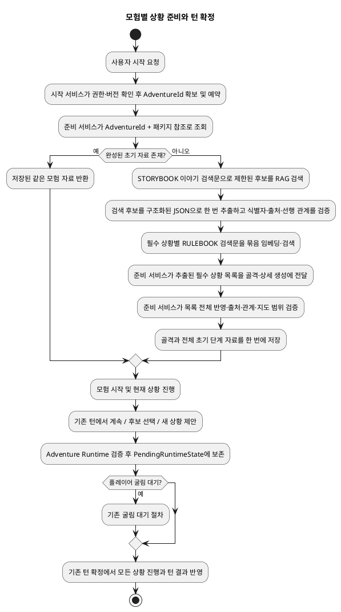

# Architecture Spec: 모험별 상황 준비와 턴 확정

## 1. Design Scope

### 1.1 Target

| 항목 | 대상 |
|---|---|
| Product Spec | [product-spec.md](product-spec.md) |
| Use Cases | UC-1 초기 필수 상황·중간 후보 준비, UC-2 후보 선택, UC-3 후보 부재 시 새 상황 생성 |
| Domain | 모험별 상황 준비 및 기존 모험 진행 |
| Bounded Contexts | Scenario Preparation 및 Adventure Runtime (`adventure-service` 내부 경계) |
| Existing Services | `adventure-service`, AI Game Master (`ai-game-master-service`), 기존 자료·지도·세션 서비스 |
| External Dependencies | 기존 AI Game Master 호출 경로, PostgreSQL, 기존 지도·원문 참조 |
| Affected Data | 모험별 초기 준비 자료, 모험 진행 상태, 확정 대기 턴 상태 |

### 1.2 Product Spec Mapping

#### RAG 기반 초기 상황 준비 계약

선택된 추가 STORYBOOK의 RAG 검색으로 제한된 상황 후보를 얻고, 이를 한 번의 구조화된 JSON 요청으로 필수 상황과 명시된 선행 관계로 추출한다. 검색 결과는 원문 전체를 대표한다고 간주하지 않으며, 원문 전체를 다시 넣거나 페이지 단위로 열거·검토하지 않는다. 소유자·모험·문서·추출 버전·위치 범위, 중복 후보, 발췌 길이, 출력 식별자·출처·선행 관계를 검증한다. 이 구조 검증은 RAG가 검색하지 못한 원문 상황의 누락을 찾아내거나 완전성을 증명하지 않는다. 추가 STORYBOOK 검색과 기본 RULEBOOK 규칙 검색은 분리한다. 기본 RULEBOOK 검색문은 상황별로 묶어 임베딩한 뒤 dense 검색하며, 각 상황은 최대 네 발췌를 사용하고 발췌당 1,200자까지만 전달한다. 필수 상황 요약은 500자 이내다. backbone과 상세 상황 생성에는 전체 컴파일 모델이나 원문 전체를 전달하지 않고, 최대 2,000자 시작 맥락, 검색에서 추출한 필수 상황, 상황별 기본 규칙 발췌와 허용된 출처 위치를 전달한다.

| Product Spec 항목 | Architecture 요소 |
|---|---|
| UC-1, R-01, R-02, R-03, R-07, R-09 | 준비 서비스가 제한된 STORYBOOK RAG 후보에서 추출한 필수 상황·선후 관계를 기준으로 모험별 초기 전체 상황 세트를 생성·검증·게시 |
| UC-2, R-01, R-03, R-04, R-06, R-08, R-09 | 기존 턴 서비스가 현재 상황과 확정 사건을 바탕으로 계속 진행 또는 후보 선택을 제안하고 검증 |
| UC-3, R-05, R-06, R-08, R-09 | 후보가 없으면 새 중간 상황 후보를 제안하고 기존 턴 확정에 포함 |
| R-01, R-06, R-07 | RAG 후보의 범위와 구조, 추출 목록 반영, 위치 출처, 선행 관계 및 모험에 제공된 지도만 도메인 검증에서 강제; 검색 누락의 완전성은 보장하지 않음 |
| R-08 | 기존 버전·권한·공개 범위·플레이어 굴림 대기 절차를 유지 |
| R-09, ST-05 | 초기 자료 및 플레이 상태에 AdventureId 소유 범위를 적용하고 모험 간 공유 금지 |
| ST-01, ST-02 | 응답 시간 및 저장량 수치 목표는 근거가 없어 미확정 |

## 2. Domain Flow

### 2.1 Event Storming Flow



### 2.2 Commands

| Command | Actor | Target | Input | Preconditions | Result |
|---|---|---|---|---|---|
| 초기 상황 준비 | 시작 응용 서비스 | Scenario Preparation | AdventureId, SessionId, 패키지 ID | 권한·세션 버전 확인, 모험 ID 예약, 선택 STORYBOOK의 제한된 RAG 검색과 구조 검증 성공 | 모든 필수 상황을 반영한 전체 초기 준비 결과 또는 기존 완성 결과 |
| 상황 진행 계획 | Runtime Turn 응용 서비스 | Adventure Runtime | 현재 상황, 모험별 후보·사용 상태, 확정 사건 | 활성 모험·턴 소유권 확인 | 계속, 후보 선택 또는 새 상황 제안 |
| 상황 진행 확정 | 기존 턴 확정 흐름 | Adventure | PendingRuntimeState와 턴 식별자 | 버전·굴림·소유권 검증 통과 | 상황 진행 및 나머지 턴 결과의 단일 확정 |

### 2.3 Domain Events

| Domain Event | Producer | Trigger | Payload | Consumers |
|---|---|---|---|---|
| 독립 초기 상황 준비 완료 | Scenario Preparation | 전체 초기 자료의 원자적 저장 성공 | 모험·패키지·개정 식별자 | 모험 시작 흐름 |
| 턴 상황 진행 확정 | Adventure | 기존 턴 확정 성공 | 모험·턴 버전 및 확정된 상황 진행 | 기존 런타임 읽기 경로 |

### 2.4 Policies

| Policy | Trigger Event | Decision | Emitted Command | Owner |
|---|---|---|---|---|
| 시작 준비 재사용 | 시작 요청 | 같은 모험·패키지·개정의 완성 자료가 있으면 재사용 | 없음 | Scenario Preparation |
| 다음 상황 결정 | 확정된 플레이 흐름 | 원문 선행 관계와 사용 상태에 따라 후보 선택, 후보 부재 시 생성 | 상황 진행 계획 | Adventure Runtime |
| 턴 확정 | 검증된 대기 상태 | 상황 선택·사용·추가와 턴 결과를 함께 확정 | 기존 턴 확정 | Adventure Runtime |

### 2.5 Read Models

| Read Model | Consumer | Source | Fields | Owner |
|---|---|---|---|---|
| 모험의 초기 상황 자료 | 시작·진행 서비스 | 준비 자료 저장소 | 모험 ID, 패키지·개정 참조, 골격, 전체 초기 상세 단계 | Scenario Preparation |
| 모험 상황 진행 상태 | Runtime Turn 및 프롬프트 구성 | `StoryRuntimeState` (모험의 이야기 진행 상태) | 초기 후보의 사용 여부, 필수 상황 진행, 플레이 중 추가 상황 | Adventure Runtime |

### 2.6 External Interactions

| External System | Trigger | Input | Output | Failure |
|---|---|---|---|---|
| RAG 후보·규칙 검색 API | 초기 준비 | 추가 STORYBOOK 제한 후보 검색; 기본 RULEBOOK의 필수 상황별 규칙 검색 | 문서·유형·추출 버전·소유 범위·위치 | 검색 범위 불일치와 조회 실패는 준비 실패; 검색 누락은 완전성을 증명하지 않음 |
| AI Game Master | RAG 후보의 필수 상황 추출·상세 생성 또는 턴 상황 계획 | STORYBOOK 제한 후보를 한 번 입력; RULEBOOK 검색문은 상황별 묶음 임베딩 후 별도 검색 | 추출 목록 또는 상황 후보 제안 | 검색·분류 실패는 준비 실패; 실패를 완성 결과로 취급하지 않음 |
| PostgreSQL | 자료 조회·게시 또는 턴 확정 | 모험 키·버전 조건의 저장 명령 | 저장 결과 | 기존 충돌·확정 복구 절차 적용 |

### 2.7 Hotspots

| Hotspot | Options | Decision |
|---|---|---|
| 같은 원문을 쓰는 모험의 초기 상황 공유 | 패키지 기준 공유 / 모험별 분리 | AdventureId 포함 키로 독립 생성·저장. 원문 패키지는 참조만 함 |
| 시작 전 생성 또는 시작 후 지연 생성 | 전체 초기 자료 선준비 / 다음 단계에서 생성 | 시작 완료 전에 모든 초기 필수 상황과 중간 후보의 핵심 요소를 준비 |
| RAG 검색 후보에만 의존 | 제한된 검색 후보를 구조화된 출력으로 추출하고 범위·관계 검증 | 검색되지 않은 원문 상황의 누락이나 모델 의미 판단 완전성은 증명하지 않음 |
| 단계 순서 의미 | 연속 진행 제약 / 자료 정리 순서 | StageBackbone.order는 준비 자료의 나열 순서다. 상황 진행은 원문에 명시된 선행 관계만 제약하며, 추출된 필수 상황 사이의 선행 상황은 같은 단계 또는 더 앞선 단계에 있어야 한다. 선택 상황과 무관한 단계에는 추가 순서를 강제하지 않는다 |
| 상황 전환 확정 | 별도 저장 / 기존 턴 확정에 포함 | 현재 상황 종료·다음 활성화·후보 사용 및 신규 상황을 같은 턴 확정에 포함 |

## 3. DDD Architecture

### 3.1 Bounded Contexts

| Bounded Context | Responsibility | Ubiquitous Language | Owned Model | Owned Data |
|---|---|---|---|---|
| Scenario Preparation | 모험별 초기 필수 상황과 중간 후보 생성·검증·게시 | 준비 상황, 근거 출처, 원문 선행 관계 | StageBackbone, DetailedStage, SituationDefinition | 모험 키가 포함된 초기 준비 자료 |
| Adventure Runtime | 모험 진행 중 후보 선택·추가, 턴 검증·확정 | 현재 상황, 상황 사용 상태, 확정 대기 턴 | StoryRuntimeState, PendingRuntimeState, Adventure | 모험별 플레이 진행 상태와 확정 턴 |

### 3.1.1 Boundary Decisions

| Capability | Owner Context | Candidate Boundary | Chosen Boundary | Why Not Weaker? | Why Not Stronger? |
|---|---|---|---|---|---|
| 초기 상황 준비 | Scenario Preparation | 내부 capability | 기존 준비 경계 확장 | 자료 생성·검증·저장 책임을 기존 준비 흐름에서 수행 | 별도 모듈·서비스는 독립 소유·수명·배포 요구가 없고 동기 협력과 같은 저장 일관성을 필요로 함 |
| 플레이 중 상황 진행 | Adventure Runtime | 내부 capability | 기존 모험 진행 경계 확장 | 턴 검증·굴림 대기·확정과 원자적으로 결합해야 함 | 별도 경계는 같은 모험 턴의 원자성을 분산시킴 |

새 bounded context, 코드 모듈, 배포 서비스는 추가하지 않는다. 이는 기존 Scenario Preparation과 Adventure Runtime 내부 책임의 확장이다.

### 3.2 Context Map

Scenario Preparation은 기존 Document Knowledge의 패키지·추출 개정 및 원문 위치를 참조하고 AI Game Master를 후보 생성자로 사용한다. Adventure Runtime은 Scenario Preparation이 게시한 모험별 자료를 읽고, AI Game Master의 진행 제안을 검증한다. 원문 및 지도 원본 상태는 기존 소유 경계에 남는다. 두 신규 capability 사이에 별도 배포 계약은 만들지 않는다.

| Upstream | Downstream | Relationship | Contract | Translation |
|---|---|---|---|---|
| Document Knowledge | Scenario Preparation | 자료 제공자 | 패키지·추출 개정·원문 위치 식별자 참조 | 기존 어댑터 |
| Scenario Preparation | Adventure Runtime | 준비 자료 제공 | 모험 소유 범위의 게시 자료 조회 | 기존 서비스 내부 계약 |
| AI Game Master | Scenario Preparation / Adventure Runtime | 제안 제공자 | 기존 포트의 검증 가능한 요청·응답 | 기존 어댑터 및 도메인 검증 |
| 기존 지도 소유 경계 | Scenario Preparation / Adventure Runtime | 제공 자료 참조 | 이 모험에 연결된 지도 ID 또는 지도 없음 | 범위 검증 |

### 3.3 Aggregates

| Aggregate | Root | Responsibility | Commands | Events | Invariants |
|---|---|---|---|---|---|
| 모험 진행 | `Adventure` | 기존 턴의 상황 진행과 결과를 함께 확정 | 기존 턴 확정 | 턴 상황 진행 확정 | 한 모험의 버전·턴 소유권 내에서 한 번에 확정; `StoryRuntimeState`는 이 Aggregate 내부 상태다 |
| 초기 자료 저장 트랜잭션 (Aggregate 아님) | 해당 없음 | 기존 준비 서비스와 저장소가 골격 및 전체 상세 단계를 함께 게시 | 초기 자료 저장 | 독립 초기 상황 준비 완료 | 전체 필수 초기 세트가 함께 보이고 패키지·개정·모험 키가 일치 |

### 3.4 Entities

| Entity | Aggregate | Identity | Responsibility | State |
|---|---|---|---|---|
| `SituationDefinition` | 초기 준비 자료 또는 `Adventure` 내부 이야기 진행 상태 | 모험 범위 내 상황 식별자 | 필수 여부·선행 관계·출처·핵심 요소·지도 참조 보유 | 게시된 초기 정의는 불변; 플레이 중 추가 정의는 해당 모험에만 저장 |
| `RequiredSituation` | 모험별 `StageBackbone` | `situationId` | RAG 후보에서 추출한 필수 상황 요약, 선행 상황 ID, 원문 위치 참조 | 식별자·관계·허용 위치가 구조적으로 유효 |
| `StageBackbone` | 초기 준비 자료 | 모험·패키지·개정 | 준비 단계와 추출된 `requiredSituations` 보유 | `order`는 준비 나열 순서; 목록은 모험별 JSON에 함께 저장 |
| `DetailedStage` | 초기 준비 자료 | 모험·패키지·개정·단계 | 단계 핵심 요소와 상황 목록 제공 | 초기 게시 시 전체 세트 확정 |

#### 3.4.1 Class Diagram

구조 및 주요 계약은 다음 다이어그램에 정의한다. 독립 `.puml` 원본, 로컬 SVG 렌더, 이 문서의 링크와 내용 일치 여부를 부모 검토에서 확인했다.

[상황 준비 클래스 다이어그램](diagrams/architecture/situations.class.svg)

### 3.5 Value Objects

| Value Object | Aggregate | Values | Validation | Behavior |
|---|---|---|---|---|
| 모험 식별자 (`AdventureId`) | 모험 진행·초기 자료 | 모험의 안정 식별자 | 시작 준비 전 예약, 재시도 시 같은 값 사용 | 소유 범위 구분 |
| 상황 선행 관계 | 초기·진행 상황 | 선행 상황 식별자 목록 | 존재하는 다른 ID만 허용, 자기 참조·순환 거부 | 실행 가능한 필수 상황 판별 |
| 출처 구분 | 상황 정의 | 원문 추출 또는 AI Game Master 보완 | 출처를 허위로 표시할 수 없음; 원문 항목은 위치 보존 | 원문과 보완 내용 분리 |
| 지도 참조 | 상황 정의 | 제공된 지도 ID 또는 지도 없음 | 현재 모험의 제공 범위만 허용 | 지도 없이 진행 가능 |

### 3.6 Domain Services

별도 도메인 서비스 승격은 없다. 기존 `StoryRuntimeRules`와 `StoryStageTransitionApplicationService`가 원문에 명시된 상황 선행 관계를 기준으로 진행 가능성을 판정한다. 준비 응용 서비스가 후보 검증 및 전체 게시 흐름을 조정한다.

### 3.7 Business Rule Ownership

| Business Rule | Owner | Enforcement Point |
|---|---|---|
| R-01 원문에 명시된 필수 상황과 선행 관계 보존 | Scenario Preparation 및 Adventure Runtime | RAG 후보 추출 목록·출처·선행 관계 검증과 다음 상황으로 진행할 수 있는지 검증 |
| R-02 초기 복수 후보, 고정 개수 없음 | Scenario Preparation | 초기 생성 요청·전체 결과 검증 |
| R-03 상세 대본 대신 핵심 요소 유지 | Scenario Preparation | 상황 정의 검증 |
| R-04 플레이 행동·확정 사건 기반 후보 선택 | Adventure Runtime | `StoryRuntimeRules` 및 계획 제안 검증 |
| R-05 적합 후보가 없을 때 새 상황 제안 | Adventure Runtime | 계획 결과 검증 및 해당 모험의 대기 상태 반영 |
| R-06 제공 지도만 사용 | 각 상황 제안 소유 경계 | 모험의 제공 지도 범위 검사 |
| R-07 근거 부족 보완과 출처 구분 | Scenario Preparation | 출처·원문 위치 검사 |
| R-08 기존 공개·버전·굴림 대기·확정 규칙 | Adventure Runtime | 기존 턴 검증·확정 절차 |
| R-09 모험 간 독립성 | 두 기존 경계 | 저장 키, 조회 범위, 상태 소유권에 AdventureId 포함 |

### 3.8 Aggregate State Transitions

| Current State | Command / Event | Next State | Owner | Preconditions | Emitted Event |
|---|---|---|---|---|---|
| 준비 없음, 모험 ID 예약됨 | 초기 준비 | 전체 초기 자료 게시 | Scenario Preparation | 원문·상황·참조 검증 성공 | 독립 초기 상황 준비 완료 |
| 준비 자료 존재 | 같은 준비 요청 | 준비 자료 반환 | Scenario Preparation | AdventureId·패키지·개정 일치 | 없음 |
| 현재 상황 진행 | 계속 진행 | 현재 상황 유지 | Adventure Runtime | 기존 확정 사건 검증 | 기존 턴 확정 |
| 현재 상황 진행 | 후보 선택 또는 신규 상황 제안 | 검증된 대기 턴 | Adventure Runtime | 모험 소유·선행·지도·공개 범위 검증 | 아직 없음 |
| 플레이어 굴림 대기 | 굴림 제출·기존 턴 재개 | 확정 가능 또는 대기 유지 | Adventure Runtime | 기존 굴림 검증 통과 | 아직 없음 |
| 검증된 대기 턴 | 기존 턴 확정 | 종료 상황·다음 활성 상황·사용 상태 동시 반영 | `Adventure` | 버전 및 모든 기존 턴 검증 통과 | 턴 상황 진행 확정 |

### 3.8.1 State Diagram

이 다이어그램은 기존 턴 확정 내부의 설계 상태를 표현한다. Product Spec의 업무 상태 다이어그램을 대체하지 않는다. 독립 `.puml` 원본, 로컬 SVG 렌더, 이 문서의 링크와 내용 일치 여부를 부모 검토에서 확인했다.

[상황 턴 확정 상태 다이어그램](diagrams/architecture/turn-commit.state.svg)

### 3.9 Repository Boundaries

| Repository | Aggregate | Operations | Consistency Boundary |
|---|---|---|---|
| `StageArtifactRepository` | 신규 모험별 초기 준비 테이블 | AdventureId·패키지 출처 참조·개정 기준 조회, 초기 골격과 모든 상세 단계 일괄 저장 | 하나의 모험 준비 개정의 전체 초기 자료 게시 |
| `PostgresAdventureRepository` | `Adventure` 및 이야기 진행 상태 | 신규 JSON 저장·복원 | 기존 모험 버전 및 확정 상태 |
| `PostgresRuntimeTurnRepository` | 대기 턴 | 신규 JSON 저장·복원 | PendingRuntimeState와 기존 턴 식별자 |

## 4. Program Design

### 4.1 Program Structure

기존 시작 경로 → 준비 응용 서비스 → 생성 포트·저장소를 확장한다. 기존 턴 경로 → `RuntimeTurnApplicationService` → AI Game Master 제안 → `StoryRuntimeRules` 검증 → `PendingRuntimeState` → 기존 `Adventure.commitRuntimeTurn` 확정 흐름을 확장한다. 실제 AI 제공자 연결기는 기존 서비스 통합 경로에 연결한다. 원문 출처 참조(`ScenarioSourceReference`: 원문 위치를 가리키는 기존 식별자)의 ID·페이지 목록만으로 스토리를 추측하지 않는다. 기존 Document Knowledge(문서 근거 관리 경계) 및 준비 근거 조회로 원문 발췌와 핵심 스토리 모델을 함께 찾아 생성 입력으로 전달하고, 세션에 선택된 자료 범위를 유지한다.

### 4.2 Major Components and Responsibilities

| Component | Responsibility | Input | Output | Dependencies | Must Not Do |
|---|---|---|---|---|---|
| `AdventureSessionApplicationService` | 세션 시작 준비 경로에 모험 소유 식별자 전달 | 세션·패키지 | 준비 결과 | 준비 포트 | 모험 간 자료 공유 |
| `AdventureStartApplicationService` | 실제 시작 경로에서 예약된 모험 ID로 준비 완료 확인 | 세션·모험 식별자 | 시작 입력 | 준비 포트 | 초기 자료 준비를 시작 후로 지연 |
| `StageArtifactPreparationApplicationService` | 초기 전체 자료 조회·생성·검증·게시 | 모험·세션·패키지 ID | 전체 준비 결과 | 생성 포트·저장소·기존 지도 연결 | 외부 생성 중 DB 트랜잭션 유지 |
| 기존 생성 포트 및 실제 GM 어댑터 | 세션에 선택된 GM 실행 설정으로 여러 상황 제안 | 확장 Request | 검증 전 생성 결과 | 실제 AI Provider | 후보를 검증 없이 게시 |
| `StoryRuntimeRules` 및 `StoryStageTransitionApplicationService` | 계속·선택·생성 제안과 단계 전환의 진행 가능성 확인 | 준비 후보·사용 상태·확정 사건·원문 선행 관계 | 검증 결과 | 모험 진행 상태 | 숫자 순서의 다음 단계로 원문 선행 관계를 대신함 |
| `RuntimeTurnApplicationService` | 제안을 대기 상태로 보존하고 기존 턴 절차 실행 | 플레이 행동·기존 상태 | 대기 상태 또는 확정 결과 | 프롬프트·응답 변환·턴 저장소 | 별도 조기 상황 저장 |
| `Adventure` | 기존 확정 경계에서 모든 턴·상황 결과 반영 | 검증된 대기 상태 | 확정 상태 | 기존 저장소 | 턴 일부만 확정 |

### 4.3 Application Flow

초기 준비는 모험 ID 예약을 먼저 영속화하고, 기존 완성 자료를 조회한다. 없으면 DB 트랜잭션 밖에서 AI 결과를 만들고 검증한 뒤 짧은 저장 트랜잭션으로 골격과 전체 상세 단계 목록을 함께 게시한다. 저장 경쟁에서 다른 요청이 먼저 완성했다면 같은 모험의 완성 자료를 반환한다.

각 턴은 현재 상황과 해당 모험의 후보·사용 상태·확정 사건을 GM 제안 입력에 포함한다. 제안은 기존 도메인 규칙과 소유 범위로 검증한다. 현재 상황을 유지할 수도 있고, 후보를 선택하거나 신규 중간 상황을 제안할 수 있다. 검증 결과는 확정 대기 상태에 담으며 플레이어 굴림이 필요하면 기존 대기 절차를 따른다. `Adventure.commitRuntimeTurn`이 기존 시그니처를 유지한 채 대기 상태의 모험별 상황 진행까지 원자적으로 반영한다.

### 4.4 Component Call Contracts

| Order | Caller | Callee | Operation | Input | Output | Failure |
|---:|---|---|---|---|---|---|
| 1 | 시작 서비스 2곳 | 준비 응용 서비스 | `prepare(AdventureId, SessionId, UUID)` | 안정된 모험·세션·패키지 ID | Result(전체 DetailedStage 목록 포함) | 기존 준비 오류 및 복구 |
| 2 | 준비 응용 서비스 | `StageBackboneGenerationPort` | 기존 `generate(Request request)` | 모험·세션 ID 및 세션의 GM 실행 설정 | 골격 제안 | 기존 AI 요청 정책 |
| 3 | 준비 응용 서비스 | `StageDetailedGenerationPort` | 기존 `generate(Request request)` | 모험·세션 ID, 원문 발췌·핵심 스토리 모델 및 생성 범위 | 전체 상세 단계 제안 | 기존 AI 요청 정책 |
| 4 | 준비 응용 서비스 | `StageArtifactRepository` | `findBackbone(AdventureId, UUID, long)` / `findDetailedStage(AdventureId, UUID, String, long, long)` | 모험·패키지·개정·단계 범위 | Optional 자료 | 조회 실패·충돌 |
| 5 | 준비 응용 서비스 | `StageArtifactRepository` | `saveInitialArtifacts(AdventureId, StageBackbone, List<DetailedStage>)` | 완전 검증된 전체 자료 | 저장 완료 | 원자적 저장 실패 |
| 6 | Runtime Turn 응용 서비스 | 기존 계획·AI·규칙 경계 | 기존 요청·응답 확장 | 현재 상황·모험 후보 사용 상태·확정 사건 | 계속/선택/생성 제안 | 기존 턴 실패 변환 |
| 7 | 턴 응용 서비스 | `Adventure` | 기존 확정 흐름 및 `commitRuntimeTurn` | 확정 대기 상태 | 전체 턴 확정 | 기존 버전 충돌·복구 |

### 4.5 Major Types

| Type | Kind | Responsibility | State | Dependencies |
|---|---|---|---|---|
| `StageBackbone` | 도메인 자료 | 단계 목록 및 준비 순서 보유 | 불변 게시 자료 | 상황 정의 참조 |
| `DetailedStage` | 도메인 자료 | 단계 핵심 요소·상황 목록 보유 | 불변 게시 자료 | 원문·지도 참조 |
| `SituationDefinition` | 도메인 자료 | 필수 여부·선행 관계·출처·핵심 요소·지도 참조 표현 | 초기 자료 또는 모험 전용 신규 자료 | 단계·근거 식별자 |
| `StoryRuntimeState` | 모험 진행 상태 | 후보 사용 및 필수 상황 진행 추적 | 모험별 | 초기 상황 ID |
| `PendingRuntimeState` | 확정 대기 상태 | 이번 턴의 상황 전환·사용 상태·신규 상황 보존 | 턴별 | 기존 버전·결과 |
| 준비 `Result` | 응용 결과 | 준비된 전체 DetailedStage 목록과 기존 시작 입력 제공 | 일시적 | 저장 자료 |

### 4.6 Type Design

#### SituationDefinition

| 항목 | 정의 |
|---|---|
| Kind | 기존 도메인 자료 확장 |
| Responsibility | 준비 또는 플레이 중인 상황의 작은 단위 정보와 출처를 표현 |
| Dependencies | 기존 단계 및 핵심 요소, 원문 위치, 제공 지도 참조 |
| Must Not Depend On | 다른 모험의 자료나 공용 패키지 상황 저장 |

##### State

| Field | Type | Meaning | Constraint |
|---|---|---|---|
| 필수 여부 | Boolean 또는 기존 형식 | 원문 줄거리 유지에 필수인지 구분 | 원문 밖 사건을 추출로 표시하지 않음 |
| 선행 상황 | 상황 ID 목록 | 원문에 명시된 선행 관계 | 미존재·자기 참조·순환 거부; 빈 목록에 임의 관계 추가 금지 |
| 출처 구분 | 원문 추출 / GM 보완 | 근거가 확인된 내용과 보완 내용 구분 | 원문 추출은 원문 위치 보존 |
| 제공 지도 | 지도 ID 또는 없음 | 해당 모험에서 쓸 수 있는 지도 연결 | 다른 모험 지도 상태 참조 금지 |
| 핵심 요소 | 기존 상황 의도·정보·압박·다음 진행 조건·중요 결과 참조 | 상황을 구체화할 재료 | 전 항목을 모든 상황에 강제하지 않고 상세 대본화하지 않음 |

##### Behavior

| Method | Input | Output | Responsibility | State Change |
|---|---|---|---|---|
| 기존 검증 동작 확장 | 제안·모험의 자료 범위 | 통과 또는 기존 검증 오류 | 출처·선행 관계·맵·모험 참조 검증 | 게시 후 초기 자료 불변 |

##### Invariants

| Invariant | Enforcement Point |
|---|---|
| 초기 자료와 신규 상황은 모험별 소유 | 저장소 키와 요청 범위 검증 |
| 게시 초기 정의는 변경 불가 | 준비 저장 경계 |
| 턴 미확정 상황 제안은 확정 상태가 아님 | PendingRuntimeState 및 기존 확정 메서드 |

### 4.7 Interfaces and Function Signatures

기존 호출 경계를 유지하고 Request 및 Result의 내용만 확장한다. 초기 상황 생성 Request에는 필수 `JsonNode outputSchema`가 포함되며, JSON 객체 스키마와 `properties`, `required`, `additionalProperties: false`를 요구한다. `HttpInitialSituationGmPort`는 이를 AI Game Master 요청으로 전달하고, `TypedAgentContractController`와 `GmCompletionAdapter`·`GmCompletionRouter`를 거쳐 `AiExecutionRequest.outputSchema` 및 Codex 실행 요청의 출력 스키마에 연결한다. 이 경로의 출력 형식은 `JSON`이다. 기존 Provider 요청 정책과 업무 검증은 유지한다. `AdventureId`는 모험 식별자, `SessionId`는 세션 식별자, `StageBackbone`은 모험 진행 골격, `DetailedStage`는 준비된 단계의 핵심 요소와 상황 목록, `SituationDefinition`은 준비된 상황 정의다.

상황 자료형은 `RequiredSituation(situationId, summary, prerequisiteSituationIds, sourceRefs)`이며 `StageBackbone.requiredSituations`로 해당 모험 골격에 저장하고 상세 단계 생성에 전달한다. `StorybookEvidenceLookupPort.lookupForPreparation`은 선택된 STORYBOOK RAG 검색에서 나온 위치 참조와 제한된 `Passage(sourceRef, text)`를 한 번에 준비 서비스로 전달한다. 준비 서비스는 그 참조를 근거 허용 범위로 사용하고 같은 발췌를 `StageBackboneGenerationPort.Request`에 담아 상황 추출로 전달한다. 다음 단계 준비는 저장된 골격의 참조를 재사용하며 STORYBOOK RAG를 다시 조회하지 않는다. 응답의 소유·모험·문서·버전·위치 범위와 중복을 확인하고 발췌 길이를 제한한다. 검색되지 않은 상황의 누락은 검증하지 않는다.

어댑터는 제한된 RAG 후보를 한 번의 구조화된 JSON 요청으로 필수 상황과 명시적 선행 관계로 추출하고, 중복 식별자·허용되지 않은 출처·존재하지 않는 선행 식별자·순환을 검증한다. 검색 누락에 대한 완전성 주장은 하지 않는다. 세 초기 상황 응답(상황 추출, 진행 골격 생성, 상세 단계 생성)은 각각 명시적 JSON Schema를 받아 JSON으로 요청한다. 모든 JSON 객체는 허용 필드를 나열하고 그 필드 전체를 required로 지정하며 `additionalProperties: false`를 적용한다. 일반 문자열 필드는 빈 문자열을 허용하지 않고, 문자열 또는 null인 값은 null을 허용하되 문자열일 때는 비어 있지 않아야 한다. 비공개 생성 응답의 모든 원문 근거 위치는 해당 호출에 번호를 붙여 제공한 정본 허용 참조 목록을 `sourceRefIndexes` 정수 배열로 가리킨다. 이 계약은 상황 추출, 진행 골격의 최상위·단계별 근거, 상세 단계의 최상위·폭로·위협·압박·흐름·상황 근거에 적용한다. 각 인덱스는 정수이며 0 이상이고 해당 호출의 허용 목록 범위 안이어야 한다. 허용 목록이 비어 있으면 배열도 비어 있어야 하며, 비어 있지 않은 목록에 대한 배열 길이 제한은 추가하지 않고 중복 인덱스도 허용한다. 애플리케이션은 기존 자료 객체를 만들기 전에 인덱스를 정본 참조로 바꾸고, 기존 원문 근거·출처 구분·범위 검증을 계속 적용한다. 응답에서 직접 `sourceRefs` 객체를 받지 않는다. 상황 추출 응답은 `requiredSituations` 배열을 요구하고, 각 항목은 `situationId`, `summary`, `prerequisiteSituationIds`, `sourceRefIndexes`를 포함한다. 허용 참조가 있을 때 `sourceRefIndexes`는 하나 이상이어야 한다. 진행 골격은 하나 이상의 단계와 최상위 `sourceRefIndexes`를 요구하며 단계마다 `stageId`, `order`, `role`, `coreProblem`, `funnelSummary`, `sourceRefIndexes`가 필요하다. 상세 단계 스키마는 상세 DTO의 전체 필드를 기술하며 각 상황의 `intents`는 하나 이상이어야 한다. 또한 `revelationIds`, `pressureIds`, `funnelIds`, `funnelPredicateIds`, `importantConsequenceIds` 중 적어도 하나는 비어 있지 않아야 한다. 이 다섯 배열은 각각 비어 있을 수 있고, `intents`와 특정 배열의 의미상 종류를 맞추는 별도 조건은 없다. 이 전체 조건은 다섯 strict 객체 분기를 둔 중첩 `anyOf` 스키마로 표현한다. 비공개 상세 응답은 새 식별자를 임의 문자열로 만들지 않고 같은 응답의 기준 목록을 가리키는 정수 인덱스로 연결한다. `funnel.requiredRevelationIndexes`와 상황별 `revelationIndexes`는 `revelations[].revelationId`를, 상황별 `pressureIndexes`와 `funnelIndexes`는 각각 `pressure.pressureId`와 `funnel.funnelId`를, 상황별 `funnelPredicateIndexes`는 `funnel.requiredPredicateIds`를, 상황별 `importantConsequenceIndexes`는 최상위 `importantConsequenceIds`를 가리킨다. 각 값은 0부터 시작하는 정수 인덱스이며 기준 목록 범위 안이어야 한다. `pressureIndexes`와 `funnelIndexes`는 각각 단일 압박·흐름 대상 목록을 가리켜 값이 있으면 0만 허용하고 배열은 비어 있을 수 있다. 그 밖의 동적 대상 인덱스는 임의의 배열 길이 상한을 두지 않고 서버가 정본 목록 범위를 검증한다. 범위 오류 진단에는 고정된 응답 필드 경로와 허용 대상 수만 포함하며 반환된 인덱스 값, 대상 식별자, 원문이나 이야기 문장은 기록하지 않는다. 서버가 기준 ID로 바꿔 기존 상세 단계 객체를 만들며 잘못된 유형·범위나 기준 ID는 거부한다. 저장·외부 상세 DTO의 기존 ID 필드는 그대로 유지되고, 별도 생성 재시도는 추가하지 않는다. `mapDefinitionId`는 필수 문자열 또는 null이며, 비 null 문자열은 해당 모험에 제공된 지도 UUID 중 하나로 제한한다. 제공 지도가 없으면 null만 허용한다. 기존 지도 소속 검증과 저장·외부 자료 계약은 유지한다. 선택적인 재료·참조 배열은 빈 배열을 허용하고, 지도 식별자 null 허용은 유지한다. Structured Outputs가 중첩 `anyOf`를 지원하는 범위 안에서 각 분기는 객체 필드와 추가 속성 금지를 명시한다. 추출 목록을 골격 및 각 상세 단계 생성에 전달하고 목록의 최종 반영 여부를 검증한다. 원문 전체나 별도 대조 요청은 사용하지 않는다. 상세 단계 요청은 단계 순서대로 진행하며 각 요청에 앞선 응답에서 이미 배정된 필수 상황 ID를 `alreadyAssignedRequiredSituationIds`로 함께 전달한다. 생성기는 해당 ID를 다시 출력하지 않고, 남은 필수 상황은 추출 목록의 정확한 ID와 자료를 보존해 한 번씩 배정한다. 마지막에는 추출 목록의 전체 반영 및 전역 고유성 검증을 그대로 적용한다. 스키마는 응답 형태를 제한하며 원문·지도·상황 관계의 의미 검증을 대체하지 않는다. 검색 후보에서 추출한 목록이 원문의 모든 필수 상황을 빠짐없이 찾았다고 보장하지 않는다. 추출 목록의 각 필수 상황 ID에는 정확히 연결되는 최종 필수 `SituationDefinition`이 있어야 하며 해당 필수 상황의 `SOURCE_EXTRACTED` 출처 위치 집합은 목록의 sourceRefs와 정확히 같아야 하고 `prerequisiteSituationIds`도 일치해야 한다. 추가·누락 인용 위치는 허용하지 않는다. 추출된 필수 상황 간 선행 관계는 선행 상황이 의존 상황과 같은 단계 또는 더 앞선 단계에 배치되어야 한다. 더 뒤 단계의 선행 상황은 허용하지 않으며, 같은 단계의 관계는 허용한다. 이 단계 순서 검사는 추출된 필수 상황 간 관계에만 적용하고 선택·보완 상황이나 무관한 단계의 순서는 제한하지 않는다. 식별자와 관계는 변경하지 않고 단계를 자동 재정렬하지 않는다. 중간 상황 후보와 GM 보완 상황은 이 대응 검사 대상이 아니며 기존 출처 구분 규칙을 따른다. 복원된 자료도 검증하며, 불일치 또는 원문 범위 실패에서는 게시하지 않는다.

```java
StageArtifactPreparationApplicationService.Result prepare(
    AdventureId adventureId, SessionId sessionId, UUID scenarioPackageId);
Optional<StageBackbone> findBackbone(
    AdventureId adventureId, UUID scenarioPackageId, long revision);
Optional<DetailedStage> findDetailedStage(
    AdventureId adventureId, UUID scenarioPackageId, String stageId,
    long backboneRevision, long revision);
void saveInitialArtifacts(
    AdventureId adventureId, StageBackbone backbone,
    List<DetailedStage> detailedStages);
```

준비 결과에는 전체 상세 단계 목록을 포함하고 기존 `currentStage`와 `openingSituation` 시작 입력을 유지한다. 기존 `StageBackboneGenerationPort` 및 `StageDetailedGenerationPort`의 `generate(Request request)` 경계는 유지하며, 요청에 모험·세션 식별자와 세션에 선택된 GM 실행 설정을 전달한다. `Adventure.commitRuntimeTurn` 시그니처도 유지하고 확정 대기 상태의 모험별 상황 진행을 함께 반영한다.

| 항목 | 정의 |
|---|---|
| Responsibility | 기존 시작·저장·턴 경계에서 모험별 자료를 준비·확정 |
| Caller | 두 시작 경로, Runtime Turn 응용 서비스 |
| Implementer | 기존 준비 서비스·저장소 및 Adventure |
| Preconditions | 모험 식별자 예약·세션 권한·패키지 범위 확인 |
| Postconditions | 초기 자료 전체 게시 또는 턴 전체 확정 |
| Errors | 기존 검증·Provider·저장 충돌·확정 오류 체계 |
| Side Effects | 모험별 초기 자료 저장 또는 기존 턴 확정 |
| Idempotency | 같은 모험 준비 재시도는 저장 자료 재사용; 같은 턴 중복 확정은 기존 결과 반환 |

#### 턴 근거 조회 계약

턴 시작 시 `RuntimeTurnApplicationService`는 현재 준비된 상황을 먼저 선택하고, 선택 결과와 관련 장기 모험 기록, 현재 상태, 플레이 중 추가 사실 및 이미 확정된 고정 문서 근거 식별자를 `RuntimeFactLookupService`에 전달한다. 조회 호출은 플레이어 행동마다 별도의 문맥에서 한 번 수행하며, 전체 대화 기록은 전달하지 않는다. 이미 확정된 사실만으로 조회 질문에 답할 수 있으면 기존 단축 경로를 유지한다.

조회 담당 AI의 한 번의 요청은 근거 검색과 답변을 함께 수행한다. 근거 검색은 허용된 STORYBOOK과 RULEBOOK을 한 검색 요청의 dense 임베딩 경로로 조회하며 BM25, 별도 재정렬, 근거 충분성 판정 요청을 추가하지 않는다. 검색 결과는 출처별 상위 5개 이내로 제한하고, 현재 모험의 선택된 자료 범위·문서·추출 버전·위치가 서버의 허용 범위와 일치하는지 검증한다. 이미 전달된 `IMMUTABLE_DOCUMENT:<출처>:<문서 ID>:<추출 버전>:<위치>` 식별자는 검색 제외 목록으로 전달한다. 이 제외는 확정 턴의 근거 묶음에서 재구성한다. 저장 생명주기에서 `COMMITTED`와 `PRESENTED`는 확정으로 취급하며, `PRESENTED`는 플레이어에게 결과를 전달한 확정 경계다. 미확정 생명주기의 근거는 제외 목록에 넣지 않는다. 변할 수 있는 게임 상태·추가 사실·상황에는 적용하지 않는다.

| Contract | Boundary | Required Input | Required Output / Validation |
|---|---|---|---|
| `scenario-lookup-request.json` | `POST /internal/gm/scenario-lookup` | 행동, 게임 상태, 추가 사실, 현재·선택된 준비 상황, 관련 장기 모험 기록, 잠긴 시나리오 모델, 제외할 고정 문서 근거 식별자 | 정의되지 않은 필드 거부; 대화 전체 제외 |
| `evidence-candidate-search-request.json` | 근거 검색 내부 요청 | 한 번의 혼합 출처 dense 검색 범위와 제외 식별자 | 출처·자료 범위 검증; BM25 실행 안 함 |
| `scenario-lookup-response.json` | 조회 담당 AI 응답 | 해당 요청의 허용 근거 자료 | `status`, `answer`, `supportingElementIds`만 허용; 상태별 필수 값과 고유 식별자 검증 |
| `runtime-turn-request.json` / `runtime-turn-response.json` | 턴 진행 AI 경계 | 전체 턴 진행 문맥과 조회 결과 | 고정 JSON Schema 적용; 도구 요청과 확정 결과를 오케스트레이터가 순서대로 검증·처리 |

OpenAI 응답의 입력 토큰 및 캐시된 입력 토큰 사용량은 제공자가 반환한 경우에만 관측한다. 토큰 캐시 절감을 가정하지 않으며 캐시를 채우기 위한 입력 확장은 하지 않는다.

### 4.8 Error Propagation

원문 조회 실패, 문서 식별·유형·추출 버전·색인 상태 불일치, 경고 또는 위치 구간의 누락·불완전성, 빈 원문은 준비 실패다. 추출 본문이나 검색 발췌로 대신 완료 처리하지 않는다. 정상적인 원문 근거 부족만 GM 보완으로 허용한다. 추출 목록 또는 최종 상황 세트의 누락·무근거 추가·원문과 맞지 않는 선행 관계는 검증 오류로 전체 게시를 거부한다.

| Failure Point | Source Error | Converted Error | Handler | Result |
|---|---|---|---|---|
| AI 생성 | Provider 실패 또는 형식 오류 | 기존 AI·검증 오류 | 기존 요청 정책 | 시작 미완료 또는 턴 대기 제안 유지 |
| 초기 상황 AI 요청 | 스키마 누락 또는 strict object 조건 위반 | 기존 요청 검증 오류 | 초기 상황 포트·내부 요청 경계 | AI 요청 전 거부 |
| 준비 검증 | 잘못된 참조·출처·선행 관계 | 기존 준비 검증 오류 | 준비 서비스 | 게시 없음 |
| 초기 저장 | 동일 모험 버전 경합 | 기존 충돌 결과 | 저장소·준비 서비스 | 승자 결과 재조회 또는 버전 충돌 |
| 턴 대기/확정 | 굴림 미제출·버전 충돌·저장 실패 | 기존 턴 오류 | 기존 턴 재개·복구 | 상황 사용·추가가 미확정으로 보존 |

### 4.9 State Transition Implementation

| State Transition | Domain Owner | Method | Persistence Point | Published Event |
|---|---|---|---|---|
| 준비 없음 → 전체 준비 게시 | Scenario Preparation | `saveInitialArtifacts` | 하나의 초기 자료 저장 트랜잭션 | 준비 완료 결과 |
| 현재 상황 → 검증된 다음 상황 대기 | Adventure Runtime | 기존 계획·검증 흐름 | `PendingRuntimeState` 저장 | 없음 |
| 대기 상황 → 확정 진행 | `Adventure` | `commitRuntimeTurn` 기존 시그니처 | 기존 턴 확정 저장 | 턴 확정 결과 |

### 4.10 Dependency Rules

#### Allowed Dependencies

| Source | Target | Contract |
|---|---|---|
| 시작 응용 서비스 | 준비 응용 포트 | 모험 식별자를 포함한 기존 시작 경로 |
| 준비 응용 서비스 | 생성 포트·준비 저장소 | 요청·결과 및 모험 키 계약 |
| Runtime Turn | GM 제안·`StoryRuntimeRules` | 기존 턴 계획과 검증 경계 |
| Runtime Turn | `PendingRuntimeState`·`Adventure` | 기존 대기 및 확정 흐름 |

#### Forbidden Dependencies

| Source | Forbidden Target |
|---|---|
| 한 모험의 준비·런타임 상태 | 다른 모험의 준비 자료·진행 상태 |
| 초기 게시 자료 | 플레이 중 생성 상황에 의한 변경 |
| AI Game Master 제안 | 직접적인 정본 저장·상태 확정 |
| 단계 순서 처리 | 원문에 없는 상황 선행 제약 생성 |

## 5. Technical Architecture

### 5.1 Boundary Mapping

| Bounded Context | Internal Capability | Code Boundary | Deployment Unit | Boundary Rationale |
|---|---|---|---|---|
| Scenario Preparation | 모험별 초기 상황 준비 | 기존 `adventure-service` 패키지 경계 | 기존 서비스 | 같은 준비·자료 저장 책임 |
| Adventure Runtime | 후보 선택·생성·턴 확정 | 기존 `adventure-service` 패키지 경계 | 기존 서비스 | 기존 모험 턴 일관성 경계 |

### 5.2 Boundary Promotion Decisions

별도 컨텍스트·모듈·서비스를 만들지 않는다. 가장 약한 경계인 기존 capability 확장으로 요구 일관성을 만족한다. 준비와 런타임은 기존 구분을 유지하되 초기 자료 게시 및 턴 확정 소유권을 각각 지킨다. 더 강한 경계는 독립 수명·확장·배포 요구 없이 동기 호출과 원자성 비용만 더한다.

### 5.3 System Interaction Flow

두 시작 진입점 모두 모험 ID 예약·복원 후 준비 서비스에 전달한다. 준비 서비스는 추가 STORYBOOK에서 제한된 RAG 후보를 검색하고, 검색 결과 범위와 JSON으로 추출한 상황 관계를 검증한다. 필수 상황별 기본 RULEBOOK 검색문은 한 묶음으로 임베딩한 뒤 별도 dense 검색하며 STORYBOOK 결과와 범위를 섞지 않는다. 최종 생성 결과를 검증한 뒤 DB에 원자적으로 게시한다. 검색·추출·검증 실패는 시작을 막는다. RAG에서 검색되지 않은 원문 상황의 누락은 증명할 수 없다. 기존 시작 응답을 유지한다. 런타임에서는 활성 준비 상황 선택 후 별도 조회 담당 AI가 한 번의 혼합 출처 dense 검색으로 근거를 확인하고, 그 결과를 턴 진행 AI가 받는다. 상태 확정과 도구 실행 순서는 오케스트레이터가 유지한다. 새 공개 API는 없다.

### 5.4 Synchronous Communication

기존 응용 서비스 내부 호출 및 AI 요청의 동기 흐름을 사용한다. 기존 생성 제한·분류·재시도 정책을 따른다. AI 요청 동안 DB 트랜잭션을 유지하지 않는다. 새 비동기 메시지 계약은 추가하지 않는다.

### 5.5 API Contracts

#### 기존 시작 API

요청·응답 계약은 유지한다. 실제 시작 전에 내부 준비 호출이 완성되어야 한다. 기존 시작 응답에서 전체 시나리오 계획을 공개하지 않는다. 제공된 맵이 없다는 이유로 준비 또는 시작을 막지 않는다.

#### Errors

권한·버전·검증·Provider·저장 충돌은 기존 API 오류 변환 및 시작 실패 처리를 따른다. 준비 실패를 성공 상태로 가장하지 않는다.

#### Properties

모험별 소유 키는 내부 계약 및 저장 식별자다. 공개 화면·새 편집 API는 범위 밖이다.

### 5.6 Asynchronous Communication

새 비동기 통신은 없다. AI Provider가 기존 호출 경계를 사용한다.

### 5.7 Message Contracts

해당 없음 — 티켓은 새 메시지·이벤트 버스 계약을 요구하지 않는다.

### 5.8 Data Ownership

초기 정의와 그 준비 개정은 모험별 준비 자료가 소유한다. 각 조회·기본 키·유일성에 AdventureId를 포함한다. `StageBackbone.requiredSituations`에는 RAG 색인 상황 추출를 거친 필수 상황 목록이 기존 모험 소유 JSON으로 저장된다. 별도 공용 목록이나 전역 ScenarioModel 변경은 없다. 패키지·추출 개정은 원문 출처 참조로만 사용한다. 게시한 초기 정의는 불변이다. `StoryRuntimeState`는 초기 후보 사용 여부·필수 상황 진행·신규 상황을 해당 모험 범위에서 소유한다. 지도 원본, 원문, 캐릭터 등은 기존 소유자가 관리한다.

### 5.9 Schema Changes

기존 V68과 패키지 식별자만 포함한 기본 키를 가진 기존 테이블은 수정하지 않는다. 새 마이그레이션에서 모험별 초기 골격 테이블과 상세 단계 테이블을 추가하고, 기존 `PostgresStageArtifactRepository`와 준비 adapter가 신규 테이블을 사용하게 한다. 기존 행은 그대로 둔다. 기존 행을 새 테이블로 매핑·복사하거나 기존 자료 조회를 신규 모험 경로와 호환시키지 않는다.

| 신규 테이블 자료 | 기본 키 | 참조·제약 |
|---|---|---|
| 모험별 골격 | (모험 ID, 골격 개정) | 패키지 ID를 출처 참조 컬럼으로 보유하고 요청의 패키지 범위와 검증 |
| 모험별 상세 단계 | (모험 ID, 골격 개정, 단계 ID, 상세 개정) | 패키지 ID 출처 참조 보유; 같은 모험 ID와 골격 개정을 포함하는 골격 복합 외래 키 및 패키지 범위 검증 |

신규 JSON은 `PostgresAdventureRepository`와 `PostgresRuntimeTurnRepository`에서 저장·복원한다. 이전 JSON을 위한 변환 생성자·호환 어댑터는 추가하지 않는다. 자료 삭제 또는 기존 모험 일괄 재생성은 금지한다.

### 5.10 Consistency Model

초기 자료는 모험별 준비 개정에 대해 RAG 후보에서 추출한 `StageBackbone.requiredSituations`와 골격·전체 상세 단계가 단일 트랜잭션으로 게시된다. 골격 JSON의 추출 목록은 기존 모험 소유 범위에 저장되고 준비 재시도·복원 시 다시 검증된다. 턴 상태는 기존 모험 버전과 확정 경계를 따른다. 플레이어 굴림 대기 중에는 현재 상황·사용 상태·새 상황을 정본에 반영하지 않는다. 턴 확정에서 상황 진행과 기존 게임 결과를 함께 저장한다.

### 5.11 Infrastructure Dependencies

기존 PostgreSQL 및 마이그레이션 체계, 기존 AI Provider 설정, 기존 서비스 간 지도·원문 ID 참조를 사용한다. 신규 인프라나 배포 서비스는 없다.

### 5.12 External Dependency Isolation

AI 생성 포트와 adapter를 유지한다. 응답 형식·참조 ID·모험 범위 검증은 기존 서비스 경계에서 수행한다. 실제 빈 연결 경로가 복수 상황 생성을 호출하도록 구성한다. Provider 실패를 근거 부족 보완으로 바꾸지 않는다.

### 5.13 File and Module Structure

#### Existing Structure

MAT-01에서 확인한 기존 구조는 시작 준비 경로, 상황 준비 포트·서비스·저장소, StoryRuntimeState, PendingRuntimeState, Adventure, Runtime Turn 서비스, PostgreSQL 저장소 및 API 설정이다. 원문 미리보기 조회 포트와 HTTP adapter, `RequiredSituation`, 골격에 보관하는 추출 목록은 이번 사용자 승인 확장에서 추가하는 대상이다. 이 변경 대상은 MAT-01의 기존 구조 관찰이 아니며, 구현·검증 결과를 뜻하지 않는다.

#### Target Structure

새 모듈을 만들지 않는다. `adventure-service` 내부의 기존 준비·런타임 capability와 PostgreSQL 경계를 확장한다.

#### File Change Map

| 파일 | 변경 |
|---|---|
| `src/adventure-service/src/main/java/com/dndmaster/adventure/application/session/AdventureSessionApplicationService.java` | 준비 호출에 모험 식별자 전달 및 지도 확인 gate를 제공 지도 유무에 맞게 조정 |
| `src/adventure-service/src/main/java/com/dndmaster/adventure/application/runtime/AdventureStartApplicationService.java` | 예약한 동일 식별자로 실제 시작 전 전체 준비 확인 |
| `src/adventure-service/src/main/java/com/dndmaster/adventure/application/scenario/preparation/StageArtifactPreparationPort.java` | 모험·세션 입력 및 전체 결과 계약 반영 |
| `src/adventure-service/src/main/java/com/dndmaster/adventure/application/scenario/preparation/StageArtifactPreparationApplicationService.java` | 재사용·생성·검증·게시 순서 구현 |
| `src/adventure-service/src/main/java/com/dndmaster/adventure/application/scenario/preparation/ScenarioPackageStageArtifactAdapter.java` | STORYBOOK 색인 구간별 상황 추출·대조, 필수 상황별 RULEBOOK 조회, 추출 목록 전달 및 최종 자료 대조 |
| `src/adventure-service/src/main/java/com/dndmaster/adventure/application/scenario/preparation/StorySourcePreviewPort.java` | 기존 RAG API에서 선택된 STORYBOOK의 제한된 검색 후보를 제공 |
| `src/adventure-service/src/main/java/com/dndmaster/adventure/infrastructure/integration/HttpStorySourcePreviewPort.java` | 문서 식별·유형·추출 버전·색인 상태·경고·구간 완전성 검증과 원문 반환 |
| `src/adventure-service/src/main/java/com/dndmaster/adventure/domain/scenario/RequiredSituation.java` | 추출된 필수 상황의 ID·요약·선행 ID·원문 위치 참조 표현 |
| `src/adventure-service/src/main/java/com/dndmaster/adventure/domain/scenario/StageArtifactRepository.java` | 모험 키 조회·일괄 저장 계약 |
| `src/adventure-service/src/main/java/com/dndmaster/adventure/domain/scenario/SituationDefinition.java` | 필수·선행·출처·맵·핵심 요소 의미 확장 |
| `src/adventure-service/src/main/java/com/dndmaster/adventure/infrastructure/persistence/PostgresStageArtifactRepository.java` | 모험별 저장·조회 및 원자적 전체 게시 |
| `src/adventure-service/src/main/java/com/dndmaster/adventure/domain/runtime/story/StoryRuntimeState.java` | 후보 사용 및 신규 상황 진행 저장 |
| `src/adventure-service/src/main/java/com/dndmaster/adventure/domain/runtime/story/StoryRuntimeRules.java` | 후보·선행 관계 검증 |
| `src/adventure-service/src/main/java/com/dndmaster/adventure/domain/runtime/PendingRuntimeState.java` | 모험별 진행 제안 보존 |
| `src/adventure-service/src/main/java/com/dndmaster/adventure/domain/adventure/Adventure.java` | 기존 턴 확정에 상황 진행 반영 |
| `src/adventure-service/src/main/java/com/dndmaster/adventure/application/runtime/RuntimeTurnApplicationService.java` | 계획·검증·대기·확정 연결 |
| `src/adventure-service/src/main/java/com/dndmaster/adventure/application/runtime/RuntimeGmPromptComposer.java` | 해당 모험 후보·사용 상태·확정 사건을 입력으로 구성 |
| 기존 `StoryStageTransitionApplicationService` | 숫자 `order + 1` 중심 전환을 원문에 명시된 상황 선행 관계 기반으로 변경 |
| `src/adventure-service/src/main/java/com/dndmaster/adventure/infrastructure/persistence/PostgresRuntimeTurnRepository.java` | 신규 대기 상태 저장·복원 |
| `src/adventure-service/src/main/java/com/dndmaster/adventure/api/AdventureApiConfiguration.java` | 실제 준비 생성 adapter를 기존 AI Provider에 연결 |
| 신규 마이그레이션 | 모험별 초기 골격·상세 단계 테이블과 기본 키·동일 모험 복합 외래 키 추가; 기존 V68 및 기존 테이블 불변 |
| `src/adventure-service/src/main/java/com/dndmaster/adventure/application/scenario/preparation/InitialSituationGmPort.java` 및 `HttpInitialSituationGmPort.java` | 필수 객체 `outputSchema`를 요청에 포함하고 내부 AI 요청으로 전달 |
| `src/ai-game-master-service/src/main/java/com/dndmaster/aigamemaster/api/TypedAgentContractController.java` | strict object 스키마 필수 조건 검증 및 응답 계약 요청 전달 |
| `src/ai-game-master-service/src/main/java/com/dndmaster/aigamemaster/infrastructure/ai/GmCompletionAdapter.java` 및 `GmCompletionRouter.java` | 초기 상황 요청의 스키마를 JSON 실행 요청에 전달 |
| `ScenarioPackageStageArtifactAdapter` | 다섯 초기 상황 응답의 명시적 객체·필드·배열 제약 스키마 제공; 기존 출처·지도·관계 도메인 검증 유지 |

## 6. Runtime Design

### 6.1 Runtime Flow

시작 ID 확보·예약 → 같은 모험 자료 조회 → 추가 STORYBOOK에서 제한된 후보 검색 → JSON 상황 추출과 범위·식별자·출처·관계 검증 → 필수 상황별 기본 RULEBOOK 검색문 묶음 임베딩·별도 검색 → 추출 목록을 입력으로 생성 → 최종 목록·관계·출처 검증 → 골격·전체 단계 원자 게시 → 모험 시작. 검색·처리 실패는 준비 실패다. 이 흐름은 검색되지 않은 원문 상황의 누락을 증명하지 않는다. 각 플레이 턴은 후보·사용 상태 입력 → 계속/선택/생성 제안 → 검증 및 대기 저장 → 기존 굴림 게이트 → 기존 턴 확정으로 실행된다.

### 6.2 Concurrent Access

동일 세션의 시작 경합은 세션 버전 조건부 갱신으로 한 모험 ID에 귀속한다. 동일 모험·골격 개정 키와 저장 충돌로 같은 모험 준비 경합을 직렬화하며, 패키지 출처 참조를 범위 검증한다. 서로 다른 모험은 독립 자료를 가진다.

### 6.3 Concurrency Control

모험 ID를 원격 생성 전에 저장한다. 게시 트랜잭션에서 모험·패키지·개정 키와 완성 여부를 다시 검사한다. 런타임 확정은 기존 모험 버전 및 턴 소유권 검사를 따른다.

### 6.4 Ordering

초기 단계 순서는 준비 목록의 표시 순서다. 플레이 가능한 다음 상황은 오직 원문에서 명시된 상황 선행 관계, 확정 사건, 사용 상태로 결정한다. 원문에 없는 선후 관계를 추가하지 않는다.

### 6.5 Transaction Boundaries

원격 AI 호출은 DB 트랜잭션 밖에서 수행한다. 초기 게시 시 골격 및 전체 `DetailedStage` 목록을 한 번의 저장 트랜잭션으로 쓴다. 턴 선택·사용·추가 상황은 기존 턴 확정 트랜잭션에 포함한다.

### 6.6 Idempotency

준비 재시도는 동일 세션의 동일 모험 ID를 먼저 복원한다. 완성 자료가 있으면 그대로 반환한다. 동일 모험의 저장 경합은 이미 게시된 결과를 반환하거나 버전 충돌한다. 턴 중복 확정은 기존 확정 결과를 반환한다.

### 6.7 Partial Failure

RAG 검색·상황 추출·생성 중 어느 단계든 실패하면 초기 자료를 게시하지 않고 모험 시작을 완료하지 않는다. 검색 후보의 범위나 추출 목록의 구조가 맞지 않으면 준비가 실패한다. 부분 초기 자료는 완료로 게시하지 않는다. Provider·검증 오류에서는 시작을 완료하지 않는다. 굴림 대기나 턴 저장 실패에서는 제안과 기존 재개 절차를 보존하고 상황 사용·추가를 정본화하지 않는다. 제공 지도가 없을 때는 맵 없이 계속 진행한다.

## 7. Error Handling and Recovery

### 7.1 Failure and Recovery Flow

실패를 RAG 페이지 조회·수량·위치 검증 실패, 상황 추출 실패, 정상적인 근거 부족, 잘못된 생성 또는 추출 목록 불일치, Provider 장애, 저장 경쟁, 굴림 대기, 턴 확정 실패로 분류한다. 각각 준비 중단·GM 보완·기존 검증·제한된 AI 요청·저장 충돌·턴 재개 절차를 사용한다.

### 7.2 Error Classification

| 종류 | 처리 |
|---|---|
| STORYBOOK 검색·색인 구간 조회·상황 추출 불가, 페이지 수·위치 불일치 | 준비 실패로 처리하고 추출 목록·초기 자료 게시 및 모험 시작을 완료하지 않음 |
| 원문 근거 부족 | 위치가 완전히 확인된 원문 안의 세부 부족만 출처를 표시한 정상 GM 보완으로 진행 |
| 추출 목록 또는 최종 상황 누락·불일치 | 추출된 필수 상황 ID·출처·선행 관계를 모두 반영하기 전 초기 자료 전체를 게시하지 않음 |
| 추출 목록의 잘못된 원문 위치 참조·선행 관계 | 잘못된 항목마다 순서대로 하나씩 정정 결과를 받고, 정수 인덱스로 위치 참조를 재구성; ID·요약은 기존 값 복원, 선택 입력된 ID 불일치·개수 불일치·범위 밖 인덱스는 거부; 전체 목록의 출처·선행 식별자·순환을 재검증하고 여전히 잘못되면 기존 검증 오류로 거부 |
| Provider 실패 | 기존 Provider 정책 사용, 완성 자료로 위장 금지 |
| 저장 충돌 | 같은 모험의 완성본 재조회 또는 버전 충돌 |
| 굴림 대기·턴 확정 실패 | 대기 제안 보존 및 기존 재개 흐름 |
| 적합한 지도 없음 | 지도 없이 진행 |

### 7.3 Retry Policy

RAG에서 추출한 필수 상황 목록을 골격과 상세 단계에 전달하고, 준비된 필수 상황이 그 목록의 ID·출처 위치·선행 관계를 반영하는지 구조적으로 검증한다. 중복 ID, 허용되지 않은 출처, 존재하지 않는 선행 식별자, 순환이 있으면 준비를 실패 처리하고 게시하지 않는다. 자동 정정 호출은 하지 않는다. 저장된 추출 목록은 같은 모험의 재시도에서 복원한다. 이는 RAG에서 검색되지 않은 원문 상황의 누락을 검증하지 않는다.

### 7.4 Compensation

부분 준비 자료를 성공으로 보상 게시하지 않는다. 초기 전체 게시 전 실패한 저장은 트랜잭션으로 롤백한다. 기존 턴 확정은 기존 복구 책임을 따른다.

### 7.5 Recovery

재시작 시 예약된 모험 ID, 준비 완성 여부, 저장된 대기 턴을 복원한다. 신규 JSON 필드와 새 저장 형식의 재시작 복구는 필수다. 이전 JSON 자동 변환은 범위에서 제외한다.

### 7.6 Rollback

초기 저장 실패는 전체 게시를 롤백한다. 턴 확정 전 실패는 상황 진행을 확정하지 않는다. 기존 자료는 삭제하거나 일괄 재생성하지 않는다.

## 8. Security

### 8.1 Authentication and Authorization

기존 시작·턴 권한 및 소유권 검증을 유지한다. 모험 ID는 승인된 세션에 예약·연결된 값인지 확인한다.

### 8.2 Input Validation

패키지·개정·상황·단계·선행 ID·지도 ID가 요청 모험의 허용 범위인지 검증한다. AI가 반환한 ID·출처·공개 범위도 동일하게 검사한다.

### 8.3 Sensitive Data

원문과 미공개 서술은 로그에 기록하지 않는다. GM의 계획 입력에는 해당 모험에 허용된 비공개 필수 상황·중간 후보와 확정 상태를 필요한 범위로 제공한다. 다른 모험의 상태는 제외한다. 플레이어에게 보이는 서술과 출력에는 기존 공개 규칙을 적용하고, 전체 계획은 플레이어에게 공개하지 않는다.

### 8.4 Secrets

기존 AI Provider 자격 증명 관리 방식을 그대로 사용한다. 신규 비밀 설정은 없다.

## 9. Observability

### 9.1 Logs

기존 준비·턴 단계 진단을 확장해 모험 식별자, 선택한 상황 식별자, 선택/생성 구분, 검증 결과를 기록한다. 원문·비공개 서술·전체 프롬프트는 기록하지 않는다.

### 9.2 Metrics

신규 수치 목표는 정하지 않는다. ST-01 응답 시간과 ST-02 저장량은 미측정 상태다.

### 9.3 Tracing

기존 요청 추적 방식에 준비 및 턴 진행 단계를 연결한다. 별도 추적 인프라는 추가하지 않는다.

### 9.4 Alerts

신규 경보 기준은 미정이다. 기존 오류 경보 체계를 사용한다.

## 10. Change Boundaries

### 10.1 Allowed Changes

기존 준비·시작 경로, 생성 요청·응답 및 실제 GM adapter 연결, 모험별 초기 자료 저장, StoryRuntimeState와 PendingRuntimeState, 턴 검증·확정 및 신규 마이그레이션 변경.

### 10.2 Forbidden Changes

새 서비스·공개 API·상황 편집 UI, 전체 계획 공개, 공용 패키지에 런타임 상황 추가, 모험 간 상황 공유, 지도 생성, 기존 행 삭제, 기존 모험 일괄 재생성, 과거 자료 이관·호환성 어댑터·이전 형식 회귀 지원은 제외한다. 이는 신규 저장·재시작·복구의 검증 제외를 뜻하지 않는다.

### 10.3 Conditional Changes

마이그레이션, 기존 AI 생성 어댑터·DTO, 호출자·생성자·테스트 자료는 새 계약에 맞춰 함께 변경한다. 실제 시작 경로의 Bean 연결은 복수 상황을 생성하도록 반드시 교체·연결한다. 기존 UI는 바꾸지 않으며, 제공 지도가 없는 상황에서도 실제 세션 시작의 `mapLayoutConfirmed` 조건이 시작을 막지 않도록 제공 지도 존재 여부에 맞게 조정한다.

## 11. Verification Requirements

### 11.1 Domain Verification

| 검증 | 기준 |
|---|---|
| UC-1 / R-01 | 필수 상황 및 원문 명시 선행 관계 보존; 없는 관계 강제 없음; 추출된 필수 상황 간 선행 상황은 같은 단계 또는 앞선 단계에 배치하며 같은 단계 허용 |
| UC-1 / R-01 | 제한된 RAG 후보에서 추출한 필수 상황·선행 관계가 최종 단계에 반영됨; 검색 누락의 완전성은 증명하지 않음 |
| UC-1 / R-02, R-03 | 여러 초기 후보 생성, 개수 고정 없음, 상세 대본 대신 선택적 핵심 요소 |
| R-07 | 원문 내 세부 근거 부족은 위치 참조와 GM 보완 구분으로 허용; 실제 원문 조회·추출·대조 실패는 준비·시작 실패 |
| UC-2 / R-04, R-06 | 현재 행동·확정 사건에 맞는 모험 내 후보 선택; 제공 지도만 사용 |
| UC-3 / R-05 | 적합 후보 부재 시 새 모험 전용 상황 제안 |
| R-08 | 공개·버전·굴림 대기 절차 유지 |
| R-09 / ST-05 | 같은 패키지 두 모험의 초기 자료와 런타임 상태가 독립 |

### 11.2 Program Verification

두 시작 진입점이 같은 예약 ID를 전달하는지, 선택 STORYBOOK의 제한된 RAG 결과에서 문서·소유·추출 버전·위치 범위를 확인하는지, 후보 중복과 발췌 길이를 제한하는지, 상황 추출이 JSON Schema를 적용하는 단일 요청인지, 추출 목록의 고유 식별자·허용 출처·선행 식별자·비순환 관계를 검증하는지 확인한다. 기본 RULEBOOK 검색은 상황별 묶음 임베딩 뒤 별도로 수행하며 STORYBOOK과 검색 범위를 섞지 않는다. 검색되지 않은 원문 상황의 누락을 완전성 검증으로 표시하지 않는다. 준비 실패는 게시와 모험 시작을 막고, 준비 결과와 기존 호출 시그니처는 유지한다.

테스트 범위에는 다음 기존 단위·통합 테스트 접점을 새 계약에 맞춰 갱신한다. 아래는 구현 시 검증 범위이며 실행 완료를 뜻하지 않는다: `StageArtifactPreparationApplicationServiceTest.java`, `ScenarioPackageStageArtifactAdapterTest.java`, `ScenarioRuntimeAdventureStartTest.java`, `AdventureSessionStageStartTest.java`, `StoryRuntimeStateTest.java`, `RuntimeTurnPostgresIntegrationTest.java`, `ScenarioRuntimeTurnSafetyTest.java`, `PreparedMapEntryCommitGateTest.java`.

### 11.3 Technical Contract Verification

`InitialSituationGmPort.Request.outputSchema`가 필수 객체 조건과 JSON 출력 형식을 유지하고, 상황 추출·골격·상세 응답이 strict JSON Schema를 적용하는지 확인한다. 상황 추출 응답은 `requiredSituations`와 각 항목의 식별자·요약·선행 ID·sourceRefIndexes를 요구한다. sourceRefIndexes는 해당 요청의 정본 허용 참조 목록 범위 안인 정수여야 하며 응답에서 직접 sourceRefs 객체를 받지 않는다. 추출 후에는 고유 식별자, 허용된 위치, 선행 ID 존재 및 순환 여부를 애플리케이션이 검증한다. 상세 응답의 대상 인덱스, 시작 상황, 단계별 선택 상황 ID, 제공 지도 범위 등 나머지 기존 검증은 유지한다. 검색 후보에서 추출한 결과가 원문 전체를 포괄한다고 증명하는 계약은 두지 않는다.

### 11.4 Runtime Verification

RAG 응답의 소유자·모험·문서·추출 버전·위치 불일치, 중복 위치, 빈 후보, 과도한 발췌, 잘못된 JSON, 중복 상황 ID, 허용되지 않은 출처, 알 수 없는 선행 ID, 순환 관계를 검사한다. 각 실패가 초기 자료 게시와 모험 시작을 막는지 확인한다. 검증 통과 시 추출 목록이 골격·상세 결과에 반영되고 모험별로 저장·복원되는지, 동일 모험 재시도와 다른 모험 간 분리가 유지되는지 확인한다. RAG에서 검색되지 않은 필수 상황이 없는지를 테스트로 보장한다고 주장하지 않는다. 기존 E2E 시도에서 확인된 provider 출력 및 상세 자료 검증 실패 이력은 회귀 원인 기록으로 유지하며, 이후 실제 시작 성공 여부는 별도 E2E 결과로 기록한다.

### 11.5 Recovery Verification

Provider 오류, 잘못된 참조, 준비 저장 실패, 확정 대기 및 굴림 제출 전 재시작, 턴 확정 실패 후 재개, 중복 확정이 상황을 중복 등록·사용 처리하지 않는지 검증한다. 숫자 기반 재시도 횟수는 기존 정책에서 가져온다.

### 11.6 Agent Verifier Criteria

#### Domain

UC-1..3 및 R-01..09와 ST-03..05가 설계 경계·소유권·검증 기준에 연결되어야 한다. R-01 검증은 제한된 RAG 후보의 범위·출처·선행 관계와 추출 목록의 최종 반영을 확인하되, 검색되지 않은 상황이나 AI 의미 판단의 완전성을 증명한다고 주장하지 않는다. R-07의 정상 근거 부족과 실제 기술 실패를 구분해야 한다.

#### Program Design

요청 서명, 기존 호출 경계, 실제 시작 경로와 확정 저장 연결이 명시되어야 한다.

#### Technical Architecture

새 경계를 불필요하게 승격하지 않고, 모험 키·마이그레이션·JSON·기존 파일 범위가 일치해야 한다.

#### Runtime

AI 호출 중 저장 트랜잭션이 없고, 초기 세트 전체 게시와 턴 원자적 확정이 보장되어야 한다.

#### Scope

새 UI/API/서비스, 기존 자료 삭제·이관·호환성 유지가 들어가지 않아야 한다. 기존 자료를 삭제·복사·이관하지 않으며 새 준비 경로는 기존 자료 테이블에 쓰지 않아야 한다.

#### Evidence

이 명세의 설계 근거는 Product Spec, 사용자 승인 방향, `architecture-contracts.yaml`, `system-targets.yaml`, 검토된 `architecture-proposal.yaml`, 승인된 MAT-01 자료 사용 기록이다. 이번 설계는 제한된 RAG 후보 추출과 구조 검증을 정의하며, 검색 누락을 완전성으로 간주하지 않는다. MAT-01은 현재 코드 구조를 읽은 자료로 실행 검증이 아니다. 적용 가능한 승인 Principle과 영속 Evidence는 제공되지 않았으며 권위 근거로 꾸며 쓰지 않는다. 이전 검토 결과 ACCEPTED는 당시 설계 검토 이력이며 이 후속 개정·구현·테스트·빌드 검증 완료를 뜻하지 않는다. 이번 JSON 응답 스키마 개정은 별도 검토가 필요한 상태(REVIEW_REQUIRED)이며, 구현자 focused test 결과와 실제 E2E 완료 주장은 구분한다. 실제 E2E 성공은 확인되지 않았다.

## 12. Alternatives and Trade-offs

| Alternative | Decision | Trade-off |
|---|---|---|
| 같은 패키지의 초기 자료를 여러 모험이 공유 | 채택하지 않음; AdventureId별 독립 생성·저장 | 생성량과 저장량이 늘지만 모험 간 누출·변경을 방지 |
| 초기 후보를 플레이 중 단계별 생성 | 채택하지 않음; 시작 전 전체 초기 자료 준비 | 시작 전 생성 비용이 발생하지만 UC-1의 준비 결과를 보장 |
| 단계 순서를 플레이 선행 관계로 취급 | 채택하지 않음; 원문 명시 관계만 적용 | 정렬 번호의 단순함보다 원문 근거를 따름 |
| 별도 모듈·서비스 | 채택하지 않음; 기존 경계 확장 | 별도 배포·격리 유연성은 추가하지 않고 기존 일관성 경계를 유지 |
| 기존 테이블 확장 또는 과거 행 재매핑 | 채택하지 않음; 기존 테이블과 행은 그대로 두고 신규 테이블 두 개 사용 | 기존 패키지 식별자 기준 키를 변경하지 않으며 과거 자료 복사·이관·호환 지원을 추가하지 않음; 신규 형식의 복구·재시작은 유지 |
| 정량 응답 시간·저장량 목표 | 미정 | ST-01·ST-02 측정 자료 및 사용자 수치 목표 없음 |

## 13. Risks and Open Questions

### 13.1 Risks

| Risk | Mitigation |
|---|---|
| 후보 생성·저장량이 이야기 길이에 따라 증가 | 고정 개수·수치 목표를 만들지 않고 기존 진단으로 관찰; ST-02 미측정 유지 |
| 실제 시작 경로에 기존 단일 생성 연결이 남아 있을 수 있음 | 실제 빈 연결을 갱신하고 복수 상황 생성 검증을 필수화 |
| 시작 전 준비 시간 증가 | 기존 AI 제한·분류·재시도 적용; ST-01 수치 목표는 측정 전 미정 |
| 잘못된 선행 참조·지도·출처가 진행을 깨뜨릴 수 있음 | 저장·턴 입력 양쪽에서 범위·순환·출처 검증 |
| 새 필드가 복원되지 않으면 재시작 후 상태 손실 | 신규 형식 저장·복원 및 실패 복구 검증 의무화 |
| 과거 모험은 새 모험별 상황 규칙을 사용하지 않음 | 기존 테이블과 행을 보존하고 신규 모험 경로는 별도 신규 테이블만 사용; 이는 승인된 적용 범위 |

### 13.2 Open Questions

차단 질문은 없다. ST-01 응답 시간 목표와 ST-02 저장량 목표는 측정·근거가 없어 미정이며, 현재 설계의 차단 사항은 아니다.

## Architecture 다이어그램 계약

- 구조: [상황 준비 클래스 다이어그램](diagrams/architecture/situations.class.svg)
- 설계 상태: [상황 턴 확정 상태 다이어그램](diagrams/architecture/turn-commit.state.svg)
- 두 다이어그램의 독립 `.puml` 원본, 로컬 SVG 렌더, Markdown 링크와 내용 일치는 부모 검토를 통과했다. 코드·앱 테스트 또는 빌드 완료를 뜻하지 않는다.
